# Program Chairs’ Report on Peer Review at ACL 2023

Anna Rogers} Marzena Karpinska\~ Jordan Boyd-Graber Naoaki Okazaki|

}IT University of Copenhagen \~University of Massachusetts Amherst University of Maryland |Tokyo Institute of Technology

arog@itu.dk mkarpinska@cs.umass.edu jbg@umiacs.umd.edu okazaki@c.titech.ac.jp

## Abstract

We present a summary of the efforts to improve conference peer review that were implemented at ACL’23. This includes work with the goal of improving review quality, clearer workflow and decision support for the area chairs, as well as our efforts to improve paper-reviewer matching for various kinds of nonmainstream NLP work, and improve the overall incentives for all participants of the peer review process. We present analysis of the factors affecting peer review, identify the most problematic issues that the authors complained about, and provide suggestions for the future chairs. We hope that publishing such reports would (a) improve transparency in decision-making, (b) help the people new to the field to understand how the \*ACL conferences work, (c) provide useful data for the future chairs and workshop organizers, and also academic work on peer review, and (d) provide useful context for the final program, as a source of information for meta-research on the structure and trajectory of the field of NLP.

## 1 Introduction

With the continued growth of our field and the rising number of conference submissions, peer review draws more and more attention from the community—as an application area (Hua et al., 2019; Anjum et al., 2019; Stelmakh et al., 2019, inter alia), in meta-research (Rogers and Augenstein, 2020; Church, 2020, inter alia), in initiatives to organize and release peer review data (Kang et al., 2018; Jecmen et al., 2022; Dycke et al., 2022, inter alia), and, of course, in the regular heated social media discussions during submission deadlines, review release dates, and acceptance notifications. It is unlikely that peer review will ever be perfect – it remains ‘the least bad system’ we have for ensuring the quality of scientific publications (Smith, 2010). Still, with each iteration we should learn a little more about what works better for organizing peer review at such scale, and in a community so diverse in expertise and experience.

As a step in that direction, ACL’23 makes its peer review report public and an official part of the conference proceedings, complementing the introduction and other administrative materials. The goal is to increase the visibility of the results of the conference process, as well as any incidental findings from conference organizations and the lessons learned the hard way that may be useful to the future chairs and workshop organizers. Such publications also provide extra incentives for the future program chairs to invest more effort in the analysis of their process, and they provide a useful background to the composition of the final program that may be useful for meta-science research (since they essentially document the selection process for that program). Last but not least, such publications will improve the transparency of the \*ACL conference process, which may be useful to the researchers who are new to the field.

We present the core statistics per track (§2), analysis of resubmissions (§3) and core demographics (§4), our efforts for improving peer review quality (§5), improving decision support for the chairs (§6), out analysis of various factors contributing to review scores and final decisions (§7), ethics review and best paper selection (§8), and our efforts towards improving incentives for the authors, reviewers and chairs (§9). We conclude with overall recommendations for future conference organizers (§10). The materials we developed will be available at a dedicated repository1.

The results presented here are based on the analysis of internal data of ACL’23, as well as exit surveys that we sent to the chairs, authors and reviewers. We received responses from 25 senior area chairs (SACs)

<table><tr><td rowspan="2"></td><td colspan="3">Direct submissions</td><td colspan="3">ARR submissions</td></tr><tr><td>Submitted Main</td><td></td><td>Findings</td><td>Submitted Main</td><td></td><td>Findings</td></tr><tr><td>Computational Social Science and Cultural Analytics</td><td>113</td><td>22.12</td><td>19.47</td><td>10</td><td>90.00</td><td>10.00</td></tr><tr><td>Dialogue and Interactive Systems</td><td>269</td><td>24.54</td><td>15.24</td><td>19</td><td>21.05</td><td>42.11</td></tr><tr><td>Discourse and Pragmatics</td><td>52</td><td>21.15</td><td>34.62</td><td>1</td><td>100.00</td><td>0.00</td></tr><tr><td>Ethics and NLP</td><td>54</td><td>22.22</td><td>31.48</td><td>7</td><td>42.86</td><td>42.86</td></tr><tr><td>Generation</td><td>175</td><td>25.71</td><td>20.57</td><td>6</td><td>66.67</td><td>16.67</td></tr><tr><td>Information Extraction</td><td>279</td><td>25.45</td><td>16.13</td><td>33</td><td>24.24</td><td>36.36</td></tr><tr><td>Information Retrieval and Text Mining</td><td>94</td><td>14.89</td><td>21.28</td><td>9</td><td>44.44</td><td>0.00</td></tr><tr><td>Interpretability and Analysis of Models for NLP</td><td>189</td><td>24.34</td><td>28.04</td><td>20</td><td>35.00</td><td>55.00</td></tr><tr><td>Language Grounding to Vision, Robotics, and Beyond</td><td>147</td><td>24.49</td><td>21.77</td><td>5</td><td>40.00</td><td>40.00</td></tr><tr><td>Large Language Models</td><td>252</td><td>28.17</td><td>21.03</td><td>10</td><td>50.00</td><td>30.00</td></tr><tr><td>Linguistic Diversity</td><td>18</td><td>27.78</td><td>22.22</td><td>1</td><td>0.00</td><td>100.00</td></tr><tr><td>Linguistic Theories, Cog. Modeling &amp; Psycholinguistics</td><td>38</td><td>23.68</td><td>23.68</td><td>8</td><td>50.00</td><td>37.50</td></tr><tr><td>Machine Learning for NLP</td><td>313</td><td>21.09</td><td>23.32</td><td>37</td><td>56.76</td><td>2.70</td></tr><tr><td>Machine Translation</td><td>198</td><td>25.25</td><td>18.18</td><td>7</td><td>0.00</td><td>57.14</td></tr><tr><td>Multilingualism and Cross-Lingual NLP</td><td>85</td><td>20.00</td><td>30.59</td><td>12</td><td>25.00</td><td>16.67</td></tr><tr><td>NLP Applications</td><td>354</td><td>22.88</td><td>19.77</td><td>25</td><td>52.00</td><td>8.00</td></tr><tr><td>Phonology, Morphology, and Word Segmentation</td><td>21</td><td>28.57</td><td>19.05</td><td>0</td><td></td><td></td></tr><tr><td>Question Answering</td><td>197</td><td>18.78</td><td>18.78</td><td>22</td><td>45.45</td><td>18.18</td></tr><tr><td>Resources and Evaluation</td><td>213</td><td>28.17</td><td>19.72</td><td>23</td><td>56.52</td><td>0.00</td></tr><tr><td>Semantics: Lexical</td><td>54</td><td>25.93</td><td>25.93</td><td>3</td><td>66.67</td><td>33.33</td></tr><tr><td>Semantics: Sentence-level Semantics</td><td>81</td><td>27.16</td><td>11.11</td><td>9</td><td>22.22</td><td>22.22</td></tr><tr><td>Sentiment Analysis, Stylistic Analysis, Arg. Mining</td><td>107</td><td>17.76</td><td>30.84</td><td>10</td><td>30.00</td><td>0.00</td></tr><tr><td>Speech and Multimodality</td><td>72</td><td>27.78</td><td>36.11</td><td>7</td><td>57.14</td><td>14.29</td></tr><tr><td>Summarization</td><td>139</td><td>23.02</td><td>21.58</td><td>12</td><td>33.33</td><td>8.33</td></tr><tr><td>Syntax: Tagging, Chunking, and Parsing</td><td>69</td><td>23.19</td><td>21.74</td><td>5</td><td>20.00</td><td>20.00</td></tr><tr><td>Theme: Reality Check</td><td>110</td><td>26.36</td><td>30.91</td><td>1</td><td>100.00</td><td>0.00</td></tr><tr><td>Total</td><td>4559</td><td>20.73</td><td>18.36</td><td>305</td><td>42.30</td><td>20.98</td></tr></table>

Table 1: Number of submissions and acceptance rates per track for direct and ARR submissions to ACL’23.

(35.7% response rate), 134 area chairs (ACs) (30.5% response rate), 510 reviewers (11.4% response rate), and 556 authors (4.07% response rate of all authors2).

## 2 Tracks and Acceptance Statistics

ACL’23 had 26 tracks, most of which have also been offered at other recent NLP conferences. At the suggestion of EMNLP 2022 chairs, we kept their separation of “Large Language Models”3 track from “Machine Learningfor NLP” track. At community requests we added the following tracks: “Linguistic Diversity” and “Multilingualism and Cross-lingual NLP”. Each track had at least two Senior Area Chairs (SACs), who then recruited area chairs (ACs) for that track. The full list of senior chairs per track is available at the conference website.4

Internally, in the START system there were also two special tracks: “Ethics review” track (which handled the reviews of papers that were flagged for ethical issues), and “Conflicts of interest” (COI) track, which handled the papers with which the SACs of the relevant tracks had a COI.

ACL’23 implemented a hybrid process, in which it was possible to submit papers either directly to the START system (to be reviewed through ACL’23 internal peer review process to be described in this report), or commit it through ACL ROlling Review (ARR) with reviews already performed at ARR. Most submissions to ACL’23 were direct submissions (4559), and 305 more came through ACL Rolling Review (ARR). Table 1 shows acceptance for each type of submission and in each track.

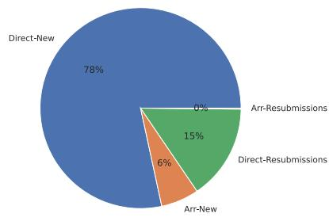  
(a) Submissions vs resubmissions

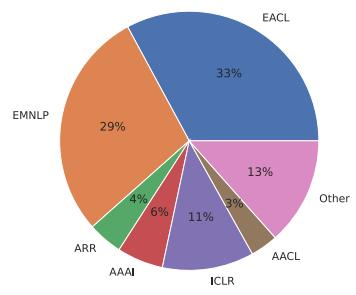  
(b) Prior venues of resubmissions

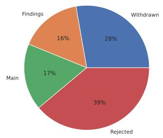  
(c) The fate of resubmitted papers  
Figure 1: Resubmissions at ACL’23

ACL Rolling Review (ARR). Table 1 shows that in most tracks, ARR submissions had a much higher acceptance rate, sometimes twice higher. This is to be expected because ARR submissions self-select for high scores and positive reviews before committing to ACL.

Since in the hybrid process ARR submissions and direct submissions directly compete for acceptance, a question arises to what extent this is a fair competition. We asked that question to our SACs. 58.3% believe that this process is fair enough, 12.5% - that it is unfair to the direct submissions, and 29.6%—that it is unfair to the ARR submissions. Of 17 SACs who believed that this situation is unfair in some way, 23.5% suggested that they should have separate acceptance rate, 41.2%—that they should have a separate process and acceptance criteria, and 47.1%—that there should be some other solution (many comments pointing to the confusion, the apples-to-oranges comparisons of reviews performed with different evaluation, the less-than-ideal import of openreview data into START (browsing attachments takes more time). Many expressed a preference for a non-hybrid process.

As program chairs, our biggest challenge with ARR was that by design it provides reviews and metareviews, but the acceptance decisions are then made by our SACs—who generally do not provide extra feedback to either direct submissions or ARR submissions (nor can they be expected to: some tracks had over 300 papers per 3 SACs). For direct submissions, nobody expects SAC-level feedback. But to ARR authors, who likely self-selected for high scores and positive reviews, to be rejected without explanation is more frustrating, and we received a lot of angry emails demanding extra feedback (even though neither we nor ARR promised that). It seems that by design, a process where there are acceptance quotas, and decisions are fully decoupled from feedback, will necessarily leave the majority of authors rejected without explanation—and hence disappointed and unsure what they could do to improve their work (and we agree that this would indeed be frustrating to the authors).

The above factors could transform into a bigger problem in the future. We only had 305 ARR submissions, but if a majority of our submissions came with high scores and positive reviews—this just would not be a useful signal anymore. The acceptance odds of direct submissions would decrease (as compared to a process where everyone starts at the same stage of peer review). The SAC-ing would become harder (since selecting among high-quality papers is less easy than among papers of varying quality), and the authors would be disappointed because many would be rejected with high scores and no idea what they could do differently.

## 3 Resubmissions

Among the 4559 direct submissions to ACL’23, 754 indicated that they were resubmissions (see fig. 1a). The biggest “donors” were EACL5 (296), EMNLP (258), ICLR (103), AAAI (52), and ACL Rolling Review6 (39). Although the selectivity of top-tier conferences means that the majority of papers are rejected, the bulk of the ACL’23 submissions are new, which means that at this point the burden of re-reviewing is relatively low. It is possible that this is due to the wider acceptance of Findings as a publication channel, as more \*ACL conferences continue to offer this option.

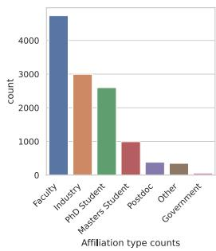

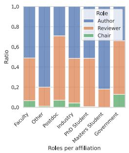  
(a) Affiliation types distribution

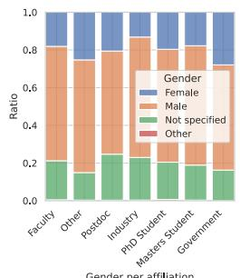

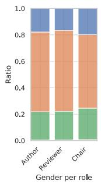

(b) Gender distribution  
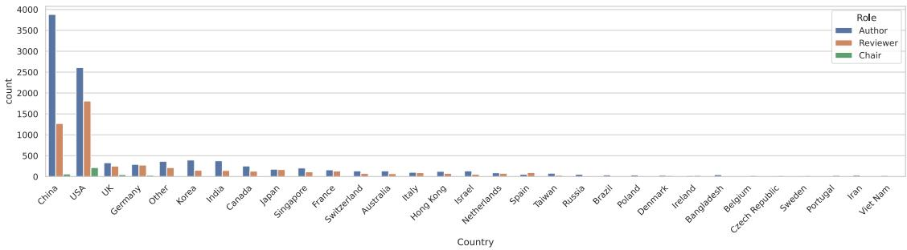  
(c) Top 30 countries listed in the ACL author and reviewer profiles  
Figure 2: Author and reviewer pool at ACL’23\*  
\* All information is self-reported, not independently verified, and does not correspond to any specific definition of affiliation, gender, or country (e.g., some authors from Edinburgh may elect to list their country as “Scotland” rather than “UK”.)

Moreover, ACL’23 authors had the option to submit previous reviews as an attachment, but only 243 submissions used this option, which suggests that most resubmitters preferred to have a completely new set of reviewers. ARR allows that option within ARR, but the ARR submissions themselves did not have a high rate of revise-and-resubmit (only 8/305), as shown in fig. 1b.

Intuitively, one could expect that resubmissions have a higher chance of acceptance, since these are the papers that have received feedback and had a chance to revise. But fig. 1c suggests otherwise. See more analysis in §7.3.

## 4 Authors and Reviewers at ACL’23

We received a record 4864 submissions (4559 direct, 305 from ARR) from the total of 13,658 authors, reviewed by 4490 reviewers. This section reviews our recruitment process and the three demographic variables (country, affiliation type, and gender) to which we had access in the global START profiles of all participants of ACL peer review process.

Reviewer recruitment. We initially sent review invitations to the reviewer list which we had received from the organizers of previous conferences. We also required the authors of all submissions to nominate at least one experienced reviewer, whom we also sent invitations.

As we elicited reviewer data, we found that for a quarter of our reviewers7 there is no reliable Semantic Scholar publication history data that can be used for paper-reviewer matching. For conferences that fully rely on automated paper–reviewer matching based on publication history, this factor obviously sets a bound on their possible performance. Often the author pages exist because Semantic Scholar automatically created them, but the authors did not claim them and did not clean them up, which may result in the addition of publications by namesake authors (e.g. the automatically created profile for “Anna Rogers” originally had contributions from at least three researchers with that name.) This is particularly worrying because at this point many venues have used this information for paper-reviewer matching, and urged the NLP community to maintain their Semantic Scholar profiles. We also specifically reminded about this, but still a quarter of our sign-up pool stated that their publication history is not accurate. In addition to this problem, matching based on publication history has the issue with establishing expertise of different authors on on multi-author publications. Hence, we developed an alternative matching approach described in §5.2.

Affiliation types. Figure 2a presents the overall distribution of the affiliations of our authors and reviewers (as stated in START profiles). The biggest group of authors, reviewers, and chairs are academic faculty. The second biggest group (by absolute numbers) in all three categories is industry, which is relevant to the recent concerns about the influence of industry on academic NLP research (Abdalla et al., 2023). Furthermore, students form at least 26% of reviewer pool (Ph.D. 22.7%, M.Sc. 3.3%). This was also our experience as area chairs at other recent conferences, and it highlights the need to continue the reviewer training efforts.

Gender distribution. Based on the information in softconf profile, about 20% of ACL peer review participants in all roles did not answer the question about their gender (Figure 2b). For a part of this population this is likely a deliberate choice, but judging by how many other fields in the START profiles were not accurately filled in or updated, in many cases this likely signals simply the lack of desire to fill in forms, especially for the new authors who had to register in START last minute in order to make a submission. Considering only those profiles that responded to this question, we see a heavy imbalance for “male”, in agreement with the reports on under-representation of women in Computer Science (Jaccheri et al., 2020; Pantic and Clarke-Midura, 2019), where a lot of NLP research is currently happening. This underscores the need to continue the Diversity and Inclusion efforts.

Top contributing countries. The analysis of the countries of all authors and reviewers suggests that the balance between reviewing and submitting papers is considerably off for many locations, and particularly China.8 We believe that this is at least partly due to the fact that our recruitment efforts started with the pool of the previous conferences. That pool needs to be deliberately expanded by more active and targeted reviewer recruitment efforts among Chinese institutions.

Church (2020) estimates that at 20% acceptance rate the authors of published papers “owe” the community at least 15 reviews per each publication (3 for their own paper, and 4x3 for the papers that didn’t get in). While some dis-balance between the author and reviewer list is to be expected (e.g., since many junior authors are not yet qualified to review, and many senior authors perform other organization roles)—we clearly need to decrease it in order to decrease the reviewer load. Our default quota was six papers9 per reviewer, in line with most recent conferences. This is a significant workload, and it can hardly be expected to improve the quality of reviews. Moreover, the more reviewers are in the pool, the smaller the trade-off between optimizing for best matches or smaller workload per reviewer.

## 5 Efforts towards improving review quality

This section describes the following steps that ACL’23 proposed and implemented within its peer review process to improve review quality: review tutorials (§5.1), Area-Contribution-Language paper-reviewer matching (§5.2), flagging of review issues by the authors (§5.3). The efforts to improve the overall incentives are decribed in §9.2 and §9.3.

## 5.1 Reviewer training

As part of reviewer training, we prepared the following public materials (as a revision of an earlier tutorial10, developed by Anna Rogers and Isabelle Augenstein for ARR):

• ACL’23 Peer Review Process: the general tutorial about review process for novice reviewers, that covers the basic structure of \*ACL peer review process, author response, and discussion period, as well as tips for planning the time, reporting conflicts of interest and assessing whether to ask for reassignment. These materials were optional for experienced reviewers, and could be used across different \*ACL venues as is.

• ACL’23 Peer Review Policies: the tutorial explaining our review form and responsible NLP checklist (§9.1), as well as our peer review policy: specific, professional reviews with scores supported by the text. Our list of reviewer heuristics such as “reject if not SOTA” currently contains 14 heuristics (continued from the original eight heuristics pioneered at EMNLP 2020 (Cohn et al., 2020)). We asked even experienced reviewers to read this tutorial. The future chairs could reuse parts of this tutorial, with necessary updates to the review form description and review policies.

Feedback. The exit survey indicates that the reviewers found the materials clear (43% respondents rated them as at 4 out of 4 and 40.5% - as 3 out of 4 on 4-point scale). One avenue of improvement suggested in many free comments was adding examples of good reviews.

We also asked the reviewers about their preferences for alternative formats, and the self-paced text-based tutorial was the majority choice (62.5% vs 13% preferring video tutorials and 9.6% preferring interactive tutorial with quizzes). But 13.4% respondents said that they would probably never be able to spend time on reviewer training, no matter what format it is offered in. This suggests that reviewer training, while valuable, will not help in all cases, and could perhaps be interpreted as an upper bound on the effect of any reviewer training.

## 5.2 ACL paper-reviewer matching: Area-Contribution-Language

One of the peer review issues that authors (and chairs) often complain about is “meh” reviews: the reviewer does not really find any significant problems with methodology or execution of the paper, but the overall recommendation is middling. This could be a symptom of paper-reviewer mismatch: the reviewer just is not sufficiently interested in the overall topic or approach, and hence no matter how good the paper is, it would not elicit much enthusiasm. In a recent survey (Thorn Jakobsen and Rogers, 2022) of authors, reviewers and ACs about their prior experience at NLP venues, many reviewers stated that “the area match was right, but... the subject ofthe paper was not interesting to me (e.g. I would prefer another NLP task, model, or data)” (54%), or the paper was not asking a research question that would be interesting for me” (45%). At the same time, over 27% of the author respondents in that survey reported that they had experience of reviews where the reviewer was not interested in the subject of the paper.

Most recent \*ACL conferences and ARR work with some version of an automated paper-reviewer matching system that computes affinity scores between the abstract and title of the submission and the candidate reviewer, based on their publication history. Interestingly, the same survey by Thorn Jakobsen and Rogers (2022) found that both authors, reviewers, and ACs generally considered these scores to be the least important factor for paper-reviewer matching. Besides the limitations of the current systems, one factor here is probably the noise in the reviewer publication history data (only 75% of our reviewers indicated that their Semantic Scholar profiles were accurate enough to use for review assignments, see §4). Then there is also the inherent difficulty with establishing level of expertise on a particular topic in multi-author papers.

A traditional alternative to affinity scores, that also addresses the issue with reviewer interest, is bidding: the reviewers explicitly say which papers they would be interested in. But this process is rather laborious: for a big track, a reviewer would need to indicate their interest for hundreds of papers. It also opens up the possibility of collusion rings (Littman, 2021). In our experience, many reviewers do not even respond to bidding calls on time, which once again leads to some part of assignments being essentially random.

<table><tr><td>Match by area</td><td>Match by contribution</td><td>Match by language</td><td>Review count</td><td>Review %</td></tr><tr><td> $\checkmark$ </td><td>√</td><td>English</td><td>8996</td><td>71.36</td></tr><tr><td> $\mathrm { \ n / a ^ { * } }$ </td><td>n/a</td><td>n/a</td><td>1052</td><td>8.35</td></tr><tr><td>x</td><td>√</td><td>English</td><td>691</td><td>5.48</td></tr><tr><td>√</td><td>x</td><td>English</td><td>558</td><td>4.43</td></tr><tr><td>√</td><td>√</td><td>√</td><td>476</td><td>3.78</td></tr><tr><td>√</td><td>√</td><td>x</td><td>345</td><td>2.74</td></tr><tr><td>x</td><td>√</td><td>√</td><td>164</td><td>1.3</td></tr><tr><td>x</td><td>x</td><td>English</td><td>142</td><td>1.13</td></tr><tr><td>x</td><td>x</td><td>√</td><td>52</td><td>0.41</td></tr><tr><td>√</td><td>x</td><td>√</td><td>50</td><td>0.40</td></tr></table>

Table 2: The number of reviews matched to submission by different combinations of ACL (Area-Contribution-Language) criteria. The ’n/a’ row corresponds to manual assignments by ACs, for which we do not have the match information.

Thus, we experimented with a new workflow that we dub ACL (Area-Contribution-Language) paperreviewer-matching. It is a keywords-based matching process that explicitly targets three dimensions of submissions: track sub-areas (topical match), contribution types (match by focus/methodology), and target language (for submissions not focusing on English). To the extent possible, the paper-reviewer matching aimed to provide matches across all these dimensions. This approach further enabled us to provide the ACs with explanations for the specific matches (see §6.3).

Track sub-areas. Each track at ACL 2023 had an associated set of keywords describing its potential sub-areas. The goal was to describe the biggest expected sub-areas, and hopefully provide the authors with a better idea of the kind of work that the track was inviting. The full list of our keywords is publicly available in our blog post.11 Our keywords were provided by the SACs of all tracks independently, but the future chairs may wish to take a more top-down approach to editing this list, and to ask their SACs to check that the list still describes the sub-areas for which the most submissions are expected, and the individual keywords are sufficiently clear for the authors.

Language(s). Due to the “default” status of English (Bender, 2019), submissions targeting other languages may be perceived as “niche” by reviewers. Additionally, the lack of expertise in a language may make it harder for reviewers to spot potential issues. Hence, for papers on languages other than English, we endeavoured to also maximize reviewer matches along this dimension.

Contribution types. The contribution types cross-cut tracks, and we hope they would help to decrease the amount of cases where the reviewer just fundamentally does not recognize a certain type of work (Bawden, 2019) and hence scores it down, or has unreasonable expectations (e.g. experimental results in a position paper). For example, the category of compute/data-efficiency creates a de-facto equivalent of efficiency track spread across all tracks.

Our contribution types are based on COLING 2018 classification (Bender and Derczynski, 2018), which we extended as follows: (1) NLP engineering experiment (most papers proposing methods to improve state-of-the-art), (2) approaches for low-compute settings, efficiency, (3) approaches for low-resource settings, (4) data resources, (5) data analysis (6) model analysis & interpretability, (7) reproduction studies, (8) position papers, (9) surveys, (10) theory, (11) publicly available software and pre-trained models.

Implementation. To collect the information for this kind of matching, we asked the authors at submission time to specify their preferred track (up to two), the best-matching keywords in that track (multiple selection possible, or “other” option with free text entry), the best matching contribution type(s) and target language(s). Correspondingly, at reviewer recruitment stage we asked the reviewers to fill in a form specifying their preferences for the tracks, keywords, contribution types, and the language(s) the work on which they could review. The matching itself was based on Integer Linear Programming, aiming to maximize matches across the three keyword types (with more types of matching being more valuable than e.g. more matches only by area). As a fallback, we also retrieved Semantic Scholar profile data for the reviewers and computed the similarity between submission abstracts to the abstracts in the publication history of candidate reviewers, but this factor was given the lowest priority in the assignment strategy.

The Area-Contribution-Language matches, as well as the most similar paper of the reviewer, then also became the basis for the rationales for the match (see §6.3). The SACs were given the opportunity to selectively check and adjust the matches as described in §6.2 (although few of them did), and the ACs and SACs were able to see the rationales for the matches when considering the reviews.

From the analysis of the final 12606 reviews in START, 1052 (8.3%) did not have the match information (due to manual reviewer reassignment by the chairs, most likely emergency reviewers). Of the remaining 93.7% reviews made by our criteria, only 1.13% reviews with automated assignment were assigned based on the similarity scores from publication history, after exhausting the possible keywords-based matches in the reviewer pool. 82.9% reviews had at least one match by the type of area, 84.97% - by contribution type. Importantly for DEI efforts and development of NLP for languages other than English, we had 1167 reviews for submissions that specified at least one target language other than English – and we were able to provide a reviewer matching by (at least one) language in 63.58% such reviews.

Feedback. When asked to rate on 4-point scale how well the paper-reviewer matching worked for them, 85.5% ACL’23 reviewers rated it positively (35.7% at 4/4, 49.8% at 3/4). When asked for the kinds of mismatch, if any, 28.4% pointed at the topic, 13.7% at the methods, 10.4% at the type of contribution, 4.5% at languages, and 5.7% at other kinds of mismatch.

We conclude that Area-Contribution-Language assignments are overall a promising direction that can contribute to DEI efforts in the field and diversity of its contributions (see also §7). The matches could be further refined by (a) revising the area keywords12, and (b) more targeted reviewer recruitment to include speakers of various languages. One of our SACs suggested providing a glossary together with the list of keywords. We also recommend investing effort into a dedicated interface for checking reviewer assignments that would enable ACs to help with reviewer assignment checks while seeing the up-to-date reviewer availability information, and highlighting the possible problems with the current assignments (such as imperfect matches, rare types of contributions or languages that may need extra attention, insufficient pool for a area or a contribution that turns out to be more popular this year).

## 5.3 Review issue flagging

Even with all the above efforts, we anticipated that there would still be problematic and mismatched reviews. Given that the only people with the incentive to read the reviewer guidelines and enforce them are the authors, we developed a way for them to flag reviews for specific issues, which the ACs could be given specific instructions about, and be able to address more systematically.

Unfortunately, the START system does not have an editor for the author response form or meta-review form. Hence we had to provide the authors and ACs with the list of possible issues, and ask them to specify their type and rationale in plain text form, as shown in Figure 3. As could be expected, even with a template there were many format errors. We recommend that the future conferences use a form with a multi-selector, per each reviewer.

The authors actively used this feature at ACL’23, flagging 12.9% of all reviews. This is reassuring: judging by the intensity of online discussions of peer review at each review release day, most reviews are bad). The frequency of various reported issues is shown in Table 3. The biggest reported problem is the heuristics such as “not novel”, “not surprising”, “too simple”, and “not SOTA”. Particularly concerning are the rude/unprofessional reviews: even though there are only 1.69%, they have the most potential to impact the mental health of the authors, and we should strive for that number to be 0.

The author-reported issues should be interpreted as a lower bound on the number of review issues, because of 100 papers were reviewed but withdrew before the final decisions. It is possible that they did because they (a) agreed with the criticism and wished to revise the paper, or (b) that they disagreed but did not see a chance to persuade the reviewers. Assuming the latter, and that all their reviews were problematic, this would raise the upper bound of problematic reviews to 15.3%. But it is unlikely that all withdrawn papers were of the (b) type, and the comments from ACs also suggest that many issues were not fully justified.

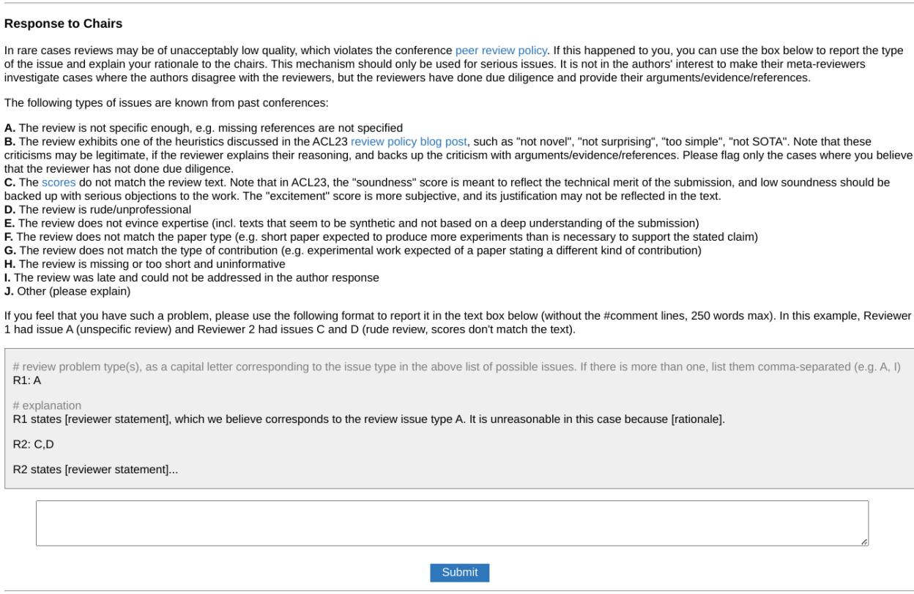  
Figure 3: Review issue flagging: minimal plain-text implementation in START

Feedback. When asked to rate the utility of this system at ACL’23 on 4-point scale, with 4 being the highest score, 42.1% of the authors in our exit survey rated it at 4/4, and 40.3% - at 3/4. We interpret it as overwhelming support, and recommend that this feature is maintained in the future conferences. However, the qualitative analysis of the authors’ comments suggests that in some cases the ACs did not respond to the flagged issues properly, which entails the need for further training and monitoring by the SACs.

Our follow-up analysis suggests that ACs reported addressing the author-flagged issues in at least 30.59% submissions (judging by their using a similar template to Figure 3 in the “confidential notes to chairs” in the meta-review. This should be interpreted as a lower bound: since the interface was very clunky, it is possible that some ACs did consider the flagged issues, but did not report their actions. But, clearly, many issues were not properly addressed, and there is much room for improvement and further training of ACs. Still, given that this is the first implementation of this system, this is a promising approach and it should improve in the future.

## 5.4 Reviewer discussion

Similarly to most of the recent \*ACL conferences, we implemented the author response period: a week during which the authors have the opportunity to read the reviews and send their response. The goal of this process is improving the quality of the reviews, and we supplemented that goal with the above new option for the authors to flag specific types of review issues (§5.3). The authors could (but didn’t have to) provide a response and flag review issues; this was done for 88.3% of reviewed submissions. In 57.3% review forms the reviewers indicated that they read the response (it is possible that more did read the response but did not fill in the form).

Those comments were seen by the ACs, not the reviewers. The ACs had the option to initiate reviewer discussions for the cases where they saw significant disagreements, quality issues, or misunderstandings. Each paper had an associated “forum” on START, where the reviewers could communicate in an anonymized fashion (as R1, R2, R3). The ACs were provided with instructions and suggested starter message template.

<table><tr><td>Type of issue</td><td>Number of reviews</td><td>% of reviews</td></tr><tr><td>A: The review is not specific enough</td><td>272</td><td>2.16</td></tr><tr><td>B: Review heuristics such as “not novel&quot;, &quot;not surprising&quot;, &quot;too simple”, “not SOTA&quot;</td><td>678</td><td>5.38</td></tr><tr><td>C: The scores do not match the review text</td><td>448</td><td>3.55</td></tr><tr><td>D: The review is rude/unprofessional</td><td>213</td><td>1.69</td></tr><tr><td>E: The review does not evince expertise</td><td>542</td><td>4.3</td></tr><tr><td>F: The review does not match the paper type</td><td>98</td><td>0.78</td></tr><tr><td>G: The review does not match the type of contribution</td><td>152</td><td>1.21</td></tr><tr><td>H: The review is missing or too short</td><td>205</td><td>1.63</td></tr><tr><td>I: The review was late</td><td>12</td><td>0.1</td></tr><tr><td>J: Other</td><td>162</td><td>1.29</td></tr></table>

Table 3: Review issue statistics

In total, out of 4559 direct submissions to ACL, 4069 had received reviews, and for 2901 out of those the ACs initiated discussions. In total, ACL review process generated 8553 messages (3879 by the ACs). However, only 2107 discussions (72.63%) had at least one response from at least one reviewer. Somewhat consistently, the discussions were overall initiated by 77.4% of all ACs. We conclude that both AC and reviewer involvement have room for improvement.

We reviewed one case of a strong paper that ended up being rejected. The AC could have been persuaded by a “champion” reviewer, and there was one such expert in the set who was surprised by the final outcome—but they did not engage in the forum discussion. We followed up with the reviewer, and they explained that since their review was already positive, they did not feel that they needed to be “on the case” anymore. We cannot establish how common this misconception is, but we would urge all reviewers to always read all reviews and author response, and when certain of the merit of a paper—to try to make sure that the AC is convinced.

## 6 Improving decision support for the chairs

In addition to the efforts for improving the quality of peer review (§5), we implemented the following steps for facilitating the decision support by ACs and SACs: revised SAC and AC guidelines (§6.1), guidance for assignment checking (§6.2), match rationales (§6.3), Soundness/Excitement scores (§6.4).

## 6.1 Updated SAC and AC guidelines

We updated the SAC/AC guidelines that we received from the program chairs of ACL’21 in following ways. We reformatted it to Markdown to utilize the ecosystem of GitHub (e.g., version control, asynchronous collaboration among PCs, automated deployment). The guides were built by Sphinx13 with MyST extension14, which enables to use Markdown and variables (making it easy to keep the consistency of dates and external URLs between SAC and AC guides and for the future chairs to adapt to their timeline). We also adjusted the existing instructions and created new instructions to incorporate everything we developed, from the new reviewer guidelines to guidelines for making recommendations. We shared the guides before the review process so that SACs and ACs can be prepared for the tasks and workloads.

Feedback. 83.3% SACS and 90.3% ACs rated the clarity of instructions at 3/4 or 4/4. Some of the free-text comments indicated a preference for shorter guidelines, but since the process is complex, and the guidelines need to serve both new and experienced chairs, there are limits to how much they can be shortened.

## 6.2 Support for checking assignments

As mentioned above, the usual workflow in large conferences is that the assignments are made automatically based on affinity scores between candidate reviewers’ publication history and submissions. Usually, the automated assignments are then shown to the ACs and SACs to check manually, but this is very difficult in practice: SACs cannot process such a large volume on their own, so they need to rely on ACs. But ACs, at least on START, do not have access to the list of possible reviewers together with their current number of assignments and all their COIs, which means that even if they spot an error—it is difficult for them to identify and recommend an available alternative. Providing the up-to-date quota and COI information on all reviewers in track to the ACs is not possible in the current START platform. There are also no detailed guidelines for this step, which means that even if ACs had the reviewer information, everybody would be suggesting alternatives based on different criteria.

In our experience as SACs in previous conferences, although the automated assignments are not perfect, very few ACs actually report the problems or propose alternatives. To see whether this was widespread, we asked our SACs in the exit about whether, in their experience, the ACs asked to check the automated assignments usually recommend many changes. Only 9 of our respondents previously served as SACs in this set-up, but most of them (6/9) concurred with our experience, reporting that ACs adjust very few assignments. When asked why the ACs do not recommend more changes, 33.3% SACs stated that there are no adjustments because the ACs don’t really check, 29.9%—that it happens because the automated assignments are already good enough, 29.2%—because of the difficulty with sharing up-to-date reviewer availability information with them, and 20.8%—that there are no better candidates even if the ACs check. 37.5% indicated that there are also other issues contributing to the ACs not recommending more changes.

We interpret these results as pointing to the fundamental issue of systematically sharing up-to-date reviewer availability information together with their preferences, experience, and profile information, in a way that would make it easy for the ACs to perform such checks and recommend alternatives.

Given that the above factors make it unrealistic to adjust assignments with help of ACs, and that the volume of assignments to check was too large for SACs, we experimented with an alternative approach: since we had the “explanations” for the matches and also the quantitative information about different types of contributions, languages and area keywords, this information would make it possible for SACs to identify the types of submissions most in need of extra checks, and to focus on those. This way the workload would remain manageable, and the SACs would be able to do that while having full access to the latest reviewer availability data. To assist in this process, we developed Jupyter notebooks with quantitative analysis per track (identifying which keywords, types of contributions and languages were rare and could need extra attention)—as well as reviewer lookup functionality by preferred keywords, languages or types of contribution (or any combination thereof). This solution was better than nothing, but admittedly clunky and could be much improved.

Feedback. 66.7% of SACs stated that they believed selective checking to be overall sufficient given sufficiently strict reviewer pool criteria (although in our specific case not all reviewers in our pool were up to all SAC’s standards).

Caveat: we encountered difficulty with uploading the final automated assignments due to dynamic computation of conflicts-of-interest in START. Because of that, several hundred automated assignments had to be redone manually at the last minute. For the conferences based on START, we strongly recommend that this computation is frozen after the main part of reviewers and chairs are added to the tracks.

## 6.3 Paper-reviewer match rationales

Given the information for the paper-reviewer matches that we had collected (§5.2), we were able to provide the ACs with a list of rationales for each match (except for those reviewers who were added manually by the chairs, and for whom we did not have this information.) A sample “explanation” for a match is shown in Figure 4a. The idea was to provide the AC with not only the general information about the reviewer, but also what are their interests that match this submission. Importantly, we highlighted the cases where the author-stated type of contribution or language was not among the reviewer’s stated (a) Example of paper-reviewer match rationales. The most similar paper titles directly link to the papers (based on Semantic Scholar). For contributions and languages, the rationales either show the match, or alert to the lack of the match, so that the AC could take that into account.

Basis for this assignment   
Match by track subarea: corpus creation, reproducibility   
No match by contribution types. The authors specified: approaches for low-compute settings, efficiency   
Match by target language (non-English): French   
Most similar paper score: 0.744   
Most similar paper:   
Reviewer highest degree: PhD (2   
Reviewer affiliation type: Academia   
Reviewer publication history: scholar profile

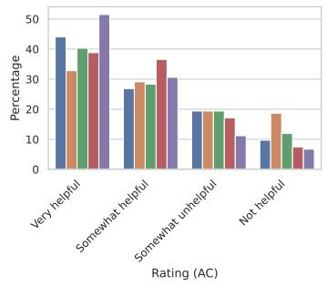

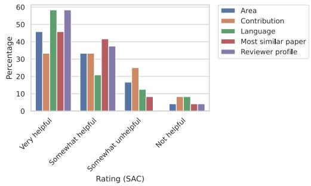  
(b) Chair feedback on which features of the match explanation they found the most useful.  
Figure 4: Example explanation for paper-reviewer matches, and AC utility ratings for individual features displayed.

interests, which would ideally provide the AC with grounds to check potential bias against certain kinds of work.

Feedback. This feature received overwhelming support from the chairs: 87.5% SACs and 73.9% ACs rated its utility at 3 or 4 out of 4 (Figure 4b). Among the suggestions for the future improvement, the SACs suggested indicating whether the reviewer was an emergency reviewer, and how late the review was, as well as some elements of reviewer history (e.g. whether they were late for other conferences). The numerical similarity scores were less useful than the titles of the most similar papers. While predominantly the ACs were very positive about easily accessible links to reviwer profiles (Figure 4b), some ACs raised fair concerns about the effect of this feature on reviewer deanonymization: the reviewers are already visible to ACs since they need this information for chasing late reviews, but providing links to reviewer profiles increases the saliency of the reviewers’ identities, and hence may by itself increase bias against, for instance, student reviewers.

## 6.4 Soundness/Excitement scores

While most of the experimental aspects of the ACL 2023 process was focused on matching reviewers to papers more effectively, a larger change visible to authors and reviewers was the introduction of two new scores on the review form to replace the Overall Recommendation that was previously the centerpiece of \*CL review forms.

We asked reviewers for two scores: Soundness and Excitement.15 Our goal was that any sound paper would be accepted to some ACL affiliated venue (i.e., Findings), but that the “main conference” distinction (limited by space) would be focused on the most exciting papers. Our hope was that Soundness, as a more specific rubric with more objective criteria, would be less noisy than a single Overall Recommendation score, which would help reduce the randomness of decisions. The AC guidelines had explicit instructions for how these scores should map to their recommended status.

One more factor motivating our proposal was that the Soundness/Excitement distinction could help with the author-reviewer communication during the author response. When a reviewer points out issues with

Soundness, the authors generally have a fair chance to clear any misunderstandings or issues with review quality, and the chairs are interested in this kind of discussion. The Excitement, however, is subjective, and the authors do not have a fair chance to convince reviewers that their general views or research agenda are wrong. The Soundness/Excitement distinction helps to focus the response on the Soundness issues, and hence have a more productive discussion.

Feedback. Judging by the exit surveys, this change was overall well received: over 80% of the chairs, reviewers and authors either expressed support or did not object to this change. 38.1% authors, 35.1% reviewers and 29.9% ACs indicated that while the idea was good, it could be better executed. Among the named issues was the clarity of communication about what these scores meant, the difference in granularity (our scale for Excitement had 9 points, and Soundness only 5), and the wording could be adjusted to remove the semblance to Overall recommendation score. We made these recommendations to the program chairs of EMNLP 2023, who decided to keep this system.

From the communication with the authors who expressed dislike for this system, our impression is that one of the factors here is the mistaken impression that the final decisions are overall based on scores, and the papers with similar scores should be guaranteed the same outcome—whereas in reality the chairs know that scores can be noisy and miscalibrated, and hence the final decisions are made on case-by-case basis, with the full view of the reviews and meta-review, and also taking into account the acceptance quotas and their editorial priorities.16 The Soundness/Excitement scores were rather intended to make it harder for the chairs to just sort by the scores.

## 7 What Factors Contribute to ACL Peer Review Outcome?

Here we present the results of statistical analysis of ACL’23 data, with the goal of explicating what factors contributed to the final decisions and to the quality of individual reviews. We hope that this process both improves the transparency around chair decision-making, and highlights the potential biases and points of improvement for future conferences.

For the new authors, we should explain the general process for the acceptance decisions at ACL’23. First, the reviewers contribute their reviews. At the author response the authors see the reviews and have an opportunity to respond: a process mostly intended to clarify any misunderstandings (we disallowed submitting new results). Then the ACs initiate the reviewer discussion, with the goal to clarify misunderstandings and improve the quality of the reviews. Based on the final reviews and their own expertise, they write the meta-reviews and make recommendations for acceptance (Main track or Findings) or rejection. They are not concerned with the acceptance quotas. Their recommendations and meta-reviews (as well as reviews and author response if necessary) are then considered by the SACs, who have the constraint of the target acceptance quota (which we set at about 22% for the main track and 35% for Findings). Their decisions are based on three main factors: meta-reviews, quotas, and editorial priorities (with case-by-case consideration as needed). If they run out of their quota, they may additionally rank more papers by priority that may be accepted to main/track Findings if there is space (e.g., because some tracks did not use their quota fully). The final step is that the program chairs confirm the SAC decisions, and try to fit in as many papers of the ranked “maybes” as possible. In our case, that resulted in accepting more Findings papers than we originally planned based on prior conferences.

## 7.1 Review Scores: Overall Distribution

We start by exploring the overall distribution of the new Excitement and Soundness scores (described in §6.4) and how they mapped to the three possible decision outcomes (Rejection, acceptance to the Main track, or Findings). Both Excitement and Soundness are ordinal variables, and we use the mean as a rough estimate of the central tendency. Figure 5a shows that for both scores the means are higher for main track than for Findings, and for Findings they are higher than for rejections. For Excitement this is fully in line with our instructions to the chairs. For the main track, this suggests that higher (above 3) Soundness scores also played a role in main vs Findings decisions, although the difference is less than between Findings and rejection. The overall score distribution is shown in Figure 5b.

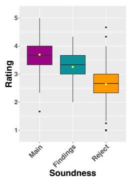  
(a) Distribution of mean scores

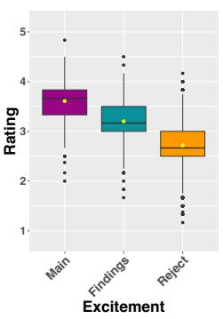

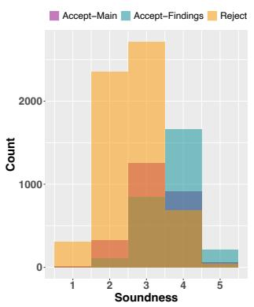  
(b) Distribution of individual scores

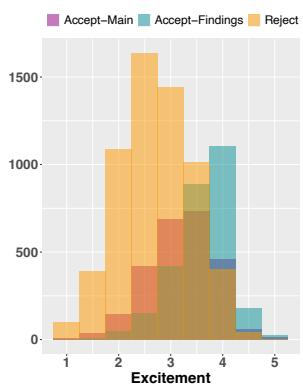

Figure 5: Soundness and Excitement scores per acceptance status
<table><tr><td></td><td>Findings Coeff</td><td>Main Coeff</td><td>Findings SE</td><td>Main SE</td></tr><tr><td>(Intercept)</td><td>-1.48</td><td>3.77</td><td>0.79</td><td>1.43</td></tr><tr><td>Soundness Mean</td><td>0.71</td><td>0.76</td><td>0.22</td><td>0.37</td></tr><tr><td>Excitement Mean</td><td>0.61</td><td>0.03</td><td>0.23</td><td>0.42</td></tr><tr><td>AC Recommendation (L)</td><td>2.66</td><td>4.50</td><td>0.50</td><td>0.94</td></tr><tr><td>AC Recommendation (Q)</td><td>-1.16</td><td>-0.05</td><td>0.43</td><td>0.81</td></tr><tr><td>AC Recommendation (C)</td><td>-0.04</td><td>0.10</td><td>0.31</td><td>0.58</td></tr><tr><td>AC Recommendation (^4)</td><td>0.04</td><td>-0.27</td><td>0.19</td><td>0.37</td></tr><tr><td>SAC Recommendation (L)</td><td>5.84</td><td>28.26</td><td>0.47</td><td>0.71</td></tr><tr><td>SAC Recommendation (Q)</td><td>-1.06</td><td>13.59</td><td>0.34</td><td>0.77</td></tr><tr><td>SAC Recommendation (C)</td><td>1.18</td><td>7.82</td><td>0.60</td><td>0.82</td></tr><tr><td>SAC Recommendation (^4)</td><td>1.52</td><td>4.48</td><td>0.64</td><td>0.74</td></tr></table>

Table 4: Coefficients and Standard Errors (SE) for the Multinomial Logistic Regression Model predicting the final acceptance decisions given the mean scores and AC/SAC recommendations. Each row corresponds to a predictor in the model, with separate coefficients reported for each level of the outcome variable (Findings and Main). The ${ } ^ { \bullet } \mathrm { L } ^ { \bullet } , { } ^ { \bullet } \mathrm { Q } ^ { \bullet } , { } ^ { \bullet } \mathrm { C } ^ { \bullet }$ , and $\cdot \hat { 4 } ^ { \cdot }$ subscripts for AC\_ordinal and SAC\_ordinal represent linear, quadratic, cubic, and quartic polynomial terms, respectively, reflecting the assumed shape of the relationship between these ordinal predictors and the log-odds of the outcomes.

## 7.2 Factors Impacting the Final Acceptance Decisions

## 7.2.1 Reviewer Scores and Chair Recommendations

To establish the odds of a paper being accepted into Findings or the Main track vs it being Rejected, based only on reviewer and chair recommendations, we fit a multinomial log-linear model with multinom() function from the NNET package in R (Venables and Ripley, 2002).18 The dependent variable (DV) is the Outcome coded as a three-layer categorical variable (Main track, Findings, or Reject) with Reject being set as the reference level. The independent variables (IVs) are AC Recommendation (ordinal), SAC Recommendation (ordinal), mean Soundness score (interval), and mean Excitement score (interval).19 The analysis is performed on the papers submitted directly to the conference as the ARR submissions were reviewed through a different process and had different scores. The model coefficients are shown in Table 4. The model is a good fit for the data with McFadden’s pseudo- $R ^ { 2 }$ of 0.777 (McFadden, 1973).20

<table><tr><td></td><td>LR Chisq</td><td>Df</td><td>Pr(&gt;Chisq)</td><td></td></tr><tr><td>Soundness Mean</td><td>10.88</td><td>2</td><td>0.0043</td><td>**</td></tr><tr><td>Excitement Mean</td><td>9.67</td><td>2</td><td>0.0080</td><td>**</td></tr><tr><td>AC Recommendation</td><td>209.71</td><td>8</td><td>0.0000</td><td>***</td></tr><tr><td>SAC Recommendation</td><td>1438.12</td><td>8</td><td>0.0000</td><td>***</td></tr></table>

Table 5: Type III Analysis of Deviance for Multinomial Logistic Regression in Table 4.17

To obtain the significance values for each IV (Table 5), we use the ANOVA() function in R on the fitted model (Type III Anova). As expected, all four IVs are significant (p<0.05) but at different levels. The SAC Recommendation $( \chi ^ { 2 } ( 8 ) = 1 4 3 8 . 1 2 , p < 0 . 0 0 1 ) ^ { 2 1 }$ and AC Recommendation $( \chi ^ { 2 } ( 8 ) = 2 0 9 . 7 1$ $p { < } ~ 0 . 0 0 1 )$ significantly predict the Outcome with the SAC Recommendation appearing to be a better predictor (as expected, since AC recommendation are made without regards to the acceptance quotas). The mean Soundness score $( \chi ^ { 2 } ( 2 ) = 1 0 . 8 8 , p = 0 . 0 0 4 3 )$ and mean Excitement score $( \chi ^ { 2 } ( 2 ) = 9 . 6 7 ,$ , p = 0.0080) are also significant at $\begin{array} { r } { p < . 0 5 . } \end{array}$

To establish the exact contributions of mean Soundness and Excitement scores to acceptance decisions for the Main track and Findings, we can look at Table 4 again. Note that since it is a multinomial regression model, the coefficients indicate an increase in log odds rather than directly interpretable odds (for which the coefficients need to be exponentiated). The “Findings Coeff” and “Main Coeff” correspond to the log-odds of being accepted into the Findings and Main track as opposed to being rejected.

Soundness. In the case of the mean Soundness score the coefficient is positive for both Findings (0.71) and the Main track (0.76). This means that for one unit increase in the mean Soundness score the log-odds of being accepted as opposed to being rejected increase by 0.71 for Findings and 0.76 for the Main track. By taking the exponential of these values, we see that for one unit increase in the mean Soundness score the odds to be accepted increase 2.03 times for Findings and 2.14 times for the Main track.

Excitement. Similarly, both coefficients are positive for the mean Excitement score for both Findings (0.61) and the Main track (0.03). This means that for one unit increase in the mean Excitement score the log-odds of being accepted vs rejected increase by 0.61 for Findings and 0.03 for the Main track. By taking the exponential of these values we see that for one unit increase in the mean Excitement score the odds of being accepted increase 1.84 times for Findings and 1.03 times for the Main track. While the values are still positive, this increase is much lower22 than for the mean Soundness scores, especially for the Main track. The overall distribution of these scores per acceptance status is shown in Figure 5b.

AC Recommendations. Since AC Recommendation is an ordinal variable, it is coded using polynomial contrast, so the L indicates linear effect, Q a quadratic effect, C a cubic effect, and so on. Here we look mostly at the linear effect since it has a direct (linear) effect on the outcome. We see that both coefficients are positive, indicating that with an increase of one unit, the log-odds of being accepted vs being rejected increase by 2.66 units for Findings and 4.50 units for the Main track. By taking the exponential of these values we see that one unit increase in AC Recommendation corresponds to a 14.30-fold increase in the odds of being accepted into Findings (vs being rejected) and 90.02-fold increase in the odds of being accepted into the Main track (vs being rejected).

SAC Recommendations. SAC Recommendation is also an ordinal variable, hence we see the same types of coefficients. However, the magnitude of the SAC’s decision appears to be much greater with a greater effect on the final outcome. With one unit increase in SAC Recommendation the log-odds of being accepted vs being rejected increase by 5.84 units for Findings, and 28.26 units for the Main track.

<table><tr><td></td><td>LR Chisq</td><td>Df</td><td>Pr(&gt;Chisq)</td><td></td></tr><tr><td>Paper Type</td><td>12.47</td><td>2</td><td>0.0020</td><td>**</td></tr><tr><td>Review Issues</td><td>43.61</td><td>2</td><td>0.0000</td><td>***</td></tr><tr><td>Preprinted</td><td>47.96</td><td>2</td><td>0.0000</td><td>***</td></tr><tr><td>Previous Submissions</td><td>4.38</td><td>2</td><td>0.1120</td><td></td></tr><tr><td>Languages Number</td><td>0.57</td><td>2</td><td>0.7528</td><td></td></tr><tr><td>Languages not only English</td><td>3.53</td><td>2</td><td>0.1711</td><td></td></tr><tr><td>Contribution: Efficiency</td><td>1.18</td><td>2</td><td>0.5540</td><td></td></tr><tr><td>Contribution: Resource</td><td>4.34</td><td>2</td><td>0.1139</td><td></td></tr><tr><td>Contribution: Reproduction</td><td>16.59</td><td>2</td><td>0.0002</td><td>***</td></tr><tr><td>Contribution: Theory</td><td>7.70</td><td>2</td><td>0.0213</td><td>*</td></tr><tr><td>Contribution: Software</td><td>19.62</td><td>2</td><td>0.0001</td><td>***</td></tr></table>

Table 6: Type III Analysis of Deviance for Multinomial Logistic Regression, predicting submission Outcome (Main, Findings, Reject) conditioned on the variables listed in the table.24

Converting these values to their exponentials, we see that one unit increase in SAC Recommendation corresponds to a 343.78-fold increase in the odds of being accepted into the Findings (vs being rejected) and a massive increase of $1 . 8 8 \times 1 0 ^ { 1 2 }$ for the odds of acceptance into the Main track (vs being rejected).

The model hence shows that the SAC recommendation is a much stronger predictor than the AC recommendation, which helps to explain why it is possible for a paper to be rejected even with a positive meta-review. AC recommendations are made without regards to the acceptance quotas, and SACs necessarily have to override them in many cases.

## 7.3 The Impact of Other Submission Properties

There are many properties of submissions that could systematically make a difference to their final outcome. In this section we investigate the possible effect of the type of contribution, the target languages, whether the reviews were problematic (as reported by the authors), and whether the paper was available as a preprint. To establish the importance of these factors, we fit another multinom() model, similarly to what we did in Table 4, and obtain the significance levels for each variable using Type III Anova. While the ordinal model would potentially better preserve the natural order of the final outcome (rejection being the worst and acceptance to the main track being the best outcome), the fitted model violated the assumptions of the ordinal model.

Since this model does not include strong predictors such as reviewer scores and chair recommendations, the fit of this model is relatively $\mathrm { p o o r } ^ { 2 3 }$ compared to the model in Table 4, which has a McFadden’s pseudo- $R ^ { 2 }$ of approximately 0.80 (indicating a substantial improvement over the null model). In contrast, this model has a McFadden’s pseudo- $R ^ { 2 }$ of approximately 0.01, suggesting that it barely improves upon the null model. Nevertheless, this model can still be used to establish the individual contributions of the submission-level properties, which likely interact in complex ways in the scores and recommendations. Statistically significant factors are also not necessarily strong predictors by themselves.

The results of this experiment are shown in Table 6. According to this analysis, the following factors have a statistically significant impact on submission outcome: low-quality reviews, preprinting, short/long paper type, and three types of contributions (software, reproduction, and theory).

To also assess the relative importance of our predictors in forecasting the final outcome, we employed a Random Forest algorithm (Liaw and Wiener, 2002). The results are shown in Figure 6. The most crucial predictor was Review Issues (i.e., author complaints about reviews25) with a Mean Decrease Gini value of 46.09. This suggests that this predictor played the most significant role in reducing the Gini impurity, and therefore, in improving the precision of our model. The second factor with the biggest Mean Decrease Gini is Preprinting (22.84). This analysis does not state the absolute importance of any factor (e.g., that

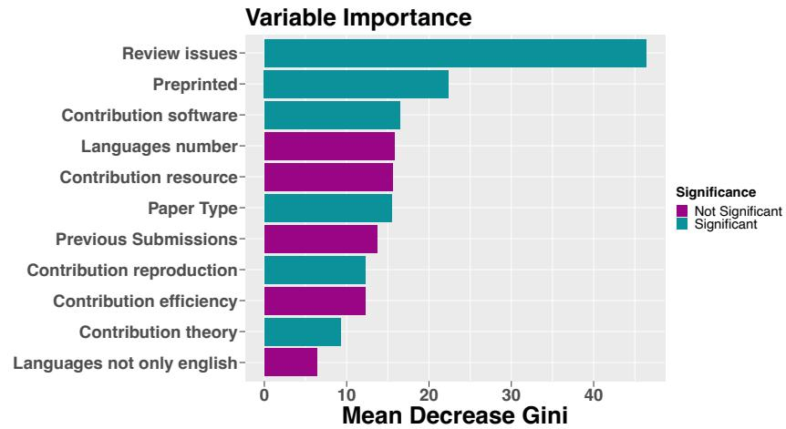

Figure 6: The importance of predictors in predicting the Outcome, ranked by mean decrease in Gini impurity. Predictor significance is indicated by color, with dark purple for not significant and dark green for significant predictors as per levels of significance indicated in Table 6.
<table><tr><td>Contribution type</td><td>% submissions</td><td>Match</td><td>Mismatch</td><td>Match-Mismatch</td></tr><tr><td>Efficiency</td><td>9.62</td><td>50.27</td><td>46.56</td><td>3.71</td></tr><tr><td>NLP engineering experiment</td><td>61.5</td><td>46.66</td><td>47.33</td><td>-0.67</td></tr><tr><td>Software and pre-trained models</td><td>12.14</td><td>56.75</td><td>45.56</td><td>11.19</td></tr><tr><td>Data resources</td><td>19</td><td>49.25</td><td>46.37</td><td>2.88</td></tr><tr><td>Data analysis</td><td>10.48</td><td>48.14</td><td>46.78</td><td>1.36</td></tr><tr><td>Reproduction studies</td><td>2.08</td><td>66.25</td><td>46.51</td><td>19.74</td></tr><tr><td>Approaches for low-resource settings</td><td>18.22</td><td>49.79</td><td>46.28</td><td>3.51</td></tr><tr><td>Surveys</td><td>1.64</td><td>44.44</td><td>46.96</td><td>-2.52</td></tr><tr><td>Interpretability</td><td>25.29</td><td>51.8</td><td>45.27</td><td>6.52</td></tr><tr><td>Theory</td><td>3.8</td><td>56.85</td><td>46.53</td><td>10.32</td></tr><tr><td>Position papers</td><td>2.57</td><td>53.54</td><td>46.74</td><td>6.8</td></tr></table>

Table 7: Acceptance rate among direct submissions that were reviewed and considered for acceptance, with (Match) and without (Mismatch) given contribution types. The average acceptance rate in this pool is 46.92%.

Preprinting increases the chances of acceptance by X%), and we are not claiming that these effects are independently large—but they do appear to be statistically significant. We will discuss these factors further: short/long papers in §7.3.1, contribution types in §7.3.2, review issues in §7.5.5, preprints in §7.5.7.

## 7.3.1 Short/long papers

Short papers have had significantly lower acceptance rates at most recent \*ACL conferences. To mitigate that, we highlighted the problem in the reviewer instructions, had a separate Soundness formulation for short papers, and asked the SACs to consider the short and long papers separately, with their own target acceptance quotas. Despite all that, the significant effect of paper type (Table 6) is obvious: the long papers had 23.50% acceptance rate to main track vs 16.53% for short, and for Findings, the rate was respectively 41.89% vs 35.58%. The core reason seems to be that the source reviewer scores are systematically lower, despite all calls to not expect 120% thoroughness of short papers.

## 7.3.2 Types of contribution

We were pleasantly surprised to find a significant positive effect for the contributions of theory, reproductions, and pre-trained models and software (Table 6). The two latter types are in line with the findings by (Magnusson et al., 2023) who report that reproducibility efforts are rewarded. This effect is also visible from simply considering the differences in acceptance rates for papers with and without these contribution types, shown in Table 7. In fact, the “average” acceptance rate of 46.92% is the closest to the most “mainstream” type of contribution (NLP engineering experiment, 61.5% submissions) – and all other contribution types except surveys have the acceptance rate at least slightly higher than that.

<table><tr><td>Submissions subset</td><td>Contribution type</td><td>% submissions</td><td>Match</td><td>Mismatch</td><td>Match-Mismatch</td></tr><tr><td>Resources &amp; Evaluation</td><td>Resource</td><td>5.48</td><td>48.39</td><td>48.21</td><td>0.18</td></tr><tr><td>All tracks without Resources &amp; Evaluation</td><td>Resource</td><td>94.52</td><td>49.48</td><td>46.34</td><td>3.14</td></tr><tr><td>Interpretability and Analysis of Models</td><td>Interpretability</td><td>4.89</td><td>52.69</td><td>57.14</td><td>-4.45</td></tr><tr><td>All tracks without Interpretability</td><td>Interpretability</td><td>95.11</td><td>51.61</td><td>45.18</td><td>6.43</td></tr></table>

Table 8: Acceptance rate among direct submissions inside and outside tracks that targeted a resources and interpretability contributions, with (Match) and without (Mismatch) given contribution types. The average acceptance rate in this pool is 46.92%.
<table><tr><td rowspan="2" colspan="2"></td><td colspan="2">Accepted papers only</td><td colspan="2">Rejected papers only</td><td colspan="2">All papers</td></tr><tr><td>%</td><td>α[CI]</td><td>%</td><td>α[CI]</td><td>%</td><td> $\alpha _ { [ C I ] }$ </td></tr><tr><td rowspan="2">Ordinal</td><td>Soundness</td><td>20.72</td><td> $0 . 0 9 3 _ { [ 0 . 0 4 7 , 0 . 1 3 7 ] }$ </td><td>17.68</td><td> $0 . 1 1 6 _ { [ 0 . 0 7 6 , 0 . 1 5 6 ] }$ </td><td>19.10</td><td> $0 . 3 1 8 _ { [ 0 . 2 9 4 , 0 . 3 4 0 ] }$ </td></tr><tr><td>Excitement</td><td>12.68</td><td> $0 . 1 2 \dot { 0 _ { [ 0 . 0 7 5 , 0 . 1 6 9 ] } }$ </td><td>10.65</td><td> $0 . 1 3 \dot { 4 } _ { [ 0 . 0 9 4 , 0 . 1 7 3 ] } \dot { }$ </td><td>23.23</td><td> $0 . 3 1 \dot { 1 _ { [ 0 . 2 8 7 , 0 . 3 3 4 ] } } \dot { }$ </td></tr><tr><td rowspan="2">Categorical</td><td>Soundness</td><td>77.28</td><td> $0 . 0 3 2 _ { [ - 0 . 0 5 2 , 0 . 1 1 2 ] }$ </td><td>37.39</td><td> $0 . 0 9 2 _ { [ 0 . 0 6 4 , 0 . 1 1 9 ] }$ </td><td>53.80</td><td> $0 . 2 2 1 _ { [ 0 . 1 9 4 , 0 . 2 4 8 ] }$ </td></tr><tr><td>Excitement</td><td>37.11</td><td> $0 . 0 8 7 _ { [ 0 . 0 5 5 , 0 . 1 2 0 ] }$ </td><td>49.60</td><td> $0 . 0 7 4 _ { [ 0 . 0 3 9 , 0 . 1 1 4 ] }$ </td><td>43.74</td><td> $0 . 2 3 3 _ { [ 0 . 2 1 2 , 0 . 2 5 5 ] } ^ { \cdot }$ </td></tr></table>

Table 9: Inter-reviewer agreement on soundness and excitement scores, measured as raw % agreement (%) and Krippendorff’s alpha (↵) with 95% confidence interval $[ \mathrm { C I } ] . ^ { 2 6 }$ We consider only direct submissions to ACL’23 that were fully reviewed, and for which the final decisions were made: 3847 in total, 1805 “accept” (to either Main track of Findings), and 2042 “reject”.

The lack of a visible disadvantage in acceptance rates for non-mainstream types of contributions is a very positive finding. Consider the case of efficiency-oriented papers: they did not have a dedicated track, but their acceptance rate was not lower (and even a bit higher) than for the average in the pool (where the majority of engineering-oriented submissions focuses on performance). In effect, every track was an efficiency track, allowing both access to the area expertise and reviewers with interest in this type of contribution. We cannot establish to what extent this is due to Area-Contribution-Language matching or an overall increased interest in the need for efficient NLP solutions. But as long as such contributions are in the minority, we would recommend ensuring the matches by this criterion.

A complication for our analysis arises for two contribution types that also had large associated tracks: resources and interpretability. In this case, it is possible that the lack of difference in acceptance rate is due to the extra effort of ensuring the reviewers with matching interests through the track mechanism. To check for that, we compare the acceptance rates for these types of contributions inside and outside of the dedicated tracks (Table 8). We find that in all cases the match between tracks and contribution types yields a 3-6% increase above the average acceptance rate of 46.92%. An interesting case is interpretability and model analysis, which has a 4.45% higher acceptance rate outside of its dedicated track (probably indicating an appreciation for papers that perform analysis in addition to some other type of contribution).

## 7.4 How Much do ACL Reviewers Agree?

The issues with consistency of peer review were recently highlighted in the ML community by the two NeurIPS experiments (Price, 2014; Cortes and Lawrence, 2021; Beygelzimer et al., 2021). By treating peer review as an annotation problem (Rogers and Augenstein, 2020), we can apply the existing methodology for analyzing inter-annotator agreement (IAA). We consider three reviewers (annotators) per paper, discarding the rare cases of 4 reviews (from emergency assignments). We compute Krippendoff’s ↵ (Krippendorff, 2011) on the Soundness and Excitement scores (Table 9). We treat these scores as ordinal data. We also experiment with mapping both scores to binary “positive/negative” categories (3–5 > “sound" for Soundness and 3.5–5 > “exciting” for Excitement, since the borderline scores were 2 for Soundness was 2 and 3 for Excitement).

(d) Number of accepted submissions with different combinations of positive (+) and negative (-) scores  
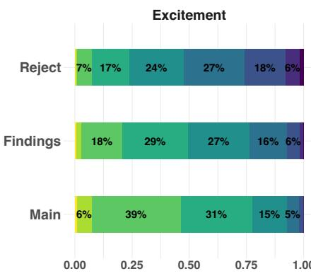

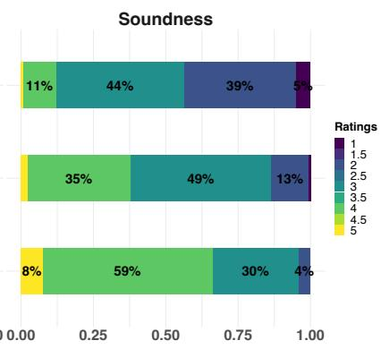  
(a) Ratio of review scores per acceptance status

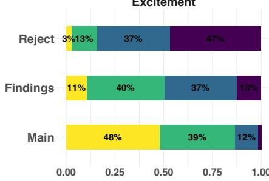

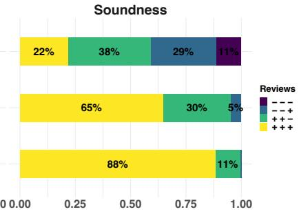  
(b) Ratio of positive (+) and negative (-) score combinations per acceptance status

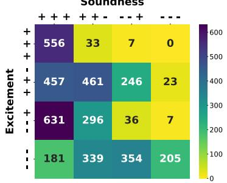  
(c) Total number of submissions with  
different combinations of positive (+) and negative (-) scores

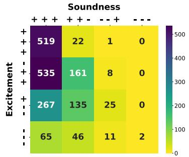  
Figure 7: Review scores vs acceptance outcome. “Positive” scores (+) refer to the above-borderline scores (Soundness >=3, Excitement >=3.5), and “negative” (-) - to the number of scores below borderline.

Consistent with the general perception of inconsistency in peer review, ↵ shows a level of IAA that seems far too low (the rule of thumb is that “substantial” agreement is in the range of 0.6-0.8 (Artstein and Poesio, 2008; Paun et al., 2022)). However, the raw agreement for the accepted papers (in the categorical view, i.e. as sound/unsound, exciting/unexciting) is almost twice higher for Soundness than for Excitement. We interpret this as an indication that although the scores are still noisy, it helps to ask more specific questions with more objective criteria. The much lower raw agreement on the Excitement is also in line with our point that this is overall a less relevant direction for the author response and reviewer discussion. Arguably we do not even want a high agreement on Excitement: everybody interested in the same thing could indicate that the field is ossifying and stagnating.

As a sanity check, we also analyzed IAA for the raw reviewer scores of EMNLP 2022 and EACL 2023. Both of these conferences used a single “overall recommendation” score, formulated differently for short and long papers. In EMNLP 2022, for 3092 observations for 3 reviewers (discarding R4 data), with scores treated as ordinal data, we got ↵ 0.316 for the short papers, 0.31 for long, and 0.318 for the whole distribution – which is almost exactly the same as our ↵ for both our scores (in the ordinal case). In EACL 2023, for 1121 subjects for 3 reviewers we got ↵ 0.317 for the short papers, 0.34 for long, and 0.348 for the whole distribution.

A related question is “what kind of disagreements do we actually have?” Figure 7a shows the distribution of individual score values for all papers in a given acceptance status, which suggests that even papers accepted to the main conference had some very negative reviews. Figure 7b breaks down the scores into “positive” (Soundness >= 3, Excitement >= 3.5) and “negative”, and considers the combinations of three reviews as “all positive” (+ + +), “all negative” (- - -), “2 positive, 1 negative” (+ + -) and “2 negative, 1 positive” (- - +). We can see that despite disagreements on the exact scores, the papers accepted to the main track have a high ratio of “positive” review combinations for Soundness (88%, only 11% papers with one negative Soundness score). But for Excitement our SACs accepted to the main track 39% papers with one negative Excitement score, and 37% papers with a single “champion” reviewer. For Findings, they even accepted 37% papers which only 1 reviewer was excited about. Figure 7c shows the total number of submissions with various combinations of positive and negative Soundness and Excitement scores, and Figure 7d shows the same categories, but with the number of accepted papers with that score combination.

Our data indicates that despite noisy scores and high disagreement, the mechanism of ACs and SACs does “rescue” many papers with one negative review, and at least the raw agreement does improve for the more specific Soundness score. Judging by the community feedback (§5), in this first implementation there was a lot of confusion about what the scores meant, and we expect that in future iterations the agreement could improve further.

## 7.5 Analysing Reviews and Review Scores

In this section, we take a step back from the final acceptance decisions and look only at the individual reviews and their scores, rather than the final outcome of the submission.

## 7.5.1 Do the Area-Contribution-Language matches impact reviewer scores?

To answer this question, Figure 8 shows the distributions of the individual reviewer scores for Soundness, Excitement, reviewer Confidence, and Reproducibility for all cases where the reviews were or weren’t matched by the area, contribution type, or language. The biggest visible impact is in reviewer Confidence, where the contributions are not matched by area: the ratio of reviews with high scores (4+) is decreased by about 14%. A worrying observation is that there is a 5% increase in high Confidence scores for the submissions where the reviewer is not matched by language and could be expected to feel less rather than more confident. We also observe an 11% increase in Soundness ratings 3+ from reviewers matched by language vs those mismatched, and 7% in Reproducibility.

## 7.5.2 Do the Area-Contribution-Language matches impact the reviewer activity?

To establish whether Area-Contribution-Language matching had any effect on reviewer activity, we counted the reviewers as “active” if they had at least one forum message or more than one review edit. The distributions of active/inactive reviewers that are/aren’t well-matched to submissions by Area-Contribution-Language criteria are shown in Figure 9. At a glance, there are a lot more matched & active reviewers, but since generally a lot more reviewers were matched than mismatched (see Table 2), we would generally expect that to be the case even by chance.

To establish whether there are any statistically significant effects, we first fit a generalized linear model (GLM) using the glm() function in R.27 The dependent variable was binary (the activity of the reviewer). The predictors were a contribution match (binary variable), a studied language match (threelayer categorical variable),28 and an area match (binary variable), all of which were treated as categorical variables (at least one matching keyword of the correct type). The link function was logit, corresponding to a binomial distribution of the response variable (logistic regression).

(c) Reviewer confidence  
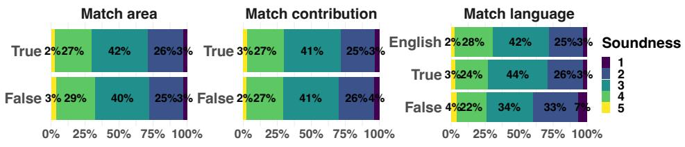

(a) Soundness  
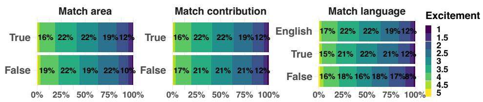

(b) Excitement  
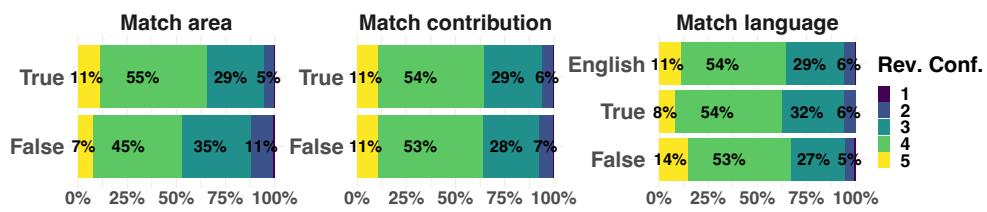

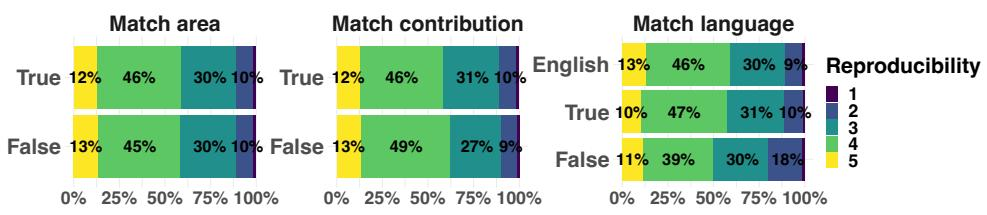  
(d) Reproducibility  
Figure 8: Area-Contribution-Language Matches impact on reviewer scores. In each plot, True/False refers to the reviews where the submissions were/weren’t matched by area, contribution or language.

The results of the GLM (see Table 10) suggest that contribution match is a significant predictor of the reviewer’s activity $( \beta = 0 . 1 6 , \mathrm { S E } = 0 . 0 8 , z = 1 . 9 7 , p = 0 . 0 4 8 )$ . Since the estimates relate to log-odds we consider the exponential of the reported value (1.178) which suggests that the odds of the reviewer being active when the contribution type is well-matched are 1.178 times higher than when the contribution does not match the reviewer’s expertise. The remaining variables, that is language match and area match, are not significant predictors in this model $( p > 0 . 0 5 )$ .30

Finally, we considered the language match as a binary variable, excluding English language papers. We conduct a Chi-square test $( \chi ^ { 2 } )$ to examine the association between the language match (excluding English) and reviewer activity Table 11. The test reveals no significant association between the language match and reviewer activity $( \chi ^ { 2 } ( 1 ) = 0 . 7 3 4 3 2 , p = 0 . 3 9 1 5 )$ . The chi-square test was performed using Pearson’s Chi-squared test with Yates’ continuity correction with the chisq.test() function in R.

We conclude that of the Area-Contribution-Language matching rubrics, only the contribution type contributes to improvement in reviewer activity. Although the effect is modest (1.178 times increase in likelihood of reviewer activity), given that reviewer activity post-submission is very important, and its level needs to be improved (§5.4), we would urge the future chairs to consider this criterion in the assignments. It also provides a quick and interpretable way to consider the variety of the types of work that are being submitted, and to provide extra attention to the assignments for the non-mainstream kinds of work.

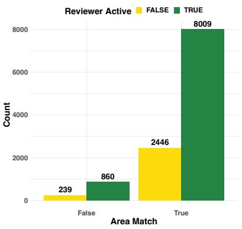  
(a) Match by area

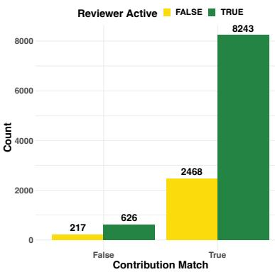  
(b) Match by contribution

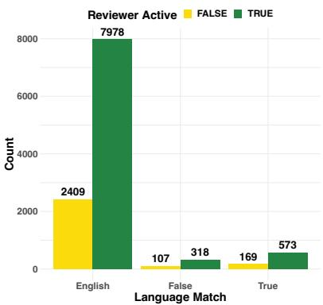  
(c) Match by language

Figure 9: Area-Contribution-Language matches vs reviewer activity. In each plot, True/False refers to reviews where the reviewers weren’t matched to the submission by area, contribution or language
<table><tr><td></td><td>Estimate</td><td>Std. Error</td><td>z value</td><td>Pr(&gt;|z|)</td><td></td></tr><tr><td>(Intercept)</td><td>1.1511</td><td>0.1012</td><td>11.38</td><td>0.0000</td><td>***</td></tr><tr><td>Match Contribution (True)</td><td>0.1638</td><td>0.0830</td><td>1.97</td><td>0.0484</td><td>*</td></tr><tr><td>Match Language (False)</td><td>-0.1076</td><td>0.1142</td><td>-0.94</td><td>0.3461</td><td></td></tr><tr><td>Match Language (True)</td><td>0.0114</td><td>0.0921</td><td>0.12</td><td>0.9015</td><td></td></tr><tr><td>Match Area (True)</td><td>-0.1151</td><td>0.0786</td><td>-1.46</td><td>0.1432</td><td></td></tr></table>

Table 10: Generalized linear model (GLM) estimates for predicting reviewer activity using match categories. Each row represents a different predictor.29
<table><tr><td>Test</td><td>Chisq</td><td></td><td>df p-value</td></tr><tr><td>Pearson&#x27;s Chi-squared (Yates&#x27; correction)</td><td>0.73432</td><td>1</td><td>0.3915</td></tr></table>

Table 11: Results of Pearson’s Chi-squared test with Yates’ continuity correction for the effect of language match (excluding English) on the reviewer’s activity

## 7.5.3 Do reviewer confidence scores reflect their experience?

START profiles contain self-reported reviewer experience labels (“never”, “first time”, “3 or fewer events”, “4 events and more”. We explored the relationship between this data and reviewer Confidence scores but found no strong effect. We do observe a small (about 4%) increase in the volume of 4+ Confidence scores for the most experienced reviewers, and it’s significant according to the ordinal logistic regression model31. But the effect is quite small, and judging by this data we don’t recommend relying on confidence as a proxy for reviewer experience. Moreover, we observe no relation between this reviewer experience data and the number of review issues reported by the authors. This is a rather depressing finding from the perspective of reviewer training, and we hope that it is rather due to START profiles not being updated by the reviewers.

## 7.5.4 Do the reviewer scores correlate with length of the reviews?

The ACL review form had the following text input fields: summary, reasons to accept, reasons to reject, questions to the authors, missing references, suggestions&typos, and confidential notes to the chairs. We roughly estimated the length of these inputs by splitting on the whitespace, and computed Spearmans correlation (Spearman, 1987) between these variables and reviewer scores for Soundness, Excitement,

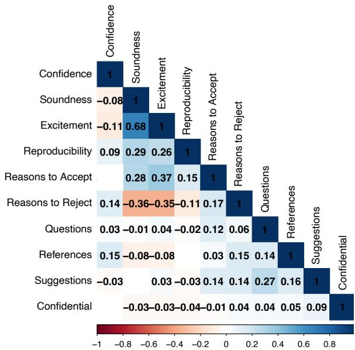  
Figure 10: Spearmans’ correlation between reviewer scores, confidence, and the length of review text fields. The insignificant correlation was left blank (p>0.05).

Confidence, and Reproducibility. The results are shown in Figure 10.

As could be expected, we observe a significant negative correlation (-0.35-0.36) between the length of Reasons to Reject and both Soundness and Excitement scores, and the opposite trend for the Reasons to Accept (0.28-0.37). Interestingly, the length of Reasons to Accept also correlates positively with the Reproducibility score, indicating that the community appreciates this factor (0.15). Confidence has a similar correlation with the length of missing references. Finally, there is a high correlation between the length of “questions to the authors” and “suggestions”, indicating that the reviewers who engage with the submission deeply use both of these fields.

The highest positive correlation is between our Soundness and Excitement scores32 (0.68), which is in line with the intuition that unsound work would probably not be found exciting either.

## 7.5.5 What factors are associated with review issues?

As discussed in §5.3, we introduced a mechanism for the authors to flag specific types of issues with reviews, and we received such flags for 12.9% of the reviews. Figure 11 shows the ratio of reviews with complaints (True) and without (False). For both Soundness and Excitement there is a clear trend towards more complaints with lower scores, but there are also complaints for high scores (e.g., 43.1% of reviews which the authors complained about had Soundness 4). This makes more sense if we consider the figure Figure 11d, which shows that 95% complaints are made about reviews where at least one of the scores is 3 or less. This suggests that reported review issues are associated with negative reviews, even for Excitement (although we tried to make it clear that this score is subjective and does not need arguing).

To explore other possible factors that could make the reviews more likely to be reported we fit a GLM model using the glm() function in R. The dependent variable is the presence or absence of reported issues (binary variable), and the predictors are the Excitement score (ordinal), Soundness score (ordinal), Confidence score (ordinal), Reproducibility score (ordinal), length of Reasons to Reject (interval), length of Reasons to Accept (interval), the Contribution Match (binary), Area Match (binary), Language Match (three-layer factor), Reviewer’s Experience (three-layer factor), and Reviewer’s Activity (binary). The link function was logit, corresponding to a binomial distribution of the response variable (logistic regression).33 The coefficients of the fitted model are presented in Table 12.

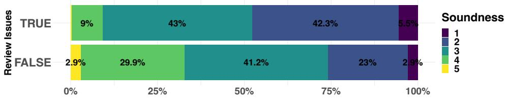

(a) Soundness  
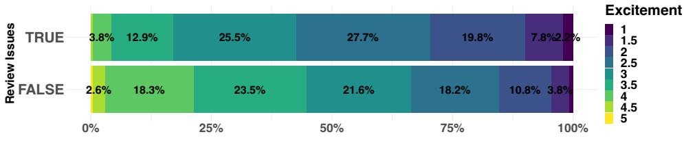

(b) Excitement  
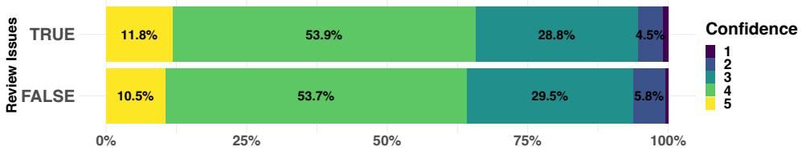

(c) Reviewer confidence  
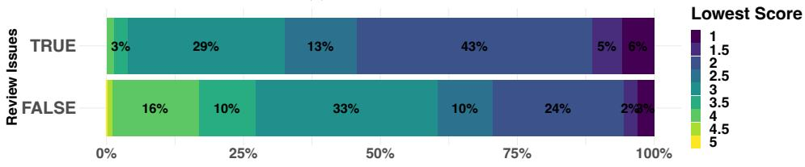  
(d) Min(Soundness, Excitement)  
Figure 11: Reviewer scores vs the amount of issues reported with reviews. In each plot, True/False refers to the reviews which were or were not flagged for review issues by the authors.

We further employ the type III Anova using the ANOVA() function in R in order to obtain significance levels for each factor which are presented in Table 13. While McFadden’s pseudo- $R ^ { 2 }$ of the fitted model is only 0.067, several variables of this model are significant predictors of the review issues.

The most significant factors are Soundness, Excitement, and the length of Reasons to Accept. All of these variables have a negative relationship with the reviewer issues, perhaps unsurprisingly, with higher scores the review is less likely to be reported. Similarly, longer text in the Reason to Accept field leads to less chance of the review being reported. Counter-intuitively, the positive coefficient associated with the reviewer being active suggests that when the reviewer is active (i.e. with at least one review revision or a forum message) the log-odds of the review issue increase by about 0.32, all else being equal. That is, the more active reviewers (putting in more effort) are actually receiving more complaints.

Other significant factors are Language Match and the reviewer’s confidence; both associated with negative coefficients. This suggests that when the reviewer is familiar with the non-English language investigated in the study, the log-odds of a review issue decrease by approximately 0.26 (i.e., the review is 1.29 times less likely to be flagged for issues). Similarly, the negative coefficient of the reviewer’s

<table><tr><td></td><td>Estimate</td><td>Std. Error</td><td>z value</td><td>Pr(&gt; |z|)</td><td></td></tr><tr><td>(Intercept)</td><td>0.5999</td><td>0.2570</td><td>2.334</td><td>0.0196</td><td>*</td></tr><tr><td>Soundness</td><td>-0.3816</td><td>0.0479</td><td>-7.967</td><td>1.63e-15</td><td>***</td></tr><tr><td>Excitement</td><td>-0.4584</td><td>0.0549</td><td>-8.349</td><td>&lt; 2e-16</td><td>***</td></tr><tr><td>Confidence</td><td>-0.0855</td><td>0.0393</td><td>-2.176</td><td>0.0295</td><td>*</td></tr><tr><td>Reproducibility</td><td>0.0609</td><td>0.0335</td><td>1.816</td><td>0.0693</td><td></td></tr><tr><td>Reasons to Reject</td><td>0.0004</td><td>0.0002</td><td>1.508</td><td>0.1315</td><td>***</td></tr><tr><td>Reasons to Accept</td><td>-0.0052</td><td>0.0011</td><td>-4.748</td><td>2.06e-06</td><td></td></tr><tr><td>Match Contribution (True)</td><td>0.0763</td><td>0.1148</td><td>0.664</td><td>0.5066</td><td></td></tr><tr><td>Match Area (True)</td><td>-0.1352</td><td>0.1030</td><td>-1.313</td><td>0.1892</td><td></td></tr><tr><td>Match Language (False)</td><td>0.0270</td><td>0.1476</td><td>0.183</td><td>0.8550</td><td>*</td></tr><tr><td>Match Language (True)</td><td>-0.2639</td><td>0.1275</td><td>-2.070</td><td>0.0384</td><td></td></tr><tr><td>Experience (Experienced)</td><td>-0.0744</td><td>0.0684</td><td>-1.087</td><td>0.2769</td><td></td></tr><tr><td>Experience (Zero)</td><td>-0.0274</td><td>0.1164</td><td>-0.235</td><td>0.8143</td><td></td></tr><tr><td>Reviewer Active (True)</td><td>0.3172</td><td>0.0737</td><td>4.303</td><td>1.69e-05</td><td>***</td></tr></table>

Table 12: Coefficients of the Generalized Linear Model predicting the review issues. The table includes the coefficient estimate, standard error, z-value, and p-value for each predictor.34
<table><tr><td></td><td>LR Chisq</td><td>Df</td><td>Pr(&gt;Chisq)</td><td></td></tr><tr><td>Soundness</td><td>64.65</td><td>1</td><td>0.0000</td><td>***</td></tr><tr><td>Excitement</td><td>70.45</td><td>1</td><td>0.0000</td><td>***</td></tr><tr><td>Confidence</td><td>4.71</td><td>1</td><td>0.0300</td><td>*</td></tr><tr><td>Reproducibility</td><td>3.31</td><td>1</td><td>0.0688</td><td></td></tr><tr><td>Reasons to Reject</td><td>2.23</td><td>1</td><td>0.1353</td><td></td></tr><tr><td>Reasons to Accept</td><td>24.17</td><td>1</td><td>0.0000</td><td>***</td></tr><tr><td>Match Contribution</td><td>0.45</td><td>1</td><td>0.5035</td><td></td></tr><tr><td>Match Area</td><td>1.69</td><td>1</td><td>0.1940</td><td></td></tr><tr><td>Match Language</td><td>4.61</td><td>2</td><td>0.0998</td><td></td></tr><tr><td>Experience</td><td>1.24</td><td>2</td><td>0.5386</td><td></td></tr><tr><td>Reviewer Active</td><td>19.35</td><td>1</td><td>0.0000</td><td>***</td></tr></table>

Table 13: Type III Analysis of Deviance for the variables in the Generalized Linear Model predicting whether issues were reported for the given review.35

Confidence suggests that with an increased Confidence score the likelihood of the review to be reported decreases though by a small margin.

## 7.5.6 Do we have bad actors?

To explore the possibility that many reported review issues are due to individual unprofessional reviewers, let us consider the fact that 1,620 reviews with reported issues were authored by 1311 reviewers, i.e. about a third of our total pool. But most of these reviewers had more than three reviews, and 1060 of them were only reported once. Of the remaining reviewers, 201 were flagged twice, and 50 reviewers had more than 3 complaints. We conclude that while there are indeed some unprofessional reviewers, and conferences need to systematically share such information and develop a system to address this problem, there are few such cases (6.2% if we consider all reviewers with more than 2 flags, and 1.2% with more than 3 flags). An interesting takeaway from Figure 11c is that the reviews that are problematic according to the authors, do not have lower confidence scores, so these are unlikely to be the new reviewers or the reviewers unfamiliar with the area.

According to folk wisdom, the bad reviewer is usually Reviewer2 (sometimes Reviewer3). We clear their good name: at ACL’23, the most issues were reported for Reviewer1, as shown in Figure 12.

## 7.5.7 Can the reviewers tell who the authors are?

In 567/12606 (4.5%) reviews the reviewers indicated that they have seen the paper, either by seeing a preprint (533) or by other means (34). Additionally, 513 (4.1%) reviewers indicated that they had a good guess of the author identity based on the paper content. 11460 (90.9%) ACL’23 reviews were reported as fully anonymous.

The community “recall” on the preprinted submissions is as follows: we had 628 submissions (13.8% of all direct submissions) for which the authors had disclosed preprints. The reviewers identified 306 (49%) of them. Hence, we estimate that although in our sample the number of “guesstimates” based on content is about the same as the number of preprinted papers, if the current 1-month embargo period was to be lifted, and the volume of preprints were to increase – the latter would also increase, while the volume of “guessed” authorship cases should stay the same (at about 4-5%). Interestingly, our reviewers reported another 102 submissions, for which preprints were not disclosed by the authors. We recommend that the future chairs investigate at earlier stages whether such cases are due to false memories of similar preprints, or preprint policy violations.

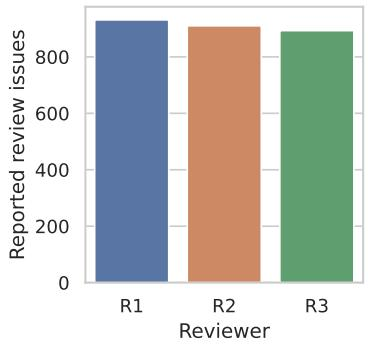  
Figure 12: The number of review issues reported for R1, R2, and R3

## 7.5.8 Do preprints affect the peer review process?

Having established that reviewers do have a high recall for preprints (§7.5.7), we investigate the possible connection between the reviewer’s awareness of the author identity on their Soundness, Excitement, and Confidence scores by fitting Cumulative Link Mixed Effect models with the Laplace approximation using the clmm() function for the ordinal package in R (Christensen, 2022). The response variable is the given score and the predictor is the Anonymity answer (fixed effects). We also employ random intercepts for the paper (SubmissionID) and reviewer (ReviewerID) to account for this variability (random effects).36

Soundness. The results of the model fitted for the effect of Anonymity on the Soundness scores are present in Table 14. The Anonymity has five possible values: (1) the reviewer does not know the authors (reference level), (2) the reviewer may know the authors, (3) the reviewer knows the authors via means other than online posting, (4) the reviewer knows the authors via online posting prior to the anonymity period, and (5) the reviewer knows the authors via online posting post to the anonymity period. Estimates for different answers to the anonymity question presented in Table 14 suggest that the reviewers were 1.59 times more likely to assign higher Soundness scores when they thought they may know the authors, and 1.75 times more likely to assign higher Soundness scores when they have seen the preprint online.37

Excitement. The results of the model fitted for the effect of Anonymity on Excitement are present in Table 15. Estimates for different answers to the anonymity question presented in Table 15 suggest that the reviewers were 1.49 times more likely to assign higher Excitement scores when they thought they may know the authors, and 1.73 times more likely to assign higher Excitement scores when they have seen the preprint online.

Confidence. The results of the model fitted for the effect of Anonymity on reviewer’s Confidence are present in Table 16. Estimates for different answers to the anonymity question presented in the table suggest that the reviewers were 1.29 times more likely to report higher Confidence scores when they thought they may know the authors, and 1.80 times more likely to assign higher Confidence scores when they saw the preprinted online.

<table><tr><td></td><td>Estimate</td><td>Std. Error</td><td>z-value</td><td>Pr(&gt;|zl)</td><td></td></tr><tr><td>Random effects:</td><td></td><td></td><td></td><td></td><td></td></tr><tr><td>SubmissionID (Intercept)</td><td>2.2427</td><td>1.4976</td><td></td><td></td><td></td></tr><tr><td>ReviewerID (Intercept)</td><td>0.7806</td><td>0.8835</td><td></td><td></td><td></td></tr><tr><td>Fixed effects:</td><td></td><td></td><td></td><td></td><td></td></tr><tr><td>Anonymity (2)</td><td>0.46037</td><td>0.11744</td><td>3.920</td><td>8.85e-05</td><td>***</td></tr><tr><td>Anonymity (3)</td><td>0.02567</td><td>0.41291</td><td>0.062</td><td>0.9500</td><td></td></tr><tr><td>Anonymity (4)</td><td>0.55947</td><td>0.13081</td><td>4.277</td><td>1.90e-05</td><td>***</td></tr><tr><td>Anonymity (5)</td><td>0.36749</td><td>0.27565</td><td>1.333</td><td>0.1820</td><td></td></tr></table>

Table 14: Cumulative Link Mixed Model Results for the effect of Anonymity on the Soundness scores. The reference level is Anonymity (1) (i.e., not knowing the authors).
<table><tr><td></td><td>Estimate</td><td>Std. Error</td><td>z-value</td><td>Pr(&gt;|zl)</td><td></td></tr><tr><td>Random effects:</td><td></td><td></td><td></td><td></td><td></td></tr><tr><td>SubmissionID (Intercept)</td><td>1.6675</td><td>1.2913</td><td></td><td></td><td></td></tr><tr><td>ReviewerID (Intercept)</td><td>0.5163</td><td>0.7185</td><td></td><td></td><td></td></tr><tr><td>Fixed effects:</td><td></td><td></td><td></td><td></td><td></td></tr><tr><td>Anonymity (2)</td><td>0.39828</td><td>0.10629</td><td>3.747</td><td>0.000179</td><td>***</td></tr><tr><td>Anonymity (3)</td><td>0.13179</td><td>0.37724</td><td>0.349</td><td>0.726816</td><td></td></tr><tr><td>Anonymity (4)</td><td>0.54498</td><td>0.11816</td><td>4.612</td><td>3.98e-06</td><td>***</td></tr><tr><td>Anonymity (5)</td><td>0.08329</td><td>0.24708</td><td>0.337</td><td>0.736049</td><td></td></tr></table>

Table 15: Cumulative Link Mixed Model Results for the effect of Anonymity on the Excitement scores. The reference level is Anonymity (1) (i.e., not knowing the authors).

We thus conclude that submissions with preprints, as well as submissions where the reviewers believe they could guess the authors, systematically receive higher ratings for both Soundness and Excitement, as well as higher Confidence scores. We further note that preprinted papers are disproportionately recommended for consideration for best paper awards (and without such a recommendation from at least one reviewer the submissions are not considered by the best paper committee). In total, only 1.6% papers received any reviewer nominations at all, and for 30% of those papers, the authors had disclosed preprints.

While our data shows the pattern of higher scores, acceptance chances, and best paper nominations for preprinted submissions, the causal mechanism remains a question: is it because such papers are inherently higher quality, or because of the benefits of community feedback they may receive, or because of the well-documented reviewer biases towards towards famous names and institutions (Peters and Ceci, 1982; Tomkins et al., 2017, among many others)? Since these possibilities necessitate different actions on the part of the chairs who strive for higher-quality program, the causal question needs to be answered for informed policy decisions. Since we observe an increase in likelihood of higher scores both for real preprints and for submissions where the reviewers only thought that they might know the authors (although the effect is smaller in that case), we can conclude that the social factor is definitely present—but more research is needed to establish its exact contribution. But the fact that we only had 13.8% preprints suggests that the current 1-month embargo policy is effective in at least reducing the volume of the problem.

## 8 Special Review Processes

## 8.1 Ethics review

Following the practice started at NAACL 2021, we formed an Ethics Committee (EC) dedicated to ethical issues. The review process was based on work in prior conferences and further developed by ARR and recommendations from the ACL ethics committee. Initially there were 235 technical reviews flagging 218 papers for ethics concerns, and the SACs narrowed down the list based on the guidelines developed by the ethics chairs) to 75 papers, 6 of which did not make it to the ethics review (either withdrawn or cleared).

<table><tr><td></td><td>Estimate</td><td>Std. Error</td><td>z-value</td><td>Pr(&gt;|zl)</td><td></td></tr><tr><td>Random effects:</td><td></td><td></td><td></td><td></td><td></td></tr><tr><td>SubmissionID (Intercept)</td><td>0.416</td><td>0.645</td><td></td><td></td><td></td></tr><tr><td>ReviewerID (Intercept)</td><td>3.413</td><td>1.847</td><td></td><td></td><td></td></tr><tr><td>Fixed effects:</td><td></td><td></td><td></td><td></td><td></td></tr><tr><td>Anonymity (2)</td><td>0.2576</td><td>0.1227</td><td>2.099</td><td>0.0358</td><td>*</td></tr><tr><td>Anonymity (3)</td><td>0.4210</td><td>0.4194</td><td>1.004</td><td>0.3155</td><td></td></tr><tr><td>Anonymity (4)</td><td>0.5874</td><td>0.1342</td><td>4.376</td><td>1.21e-05</td><td>***</td></tr><tr><td>Anonymity (5)</td><td>0.3413</td><td>0.2864</td><td>1.192</td><td>0.2334</td><td></td></tr></table>

Table 16: Cumulative Link Mixed Model Results for the effect of Anonymity on the Confidence scores. The reference level is Anonymity (1) (i.e., not knowing the authors).

20 papers under ethics review were labeled accept as-is, 43 received conditional accepts, and 6 were recommend for rejection. Of those recommended for rejection, 1 was accepted nonetheless, 1 was rejected as a result, and 4 were rejected on technical grounds. Of the conditionally accepted ones, 26 were rejected on technical grounds, and 1 was withdrawn. 16 passed the technical review and were conditionally accepted, meaning the ethics issues had to be addressed in the camera-ready version, to be verified by the SAC (based on EC guidance) prior to final acceptance.

The authors of all conditionally accepted papers submitted the camera-ready version and a short response that explained how they had made the changes requested. The SAC double-checked these revised submissions and responses, and confirmed that the ethical concerns had been addressed. As a result, all conditionally accepted papers were accepted to the main conference or Findings.

## 8.2 Best paper selection

ACL’23 implemented the new ACL award policy, aiming to expand the pool of work that is recognized as outstanding. In total, only 73 papers, i.e. 1.6% of all direct38 submissions were nominated by the reviewers or ACs for consideration for awards. These papers were assessed by the Best Paper Award Committee, and with their help we selected 4 best papers, 4 special awards (social impact, resource, reproduction, theme paper), and 39 outstanding papers. The best and outstanding papers will be announced in a dedicated plenary session for Best Paper Awards on July 10 2023.

We encountered several issues with implementing the best paper policy as described in the wiki. With 73 nominated papers, to keep it down to 10 papers per judge and have 2 reviews per paper, we had to recruit 15 judges. At this scale, the workload is compatible with organizing a separate track: recruitment, paper assignments, chasing late reviews – only this time recruiting exclusively very senior and busy people, and it is very important to upheld diversity considerations (which we weren’t able to do full justice). For the future, we recommend that a separate chair role is created for managing this process, similar in scope to the role of the ethics review chairs.

Furthermore, since the diversity considerations in the committee selection entail incompatible time zones, we found it impractical to require the judges to meet and jointly decide on the cases where they disagree (as recommended in the policy). Hence, after the judges cast their votes39, the PCs made the final decisions on the basis of their recommendations (in particular, in the cases where one judge recommended outstanding paper and the other recommended not considering it further), we upheld the objections to flaws in the papers, shallowness of analysis, and ethical issues, which left us with 39 papers (a little short of the 1-1.5% total submissions policy target for the outstanding papers).

Finally, the ACL award policy described an Area Chair Award: the award that the SACs of a given track can give to one paper in their track, fully on their own authority. This was part of the guidelines for the final SAC recommendations, but we did not require them to be made at the same time. We sent out reminders after that, but received such nominations from only 12/26 tracks (with the theme track nomination transformed into the special Theme paper award). We recommend batching these recommendations with the final SAC recommendations as a single task.

## 9 Improving the Incentives

## 9.1 Improving Reporting Incentives for the Authors: Responsible NLP checklist

Following the effort started by NAACL 2022 and continuted at ACL Rolling Review (Carpuat et al., 2021), we used the Responsible NLP Checklist as a way to ensure that all submissions conform to a certain minimum standard of reporting on their reproducibility efforts, data collection principles, and consideration of broader impacts. However, at NAACL 2022 and ACL Rolling Review, these checklists are only used internally during peer review.

To improve the transparency of NLP research and create a stronger incentive to invest effort in this work, we made the Responsible NLP Checklists an official part of all published papers. The authors filled out the checklist information in a special form, and we later used that form to generate pdf versions of the checklist, which was appended to every paper pdf for the ACL Anthology.

This change was announced in our Call for Papers, and we additionally communicated it to the authors. The authors had the opportunity to update the checklist form during the preparation of the camera-ready version of their papers.

One modification to the checklist was introducing a mandatory question about AI writing assistance. This was motivated by the introduction of OpenAI’s ChatGPT (OpenAI, 2022), the precedent of AIassisted scientific paper writing of Meta’s Galactica (Taylor et al., 2022), and, more importantly, a massive wave of promotion for AI “writing assistants” shortly before our direct submission deadline. We did not aim to completely ban AI-assisted writing (which does have legitimate use cases such as assistance to non-native English speakers), but to improve transparency: just like with the other ethics-related questions in the checklists, our posted policy required authors to explicitly state what they did. Our question and policy were subsequently adopted by ACL Rolling Review.

Magnusson et al. (2023) have reported that the higher rate of “yes” responses to the Reproducibility checklist at 4 NLP conferences. Given that our checklist includes reproducibility questions, and reproducibility positively correlates with both Soundness and Excitement, we would expect the Responsible NLP checklist to perform the same role. The reviewers themselves were predominantly positive about it: 66.99% rated it as “somewhat useful”, 18.13% as “very useful”, and only 14.35% — as “not useful”.

Table 17 shows the ratios of submissions answering ‘yes’ to the questions of the checklist, and the acceptance rates for the submissions that answered ‘yes’ vs those that didn’t. For most questions of the checklist, there is a small increase in acceptance rate for submissions that answer ‘yes’. The most significant increases are for reporting limitations (so we recommend that the conferences keep mandating this section), reporting hyperparameters and computation budget (in line with the high correlation between reproducibility ratings and reviewer scores §7.5), citing relevant work, contributing scientific artifacts such as models and software (in line with our finding of a significant effect for this contribution type discussed in §7.3).

An interesting case is the “catch question” A3 (does your abstract accurately summarize your work?). It drew some criticism as “meaningless bureaucracy”, since all submissions should respond “yes” to it. It was actually intended to see that the responders were not just clicking through the checklist. Most authors did respond ‘yes’, but those 2.24% that didn’t saw a -25.4 decrease in acceptance rate. We interpret this as suggesting that the sloppiness in filling out the checklist correlates with sloppiness elsewhere in the work.

Finally, our new question about the use of writing assistants is the only one where the response ‘Yes’ is associated with a decrease in acceptance rate, although not very large.

## 9.2 Improving Incentives for Reviewers: Reviewer Awards

Arguably the biggest source of issues with peer review quality is the lack of incentives to invest more work in invisible service labor. One direction is reputational awards, eg via creating reviewer profiles, as in Publons. Another is material awards, such as monetary prizes similar to the best paper awards. Yet another is punitive incentives, such as penalizing the late reviewers by delaying the reviews for their own submissions (Hauser and Fehr, 2007), or even blocking them from reviewing at future conferences.

<table><tr><td>Checklist question</td><td>% submissions</td><td>Yes</td><td>Not Yes*</td><td>Yes-Not_yes</td></tr><tr><td>A1 (limitations)</td><td>46.92</td><td>47.62</td><td>17.05</td><td>30.57</td></tr><tr><td>A2 (risks)</td><td>56.23</td><td>49.28</td><td>43.88</td><td>5.4</td></tr><tr><td>A3 (catch question)</td><td>97.76</td><td>47.49</td><td>22.09</td><td>25.4</td></tr><tr><td>A4 (AI-assisted writing)</td><td>7.3</td><td>41.28</td><td>47.36</td><td>-6.08</td></tr><tr><td>B (artifacts)</td><td>72.45</td><td>50.09</td><td>38.58</td><td>11.51</td></tr><tr><td>B1 (cite)</td><td>71.02</td><td>49.96</td><td>39.46</td><td>10.5</td></tr><tr><td>B2 (license)</td><td>37.8</td><td>52.48</td><td>43.54</td><td>8.94</td></tr><tr><td>B3 (intended use)</td><td>45.28</td><td>49.48</td><td>44.8</td><td>4.68</td></tr><tr><td>B4 (PII)</td><td>22.02</td><td>49</td><td>46.33</td><td>2.67</td></tr><tr><td>B5 (documentation)</td><td>48.95</td><td>50.93</td><td>43.08</td><td>7.85</td></tr><tr><td>B6 (statistics)</td><td>70.47</td><td>49.76</td><td>40.14</td><td>9.62</td></tr><tr><td>C (computation)</td><td>92.31</td><td>47.76</td><td>36.82</td><td>10.94</td></tr><tr><td>C1 (parameters)</td><td>78.58</td><td>48.96</td><td>39.44</td><td>9.52</td></tr><tr><td>C2 (hyperparams)</td><td>85.5</td><td>48.49</td><td>37.63</td><td>10.86</td></tr><tr><td>C3 (stats)</td><td>81.02</td><td>48.19</td><td>41.51</td><td>6.68</td></tr><tr><td>C4 (packages)</td><td>76.01</td><td>47.16</td><td>46.15</td><td>1.01</td></tr><tr><td>D (humans)</td><td>28.98</td><td>52.11</td><td>44.8</td><td>7.31</td></tr><tr><td>D1 (instructions)</td><td>20.95</td><td>53.85</td><td>45.08</td><td>8.77</td></tr><tr><td>D2 (payment)</td><td>21.19</td><td>53.5</td><td>45.15</td><td>8.35</td></tr><tr><td>D3 (consent)</td><td>17.31</td><td>51.2</td><td>46.02</td><td>5.18</td></tr><tr><td>D4 (IRB)</td><td>9.62</td><td>53.24</td><td>46.25</td><td>6.99</td></tr><tr><td>D5 (demographics)</td><td>14.61</td><td>54.27</td><td>45.66</td><td>8.61</td></tr></table>

Table 17: The ratio of ‘Yes’ responses to checklist questions vs the responses other than ‘yes’ (i.e. both ‘no’ and ‘no response’). The average acceptance rate in this pool is 46.92%.

All of these approaches are not without issues. Punitive incentives generally shift the focus to not getting penalized, rather than delivering high-quality reviews. Material awards may introduce the wrong incentives (Squazzoni et al., 2013), and, depending on the institution and the country, the prize may be taxed or not even make it to the recipient. Conference fee waivers also may also reward the reviewer’s institution rather than the reviewer, since the institutions usually bear the registration costs. While a survey found that reviewers generally prefer reputational awards over material (Warne, 2016), their value also depends on whether the reviewer’s institution rewards such work.

We proposed to the ACL exec (and received their approval for) an initiative to match the new ACL best paper award policy with recognizing about 1-1.5% of outstanding reviewers and chairs. This combines reputational and material incentives. Instead of monetary prizes, we proposed awarding vouchers for virtual attendance of any \*ACL (ACL, NAACL, EACL, AACL, EMNLP) conference of the awardee’s choice, to be used within a year of the award date. Since many institutions do not support the attendance of conferences without accepted papers (or even with papers accepted to workshops and Findings), we hope that this measure will increase the overall number of conferences that the awardees can attend.

We asked the area chairs to nominate the reviewers in their pool who provided extra helpful reviews, high-quality emergency reviews, “champion” reviews, reviewers who were particularly active in the discussion phase, or demonstrated exceptional open-mindedness or expertise. We received 51 such nominations. We also asked the Senior Area chairs to nominate exceptional area chairs, receiving 13 nominations. Finally, we as the program chairs also nominated the (3) SACs of the track who were the most on-time, provided the most helpful feedback, and followed our instructions the most closely. Excluding the duplicates, this resulted in 67 total nominations. All awards will be announced on the conference website40.

Since the total number of nominations was within our target number of awards (1-1.5% of total reviewers and chairs), we were able to award all 66 nominations (out of 4998) without creating a selection committee. In the future, we recommend that an extra volunteer role is created for managing the selection of awardees and managing the awards.

Caveats: despite our calls to nominate reviewers and chairs, relatively few ACs and SACs did that: only 7/70 SACs and 28/438 ACs. We recommend that the AC/SAC guidelines are expanded with a section about these awards, and that ACs are asked to start keeping track of potential outstanding reviewers at the (a) review quality check stage, (b) discussion stage, rather than only during meta-reviews (as we did). The SACs could be asked to start keeping track of outstanding ACs at the (a) assignment checks, if that is the process used by the venue, (b) meta-reviews, (c) nominating on the basis of quantitative analysis of the activity in the discussion forum and the number of author-reported review issues that the AC addressed.

## 9.3 Improving Incentives for Chairs: Peer Review Reports

Our final proposal for improving the incentives for peer review work was to increase its visibility by placing the program chair reports and any findings from their analysis of the internal conference data as an official part of the proceedings for the respective conference. This report is aiming to create a precedent for that. In the past, there have been two options for publishing such work: standalone research papers that undergo their own peer review, and miscellaneous blog posts and reports published in ACL wiki. But the former is not appropriate for reporting on incidental findings (since most of the program chairs work is not executed as a research project targeting a specific research question). The latter is unfortunately too difficult to discover, especially for the people outside of our field or new organizers who may not know which blog posts and wikis to search.

This initiative aims to improve the transparency of the overall process, and lets the younger members of the community have more insight into how the \*ACL conferences work. Moreover, given the increasing attention to peer review in NLP community (Gao et al., 2019; Caragea et al., 2019) and more broadly in ML conferences (Price, 2014; Stelmakh, 2020; Beygelzimer et al., 2021), it would be useful to make the incidental findings from the conferences more easily discoverable, incl. to the researchers in the ML community and other fields.

The main difficulty for the program chairs and the publication chairs with implementing this proposal is that the full report needs to be prepared before the conference, when there is a lot of other work. To implement this, the set of volunteer roles would need to be expanded (see section 10). We also recommend that to the extent possible, the future chairs start documenting their workflow for the report early on (perhaps during the main review cycle).

## 10 Recommendations

Improving logistics. There are several sources of papers to the ACL main conference that the program chairs have no control over: TACL, CL, Industry Track Papers, SRW papers. This means that the PCs need to ingest four different sources of information with potentially little means of interacting with the relevant authors (in contrast to direct submissions). ARR is in a liminal space between direct submissions and these other papers. The timing and format of how the papers enter ACL should be standardized.

Desk rejections. Desk reject requirements should be clearly stated in the call for papers or in the ACL Paper formatting guidelines. The guidelines omit rules or lack clear thresholds for rejection. For example, there is no minimum separation between captions and tables/figures nor between section titles and the text above and below. Nor are there minimum text sizes for text within tables or figures. Adding clear rules would make the first pass reviewing more efficient and fair. ACL also needs to communicate more clearly about the role of the aclpubcheck script: it’s a necessary but not sufficient check. Many authors assume that if they pass the aclpubcheck script, then they have followed all formatting guidelines.

Soundness/Excitement scores. With predominantly positive feedback in the exit survey (§6.4), and evidence of significant improvement in raw agreement (§7.4), we believe this experiment was successful and should be continued. The formulation of the scores and the review form should be improved, and care should be taken to reduce the overall complexity of the form.

Review issue flagging. This feature received overwhelming support from the authors, and should be continued and standardized (i.e., cleanly incorporated into author response form)—especially since it is likely to improve after several iterations, when everybody is more familiar with it and the reviewer guidelines. More AC training is needed to address the flagged issues.

Continued reviewer policy publications. 12.9% of all ACL’23 reviews were flagged by the authors for various issues, with the most frequent problem being reviewer heuristics such as “too simple” and “not SOTA”. It is reassuring to know that the ratio of bad reviews is already not very high, but of course we should strive to further decrease it. The reviewer guidelines, in combination with the review issue flagging mechanism, serve a double purpose: even if the reviewers do not read them, the authors will (since they have the incentive to call out problematic reviews), and then the area chairs also will (to handle the author-flagged issues). Hence, eventually, these policies will become widely known across the community, and enforced by it. We urge the future chairs to continue publishing their reviewer policy or simply re-use ours, and explicitly point to it in review, author response, and meta-review forms.

Reviewer assignment check support. There is currently no convenient interface for the ACs to look up the assigned reviewers and browse the alternatives with up-to-date availability information. Its lack is a major hurdle for the chairs, and it may cause either delays in the process or skipping the checks.

Reviewer match explanations. Our area chairs were very positive about this feature. For venues not using an interpretable assignment algorithm such as our keywords-based process, at the very least, the reviewer profiles and relevant papers should be provided directly with the review, without any extra search.

Post-acceptance decision litigation. Having increased the acceptance rate for Findings, we were surprised to still receive a large volume of emails from the authors who, considering their scores and meta-review, argued that either their paper should have been accepted to the main track, or that it shouldn’t have been rejected. It appears that some subcommunities share their scores with each other, under the mistaken impression that if one paper with certain scores was accepted, others with similar scores should be too. We had no capacity for anything beyond checking for clerical errors. The peer review process is by no means perfect, and there was certainly some noise in the decisions—but it is also certain that many authors who disagree with their decisions would try to argue their case if given the chance. If such litigation is not an announced an official part of the conference process—doing so for the select few would not be fair to all the other authors who also disagree with their decisions. We recommend that the future chairs either build this into their process and dedicate time and resources to it, or pre-announce that decisions are final and will not be reconsidered, beyond the cases of clerical errors.

Area-Contribution-Language matching. The results of our experiment with exactly matching the reviewers with submissions by these areas allowed us to establish that it is possible to ensure a fair acceptance rate for most “non-mainstream” contribution types, and for the 63.8% of the submissions that had target languages other than English, we were able to provide a reviewer competent in that language. These results are by no means perfect, and it is important that the future venues improve on them, perhaps with other methods. But Area-Contribution-Language matching could be considered a fair baseline for the future conferences, when considering the success rates for different types of submissions and languages. All that is needed from the chairs is to include in submission forms the checkboxes for different types of contributions, and input fields for the target languages other than English. At the very minimum, the chairs would then be able to analyze the acceptance rates of different types of submissions, and compare it with ours (Table 7). One step further would be to also solicit this information from the reviewers, and estimate the quality of automated matches by the explicit keyword matches (see Table 2).

One more practical takeaway for future work is that if we used a solution relying purely on publication history from Semantic Scholar—25% of our matches would have been made on unreliable information. For embeddings-based solutions to work better, we would first need to provide them with better data, and this will take a bigger Semantic Scholar cleaning campaign than what we were able to elicit.

Reconsidering the acceptance rate for Findings. The initial iterations of Findings starting with EMNLP 2020 had the Findings acceptance rate at about 35%. This is the target rate we gave to our SACs, and then we tried to accommodate as many of their ranked preferences as we could. Although we had over 40% rate with Findings, still, in many SAC comments we saw that they were overriding acceptance recommendations of ACs only to meet the quotas. While the quota for the Main track will stay at 20-25% for venue ranking reasons, we do not see why Findings could not be further extended to have room for most sufficiently sound work. About 60% of our direct submissions had at least two positive (above-borderline) reviews for Soundness and at least one for Excitement. Assuming some noise in the negative reviews for Soundness, it would be only reasonable to expect that at least 45%-50% submissions are Findings-worthy. Of course, the track SACs would not have to accept that many (the ratio of high-quality papers may vary between tracks and years), but when they do not see good reasons to reject — they should not be constrained by the Findings quota. This step would presumably also further decrease the burden of re-reviewing for resubmissions. We also recommend developing a standard process for Findings authors to apply for presentation at topically matching workshops, and for at least virtual poster presentation slots at the main conference.

Further research on the effect of preprinting on peer review. We find that the preprinted papers have consistently higher ratings (for both Soundness, Excitement, and reviewer confidence), get more recommendations for awards, and a higher acceptance rate. There are several possible underlying causes (from reviewer biases to higher initial paper quality and benefits of community feedback), which likely all contribute to this effect. Since these factors necessitate different actions if they were the major contributor to the observed effect, for informed policy decisions it is necessary to establish how they intermix. We observe however that although the present 1-month embargo policy does not solve this problem, it is effective at mitigating it, since we only had 13.8% such papers.

Consistently working to improve peer review concistency. Our analysis shows that the inconsistency in numerical reviewer score ratings is remarkably consistent across \*ACL conferences (at about ↵ 0.3 across EMNLP’22, EACL’23, and ACL’23). Among the likely culprits are miscalibrated scales, different interpretations of scales, at least some reviewers not even reading the guidelines, and reviewer biases. That said, we do see almost twice the raw agreement for our Soundness score (that is supposed to be more objective) over Excitement (more subjective), when the scores are mapped to the sound/unsound vs exciting/unexciting categorical variables. This suggests that asking more concrete questions does help (as long as the reviewer form does not become too complicated), and we can continue improving peer review on the basis of the general NLP methodology for iterating on guidelines and measuring agreement.

Ethics review. The innovation of the ethics review is useful and necessary, but it should be explicitly built into the timeline. We particularly struggled with the conditional accepts.

Responsible NLP Checklist. With predominantly positive reviewer feedback and evidence of improved acceptance rates for submissions that follow the best reporting practices, we believe that this is an important instrument for creating the right incentives for better science. We also recommend continuing to make it public, to strengthen these incentives.

AI-assisted reviews. We did not expect this happen so soon, but already at ACL’23 some chairs reached out to us with questions about reviews that they suspected to be at least partly generated. The reviewer guidelines will need to be updated with respect to that as well, including how sending papers to cloud-based language models may violate confidentiality.

Review policy updates. The rise of popular commercial systems such as ChatGPT that are claimed to be general-purpose, made an unfortunate match with our field’s tendency to expect the popular systems in all papers as universal baselines. We did not consider this at ACL’23, since ChatGPT fell out of scope of 3-month policy for considering contemporaneous work, but we did already have at least one precedent of a reviewer asking for a comparison with ChatGPT. We recommend that future chairs develop a clear policy in the reviewer guidelines about requests for comparisons with “closed” systems, to avoid numerous issues with evaluation methodology and benchmark data contamination (Rogers, 2023).

Expanding the set of volunteer roles. Our experience suggests that PC-ing a conference of ACL’23 size is a job that can no longer be realistically done by 3 volunteers. Early on, we introduced a visa support team41 to start early with issuing the letters of invitation for Canada. We also had crucial help from two PC assistants: Youmi Ma, an administrative assistant who handled much of the conference email, and Marzena Karpinska, who helped with analysis of peer review data in this report. In the future, we recommend that a dedicated role of a peer review chair is created, whose responsibility will be to supplement PC report with analysis of the data of the respective conference and comparing it with any records from previous conferences (so as to establish the effect of any new policies), and to coordinate the peer review awards selection and logistics (see §9.2). The growing volume of nominations for best papers requires a best paper chair, handling in effect the organization of a separate track and review process. Finally, we could have used a lot of help in the conference schedule: ideally there would be a dedicated schedule chair, ideally serving at several conferences so as to reduce friction and reuse the skill set as much as possible, as well as incorporate feedback from several events. Given that ACL had papers from SRW, Industry, ARR, TACL, CL, Findings, and the Main Conference, it’s not necessarily feasible that the main track PCs can effectively coordinate scheduling all of these papers.

Another option would be for each conference to have two sets ofPC chairs, one remainingfrom the previous year and one new. This would lighten the workload and ensure a smoother process (since people do not learn how to do everything from scratch each time). The first-year PCs would do the bulk of the work after the paper notifications are sent, and the second-year PCs would concentrate on the review process, analysis and the report. The first-year PCs would observe that and have better knowledge for designing the review process (CFP, SAC nominations, review criteria, etc).The second-year PCs would observe the COI requirements.

## 11 Acknowledgements

ACL’23 was the result of an incredible effort of 70 SACs, 438 ACs, 4490 reviewers, and 13,658 authors.   
We also thank our 2 ethics chairs and their 21 reviewers, as well as 15 judges on the best paper committee.

We thank the ARR team, and particularly Jonathan K. Kummerfeld, Thamar Solorio and Mausam, for their help with integrating ARR submissions and analyzing them.

We had a chance to learn from the past chairs Smaranda Muresan, Preslav Nakov and Aline Villavicencio (ACL 2022), Yoav Goldberg, Zornitsa Kozareva, Yue Zhang (EMNLP 2022), and Anna Rumshisky, Luke Zettlemoyer, Dilek Hakkani-Tur (NAACL 2021). We also thank EMNLP 2022 and EACL 2023 (Isabelle Augenstein, Andreas Vlachos) for sharing their score distribution data for our analysis.

Our work is built on many iterations of previous \*ACL conferences, including the AC and SAC guidelines developed at ACL 2021, and peer review tutorials developed by Anna Rogers and Isabelle Augenstein for ACL Rolling Review.

Our paper-reviewer matching relied on Semantic Scholar data, kindly provided by Kyle Lo (AI2). The Semantic Scholar team also provided extra support to numerous authors working to clean up their profiles.

Emma Strubell, Ian Magnusson, and Jesse Dodge helped us to prepare publishable versions of Responsible NLP checklist.

We were only able to devote that much effort to peer review and its analysis thanks to the help of our brilliant assistants Youmi Ma and Marzena Karpinska.

Richard Gerber (START) responded to numerous issues and implemented several changes at our request, including the possibility to include “explanations" for the paper-reviewer matching.

We deeply thank the ACL Executive (especially Iryna Gurevych, Tim Baldwin, David Yarowsky, Yusuke Miyao, and Emily M. Bender) for their support of many of our crazy ideas, including the reviewer awards and the publication of this report.

Last but not least, we thank our publication chairs and ACL Anthology team, in particular, Ryan Cotterell and Matt Post — for their infinite patience with this last-minute publication.

## References

Mohamed Abdalla, Jan Philip Wahle, Terry Ruas, Aurélie Névéol, Fanny Ducel, Saif M. Mohammad, and Karën Fort. 2023. The Elephant in the Room: Analyzing the Presence of Big Tech in Natural Language Processing Research.

Omer Anjum, Hongyu Gong, Suma Bhat, Wen-Mei Hwu, and JinJun Xiong. 2019. PaRe: A Paper-Reviewer Matching Approach Using a Common Topic Space. In Proceedings of the 2019 Conference on Empirical Methods in Natural Language Processing and the 9th International Joint Conference on Natural Language Processing (EMNLP-IJCNLP), pages 518–528, Hong Kong, China. Association for Computational Linguistics.

Ron Artstein and Massimo Poesio. 2008. Survey article: Inter-coder agreement for computational linguistics. Computational Linguistics, 34(4):555–596.

Rachel Bawden. 2019. One paper, nine reviews.

Emily M. Bender. 2019. The #BenderRule: On Naming the Languages We Study and Why It Matters.

Emily M. Bender and Leon Derczynski. 2018. Paper Types.

Alina Beygelzimer, Yann Dauphin, Percy Liang, and Jennifer Wortman Vaughan. 2021. The NeurIPS 2021 Consistency Experiment.

Cornelia Caragea, Ana Uban, and Liviu P. Dinu. 2019. The Myth of Double-Blind Review Revisited: ACL vs. EMNLP. In Proceedings of the 2019 Conference on Empirical Methods in Natural Language Processing and the 9th International Joint Conference on Natural Language Processing (EMNLP-IJCNLP), pages 2317–2327, Hong Kong, China. Association for Computational Linguistics.

Marine Carpuat, Marie-Catherine de Marneffe, and Ivan Vladimir Meza Ruiz. 2021. Responsible NLP research Checklist.

Rune Haubo Bojesen Christensen. 2022. ordinal—Regression Models for Ordinal Data. R package version 2022.11-16.

Kenneth Ward Church. 2020. Emerging trends: Reviewing the reviewers (again). Natural Language Engineering, 26(2):245–257.

Trevor Cohn, Yulan He, Yang Liu, and Bonnie Webber. 2020. Advice on Reviewing for EMNLP.

Corinna Cortes and Neil D. Lawrence. 2021. Inconsistency in Conference Peer Review: Revisiting the 2014 NeurIPS Experiment. arXiv:2109.09774 [cs].

D.R. Cox and E.J. Snell. 1989. Analysis ofBinary Data, Second Edition. Chapman & Hall/CRC Monographs on Statistics & Applied Probability. Taylor & Francis.

Nils Dycke, Ilia Kuznetsov, and Iryna Gurevych. 2022. Yes-Yes-Yes: Proactive Data Collection for ACL Rolling Review and Beyond.

Yang Gao, Steffen Eger, Ilia Kuznetsov, Iryna Gurevych, and Yusuke Miyao. 2019. Does My Rebuttal Matter? Insights from a Major NLP Conference. In Proceedings ofthe 2019 Conference ofthe North American Chapter ofthe Associationfor Computational Linguistics: Human Language Technologies, Volume 1 (Long and Short Papers), pages 1274–1290, Minneapolis, Minnesota. Association for Computational Linguistics.

Marc Hauser and Ernst Fehr. 2007. An Incentive Solution to the Peer Review Problem. PLOS Biology, 5(4):e107.

Xinyu Hua, Mitko Nikolov, Nikhil Badugu, and Lu Wang. 2019. Argument Mining for Understanding Peer Reviews. In Proceedings ofthe 2019 Conference ofthe North American Chapter ofthe Associationfor Computational Linguistics: Human Language Technologies, Volume 1 (Long and Short Papers), pages 2131–2137, Minneapolis, Minnesota. Association for Computational Linguistics.

Letizia Jaccheri, Cristina Pereira, and Swetlana Fast. 2020. Gender Issues in Computer Science: Lessons Learnt and Reflections for the Future. In 2020 22nd International Symposium on Symbolic and Numeric Algorithmsfor Scientific Computing (SYNASC), pages 9–16.

Steven Jecmen, Minji Yoon, Vincent Conitzer, Nihar B. Shah, and Fei Fang. 2022. A Dataset on Malicious Paper Bidding in Peer Review.

Dongyeop Kang, Waleed Ammar, Bhavana Dalvi, Madeleine van Zuylen, Sebastian Kohlmeier, Eduard Hovy, and Roy Schwartz. 2018. A Dataset of Peer Reviews (PeerRead): Collection, Insights and NLP Applications. In Proceedings ofthe 2018 Conference ofthe North American Chapter ofthe Associationfor Computational Linguistics: Human Language Technologies, Volume 1 (Long Papers), pages 1647–1661, New Orleans, Louisiana. Association for Computational Linguistics.

Klaus Krippendorff. 2011. Computing Krippendorff’s Alpha-Reliability.

Andy Liaw and Matthew Wiener. 2002. Classification and Regression by randomForest. R News, 2(3):18–22.

Michael L. Littman. 2021. Collusion Rings Threaten the Integrity of Computer Science Research. Communications ofthe ACM, 64(6):43–44.

Ian Magnusson, Noah A. Smith, and Jesse Dodge. 2023. Reproducibility in NLP: What Have We Learned from the Checklist?

Daniel McFadden. 1973. Conditional Logit Analysis of Qualitative Choice Behaviour. In P. Zarembka, editor, Frontiers in Econometrics, pages 105–142. Academic Press New York, New York, NY, USA.

Nico Nagelkerke. 1991. A note on a general definition of the coefficient of determination. Biometrika, 78(3):691– 692.

OpenAI. 2022. Introducing ChatGPT.

Katarina Pantic and Jody Clarke-Midura. 2019. Factors That Influence Retention of Women in the Computer Science Major: A Systematic Literature Review. Journal ofWomen and Minorities in Science and Engineering, 25(2).

Silviu Paun, Ron Artstein, and Massimo Poesio. 2022. Statistical Methods for Annotation Analysis. Springer International Publishing.

Douglas P. Peters and Stephen J. Ceci. 1982. The Fate of Published Articles, Submitted Again. Behavioral and Brain Sciences, 5(2):199–199.

Eric Price. 2014. The NIPS experiment.

Anna Rogers. 2023. Closed AI Models Make Bad Baselines.

Anna Rogers and Isabelle Augenstein. 2020. What Can We Do to Improve Peer Review in NLP? In Findings of EMNLP, pages 1256–1262, Online. Association for Computational Linguistics.

Richard Smith. 2010. Classical Peer Review: An Empty Gun. Breast Cancer Research, 12(4):S13.

Charles Spearman. 1987. The Proof and Measurement of Association between Two Things. The American Journal ofPsychology, 100(3/4):441.

Flaminio Squazzoni, Giangiacomo Bravo, and Károly Takács. 2013. Does Incentive Provision Increase the Quality of Peer Review? An Experimental Study. Research Policy, 42(1):287–294.

Ivan Stelmakh. 2020. Experiments with the ICML 2020 Peer-Review Process.

Ivan Stelmakh, Nihar B. Shah, and Aarti Singh. 2019. PeerReview4All: Fair and Accurate Reviewer Assignment in Peer Review. In Proceedings of the 30th International Conference on Algorithmic Learning Theory, pages 828–856. PMLR.

Ross Taylor, Marcin Kardas, Guillem Cucurull, Thomas Scialom, Anthony Hartshorn, Elvis Saravia, Andrew Poulton, Viktor Kerkez, and Robert Stojnic. 2022. Galactica: A Large Language Model for Science.

Terne Thorn Jakobsen and Anna Rogers. 2022. What Factors Should Paper-Reviewer Assignments Rely On? Community Perspectives on Issues and Ideals in Conference Peer-Review. In Proceedings ofthe 2022 Conference ofthe North American Chapter ofthe Associationfor Computational Linguistics: Human Language Technologies, pages 4810–4823, Seattle, United States. Association for Computational Linguistics.

Andrew Tomkins, Min Zhang, and William D. Heavlin. 2017. Reviewer Bias in Single- versus Double-Blind Peer Review. Proceedings ofthe National Academy ofSciences, 114(48):12708–12713.

William N. Venables and Brian D. Ripley. 2002. Modern Applied Statistics with S, fourth edition. Springer, New York. ISBN 0-387-95457-0.

Verity Warne. 2016. Rewarding reviewers – Sense or Sensibility? A Wiley Study Explained. Learned Publishing, 29(1):41–50.