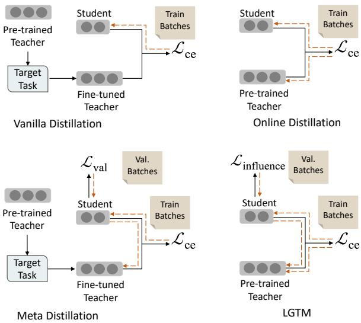
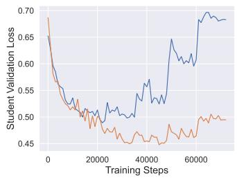
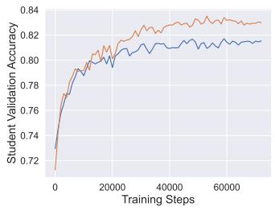
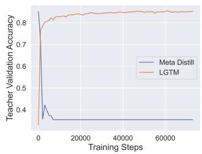
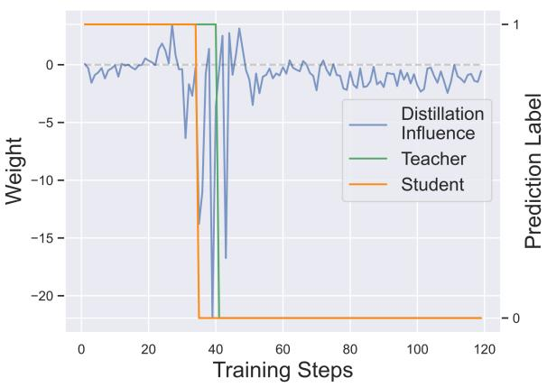
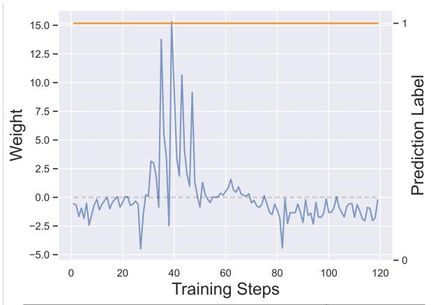
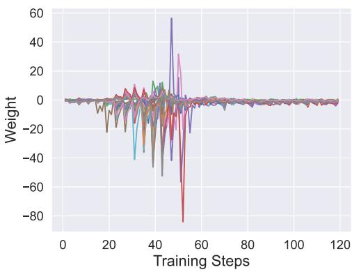
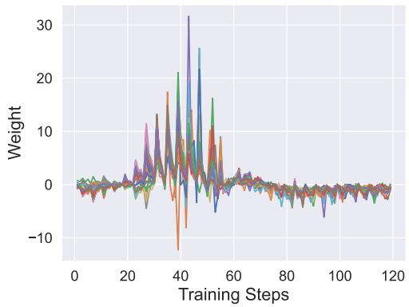
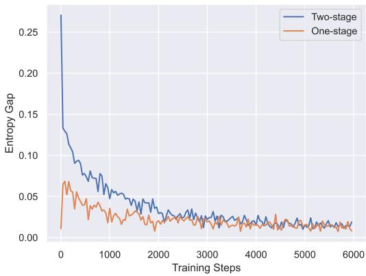
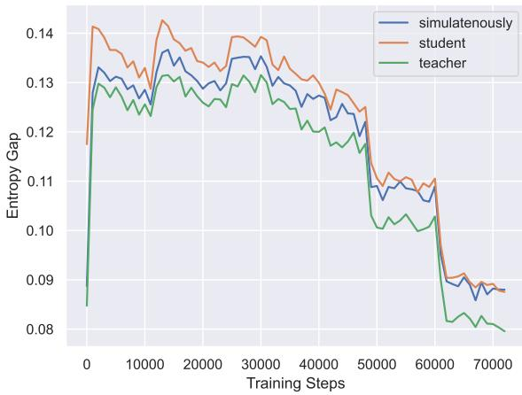

# Tailoring Instructions to Student’s Learning Levels Boosts Knowledge Distillation

Yuxin Ren1,†,∗ Zihan Zhong1,†,∗ Xingjian Shi2,† Yi Zhu2,† Chun Yuan1 Mu Li2,†

1Tsinghua University, 2Boson AI

{ryx20,zhongzh22}@mails.tsinghua.edu.cn, {xingjian,yi,mu}@boson.ai yuanc@sz.tsinghua.edu.cn

## Abstract

It has been commonly observed that a teacher model with superior performance does not necessarily result in a stronger student, highlighting a discrepancy between current teacher training practices and effective knowledge transfer. In order to enhance the guidance of the teacher training process, we introduce the concept of distillation influence to determine the impact of distillation from each training sample on the student’s generalization ability. In this paper, we propose Learning Good Teacher Matters (LGTM), an efficient training technique for incorporating distillation influence into the teacher’s learning process. By prioritizing samples that are likely to enhance the student’s generalization ability, our LGTM outperforms 10 common knowledge distillation baselines on 6 text classification tasks in the GLUE benchmark. 1

## 1 Introduction

The recent success of natural language processing (NLP) is driven by the adoption of large-scale pretrained language models (Devlin et al., 2019; Liu et al., 2019; Dai et al., 2019; Yang et al., 2019). As these models are scaling up in depth and width, they become increasingly computational and storage intensive, making deployment difficult. To address this issue, different methods have been proposed for crafting efficient models with minimal loss in performance, such as weight pruning (Fan et al., 2019; Li et al., 2021a), network quantization (Kim et al., 2021; Zhang et al., 2020), and knowledge distillation (KD) (Sun et al., 2019; Tang et al., 2019; Sun et al., 2020). Among these methods, KD has proven to be effective in various NLP applications (Jiao et al., 2020) and is widely adopted. The idea of KD involves asking a lightweight student model to mimic the output of a large teacher model so as to transfer the knowledge.

Ideally, a teacher with better performance should be able to transfer more knowledge to the student. Therefore in most knowledge distillation algorithms, the teacher network is trained to maximize its own performance. However, multiple studies (Wang et al., 2022a; Cho and Hariharan, 2019) have observed that a teacher with higher performance does not necessarily lead to a betterperforming student, and may even cause a performance degradation. Stanton et al. (2021) has attributed this inefficiency in knowledge distillation to challenges during optimization. As the model capacity gap between the student and the teacher increases, the optimization process becomes more likely to be trapped in local optima (Cho and Hariharan, 2019; Mirzadeh et al., 2020).

One way to address the performance degradation in KD is to update the teacher via feedback from student’s performance, also known as learning to teach (L2T) (Fan et al., 2018; Zhou et al., 2022). L2T allows the teacher model to adjust its “teaching agenda” by interacting with the student. Among the L2T algorithms, online distillation (Zhang et al., 2018; Zhu et al., 2018; Shi et al., 2020) trains the student and teacher concurrently and enforces similarity between their outputs on the training set. However, online distillation focuses on transferring the knowledge of the teacher to the student on training set without explicitly considering how well the student will perform on validation set. On the other hand, meta distillation (Zhou et al., 2022; Pham et al., 2021) takes the generalization ability of student on the held-out validation set into account, and guides the teacher’s learning process to maximize the generalization ability. However, the optimization objective of meta distillation may result in a degraded teacher model, as it only receives supervision from the student model.

It is well-known that humans are more efficient learners when their teachers provide guidance on the level of attention they should devote to certain problems based on their current knowledge. Similarly, it is possible that a student model could be trained more effectively if it receives such guidance from a teacher. To accomplish this goal, the teacher should prioritize samples that are likely to enhance the student’s generalization ability during training, thus allowing the student to perform better on the held-out validation set.

In this work, inspired by the concept of influence function (Pruthi et al., 2020; Koh and Liang, 2017), we propose distillation influence to estimate how distilling on each training sample impacts the student’s performance on the validation set. In addition, we are able to interpret existing L2T methods from the perspective of influence function, so as to gain a deeper understanding of their limitations. The optimization process of existing L2T methods are often impacted by outliers, because they assign all training samples in the mini-batch the same weight. Hence, we propose our L2T framework, Learning Good Teacher Matters (LGTM), which assigns loss weights of the training samples based on their distillation influence.

Extensive experiments have shown that LGTM enables more effective knowledge transfer.

In summary, our contributions are as follows:

1. We propose distillation influence to quantify how distilling from each training sample impacts the student’s generalization ability.

2. We introduce finite difference approximation to efficiently incorporate distillation influence into the teacher’s learning process.

3. Comparing to 10 common KD baselines, our proposed LGTM demonstrates consistently better performance on 6 text classification tasks in GLUE benchmark.

## 2 Notations

Suppose we have a teacher model denoted as $T ( \cdot ; \theta _ { t } )$ and a student model denoted as $S ( \cdot ; \theta _ { s } )$ The corresponding model parameters are $\theta _ { t }$ and $\theta _ { s }$ $\eta _ { t }$ and $\eta _ { s }$ are the learning rates adopted for model update. We use t and $| s |$ to denote the dimensions of $\theta _ { t }$ and $\theta _ { s } , \mathrm { i . e . , } \theta _ { t } \in \mathbb { R } ^ { | t | \times 1 }$ and $\theta _ { s } \in \mathbb { R } ^ { | s | \times 1 }$ . The time step before and after model parameter updates are denoted as m and $m + 1$ , respectively. It is used to track the evolution of the model parameters during the training process.

  
Figure 1: Comparison of vanilla distillation, online distillation, meta distillation and our proposed LGTM. The dotted orange lines show the direction of the gradient flow for model update. Note that vanilla distillation and meta distillation employ a two-stage training pipeline by first fine-tuning the teacher on the target task. Online distillation and LGTM employ a one-stage joint training strategy for both teacher and student.

Given a labeled training dataset $\mathbb { D } _ { \operatorname { t r a i n } } .$ , a batch of $B ^ { r }$ training samples and their corresponding labels are referred to as $\pmb { z } ^ { r } = ( \pmb { x } ^ { r } , \pmb { y } ^ { r } )$ , where r indicates training. We index each sample in the training batch $z ^ { r } { \mathrm { ~ a s ~ } } z _ { i } ^ { r }$ . Similarly for validation dataset $\mathbb { D } _ { \mathrm { v a l } }$ , we define the batch of samples as $\pmb { z } ^ { e } = ( \pmb { x } ^ { e } , \pmb { y } ^ { e } )$ , where e indicates validation.

In addition, we introduce the notation of the Jacobian matrix in the context of working with the chain rule and gradient. In particular, let $f :$ $\mathbb { R } ^ { k } \to \mathbb { R } ^ { n }$ be a differentiable function, and let ${ \pmb v } \in$ $\mathbb { R } ^ { k }$ be a vector. We use the notation $\frac { \partial f } { \partial \boldsymbol { v } } \in \mathbb { R } ^ { k \times n }$ to represent the Jacobian matrix of $f _ { - }$ , which has dimensions $k \times n$ . For simplicity, we annotate $\frac { \partial f } { \partial \mathbf { \boldsymbol { v } } }$ as $\nabla _ { v }$ . We use $X ^ { \intercal }$ to denote the transpose of the matrix $X$

## 3 Revisiting Learning to Teach

In this paper, we focus on task-specific distillation given pre-trained language models. Under this setting, the teacher model is already pre-trained in an unsupervised manner and the student model is either derived from part of the teacher model or pre-trained in an unsupervised manner as well.

Vanilla distillation The typical approach to knowledge distillation is a two-stage process. It involves first fine-tuning a pre-trained teacher model to maximize its performance on a specific task. Once the teacher model has converged, a student model is trained to closely imitate the output of the teacher model on the training data. The optimization objective for the student model at each mini-batch is:

$$
\begin{array} { r } { \mathcal { L } _ { \mathrm { s } } ( \boldsymbol { \theta } _ { s } , \boldsymbol { \theta } _ { t } , \boldsymbol { z } ^ { r } ) = \alpha \mathcal { L } _ { \mathrm { c e } } ( \boldsymbol { y } ^ { r } , S ( \boldsymbol { x } ^ { r } ; \boldsymbol { \theta } _ { s } ) ) } \\ { + ( 1 - \alpha ) \mathcal { L } _ { \mathrm { c e } } ( T ( \boldsymbol { x } ^ { r } ; \boldsymbol { \theta } _ { t } ) , S ( \boldsymbol { x } ^ { r } ; \boldsymbol { \theta } _ { s } ) ) . } \end{array}\tag{1}
$$

The update of the student follows:

$$
\begin{array} { r } { \theta _ { s } ^ { m + 1 } = \theta _ { s } ^ { m } - \eta _ { s } \nabla _ { \theta _ { s } } \mathcal { L } _ { s } ( \theta _ { s } ^ { m } , \theta _ { t } ^ { m } , z ^ { r } ) . } \end{array}\tag{2}
$$

The limitation of vanilla distillation is that it does not allow teacher to adjust its behavior according to student’s feedback, as the teacher’s parameters are fixed during the distillation process.

Online distillation To achieve student-aware distillation, online distillation (Zhang et al., 2018; Zhu et al., 2018; Shi et al., 2020) is proposed which involves the simultaneous fine-tuning of both the student and teacher models in one-stage.

In addition to minimizing the cross-entropy loss with respect to the ground truth labels, the target distribution of the teacher model is constrained to be close to that of the student model through the minimization of the cross-entropy loss between the outputs of the teacher and student models:

$$
\begin{array} { r } { \mathcal { L } _ { \mathrm { t } } ( \theta _ { t } , \theta _ { s } , z ^ { r } ) = \alpha \mathcal { L } _ { \mathrm { c e } } ( { \pmb y } ^ { r } , T ( { \pmb x } ^ { r } ; \theta _ { t } ) ) } \\ { + ( 1 - \alpha ) \mathcal { L } _ { \mathrm { c e } } ( T ( { \pmb x } ^ { r } ; \theta _ { t } ) , S ( { \pmb x } ^ { r } ; \theta _ { s } ) ) . } \end{array}\tag{3}
$$

The training process involves iteratively updating the parameters of both models:

$$
\begin{array} { r l } & { { \theta } _ { t } ^ { m + 1 } = { \theta } _ { t } ^ { m } - \eta _ { t } \nabla _ { { \theta } _ { t } } \mathcal { L } _ { t } ( { \theta } _ { t } ^ { m } , { \theta } _ { s } ^ { m } , z ^ { r } ) } \\ & { { \theta } _ { s } ^ { m + 1 } = { \theta } _ { s } ^ { m } - \eta _ { s } \nabla _ { { \theta } _ { s } } \mathcal { L } _ { s } ( { \theta } _ { s } ^ { m } , { \theta } _ { t } ^ { m + 1 } , z ^ { r } ) . } \end{array}\tag{4}
$$

Through iterative update, the student model is able to learn from the learning curve of the teacher model (Shi et al., 2020), which improves its performance on the given task.

However, online distillation focuses on transferring the knowledge of the teacher to the student on training set without explicitly considering how well the student model will perform on unseen test data. This might lead to the student model only memorizing the training examples without generalizing well to new ones (Zhou et al., 2022).

Meta distillation Meta distillation (Zhou et al., 2022; Pham et al., 2021) is a technique that takes into account the feedback from the student model and guides the optimization of the teacher model to maximize the generalization ability of the student. The generalization error of the student model is measured by the cross-entropy loss computed between the ground truth labels and the predictions of the student model on the validation set:

$$
\mathcal { L } _ { \mathrm { v a l } } ( \theta _ { s } , z ^ { e } ) = \mathcal { L } _ { \mathrm { c e } } ( y ^ { e } , S ( \pmb { x } ^ { e } , \theta _ { s } ) ) .\tag{5}
$$

Meta distillation decomposes models’ learning process into two stages. The first stage is to finetune a good teacher on task-specific data similar to vanilla distillation, while the second stage involves iterative update of the teacher and student models. Note that compared to online distillation, meta distillation obtains the student feedback from validation data, not training data.

During the second stage, the student model is first updated through the standard distillation process by minimizing the distillation loss in eq. (1). Then the teacher model is optimized to minimize the updated student’s loss on the held-out validation set, which ensures it is able to guide the student towards better generalization. During this process, the teacher is only trained for the purpose of knowledge transfer. Formally, the student model is updated as follows:

$$
\begin{array} { r } { \theta _ { s } ^ { m + 1 } = \theta _ { s } ^ { m } - \eta _ { s } \nabla _ { \theta _ { s } } \mathcal { L } _ { s } ( \theta _ { s } ^ { m } , \theta _ { t } ^ { m } , z ^ { r } ) . } \end{array}\tag{6}
$$

The teacher model is then updated as follows:

$$
\theta _ { t } ^ { m + 1 } = \theta _ { t } ^ { m } - \eta _ { t } \nabla _ { \theta _ { t } } \mathcal { L } _ { \mathrm { v a l } } ( \theta _ { s } ^ { m + 1 } , z ^ { e } ) ,\tag{7}
$$

However, the optimization objective of meta distillation can result in a degraded teacher model because it only receives supervision from the student. This will prevent the teacher model from continuing to learn and improve in the second stage, thus impeding its ability to adapt to new data.

## 4 Methods

To overcome the aforementioned limitations, we introduce our L2T framework, Learning Good Teacher Matters (LGTM) to enable more effective knowledge distillation. We first introduce distillation influence, which estimates how much will the student’s performance on validation data change if we put one training sample in the knowledge distillation process.

Afterwards, we introduce an efficient training method based on finite difference approximation for incorporating distillation influence into the teacher’s update. Finally, we interpret current L2T methods from the perspective of influence function.

Distillation influence Influence function (Pruthi et al., 2020; Koh and Liang, 2017) is a way of measuring the influence of training samples on the model’s predictions. It can be utilized to identify instances that have a disproportionate effect on the model’s behavior, whether due to their status as outliers or due to incorrect labeling (Jia et al., 2019; Ghorbani and Zou, 2019; Hara et al., 2019). By calculating the influence function for a particular example, it is possible to estimate the extent to which the model’s prediction would be altered as a result of operations on that sample.

In vanilla distillation, for the student model, we derive the distillation influence of $\boldsymbol { z } _ { i } ^ { r }$ as the gradient similarity between the training sample $\boldsymbol { z } _ { i } ^ { r }$ and the validation batch $z ^ { e }$ :

$$
\begin{array} { r l } & { \mathcal { T } _ { \mathrm { d i s t i l l } } ( z _ { i } ^ { r } , z ^ { e } ) = \nabla _ { \theta _ { s } } \mathcal { L } _ { \mathrm { c e } } ( T ( \pmb { x } _ { i } ^ { r } ; \theta _ { t } ^ { m } ) , S ( \pmb { x } _ { i } ^ { r } ; \theta _ { s } ^ { m } ) ) ^ { \intercal } } \\ & { \qquad \nabla _ { \theta _ { s } } \mathcal { L } _ { \mathrm { c e } } ( \pmb { y } ^ { e } , S ( \pmb { x } ^ { e } ; \theta _ { s } ^ { m + 1 } ) ) } \end{array}\tag{8}
$$

The detailed derivation can be found in appendix $\mathrm { A }$ The influence reflects how well the knowledge gained from a particular sample generalizes. It follows that the teacher should focus on teaching the student to capture training samples that have the highest distillation influences.

In order to incorporate the per-sample influence into knowledge distillation, we adjust the loss weight of each sample based on its distillation influence. This allows us to determine the relative importance of each sample, and helps to control how much each sample contributes to the teacher’s learning process. Samples that are deemed to be more beneficial for the student’s generalization are assigned higher weights. Then we propose training the teacher using the following objective:

$$
\mathcal { L } _ { \mathrm { i n f l u e n c e } } = \frac { 1 } { B ^ { r } } \sum _ { i = 1 } ^ { B ^ { r } } w _ { i } \mathcal { L } _ { \mathrm { c e } } ( ( T ( \pmb { x } _ { i } ^ { r } ; \theta _ { t } ^ { m } ) , S ( \pmb { x } _ { i } ^ { r } ; \theta _ { s } ^ { m } ) ) ,\tag{9}
$$

where $w _ { i } = \mathcal { T } _ { \mathrm { d i s t i l l } } ( z _ { i } ^ { r } , z ^ { e } )$ . By including the influence in the knowledge distillation loss function, we can tailor the training process to better suit the characteristics of the target task.

Algorithm 1 LGTM   
Require: student $\theta _ { s } .$ , teacher $\theta _ { t } ,$ training set $\mathbb { D } _ { \mathrm { t r a i n } }$ , validation   
set $\mathbb { D } _ { \mathrm { v a l } }$   
Require: $\eta _ { s } , \eta _ { t } \colon$ learning rate for the student and the teacher   
Require: ϵ: a small scalar   
Require: $M \colon$ the maximum number of the training steps   
1: while step $< M$ do   
2: Sample a batch of training set $\begin{array} { r } { z ^ { r } = ( \pmb { x } ^ { r } , \pmb { y } ^ { r } ) \sim \mathbb { D } _ { \mathrm { t r a i n } } } \end{array}$   
3: Copy student parameter $\bar { \theta } _ { s } \ \mathrm { t o }$ student $\theta _ { s } ^ { \prime }$   
4: Update $\theta _ { s } ^ { \prime } \colon { \theta _ { s } ^ { \prime } } ^ { \cdot }  \theta _ { s } - \eta _ { s } \nabla _ { \theta _ { s } ^ { \prime } } \mathcal { L } _ { s } ( \theta _ { s } ^ { \prime } , \theta _ { t } , z ^ { r } )$   
5: Sample a batch of validation set $\pmb { z } ^ { e } = ( \pmb { x } ^ { e } , \pmb { y } ^ { e } )$   
$\ J \perp \hat { \mathbb { D } } _ { \mathrm { v a l } }$   
6: Calculate $\theta _ { s } ^ { \pm } \colon \theta _ { s } ^ { \pm } = \theta _ { s } \pm \epsilon \mathcal { L } _ { \mathrm { c e } } ( y ^ { e } , S ( { \pmb x } ^ { e } ; \theta _ { s } ^ { \prime } ) )$   
7: Calculate the Distillation Influence with $z ^ { r } , \theta _ { t } ,$   
$\theta _ { s } ^ { \pm }$ and ϵ: Linfluence ▷ eq. (10)   
8: Update $\theta _ { t } \colon \theta _ { t } \gets \theta _ { t } - \eta _ { t } \nabla _ { \theta _ { t } } \mathcal { L } _ { t } ( \theta _ { t } , \theta _ { s } , z ^ { r } )$ ▷ eq. (11)   
9: Update original $\theta _ { s } \colon \theta _ { s } \gets \bar { \theta _ { s } } - \dot { \eta } _ { s } \nabla _ { \theta _ { s } } \mathcal { L } _ { s } ( \theta _ { s } , \bar { \theta _ { t } } , z ^ { r } )$   
10: $s t e p \gets s t e p + 1$   
11: end while

Finite difference approximation For standard neural network training, we often compute a consolidated gradient for a mini-batch of $B ^ { r }$ training samples to enhance computational efficiency. However, in the context of determining the distillation influence for each sample, the computation of per-sample gradient $\mathcal { L } _ { \mathrm { c e } } ( T ( \pmb { x } _ { i } ^ { r } ; \theta _ { t } ^ { m } ) , S ( \pmb { x } _ { i } ^ { r } ; \theta _ { s } ^ { m } ) )$ will slow down the training by a factor of $B ^ { r }$ In addition, a naive implementation is memory intensive, because it requires to keep a copy of $\nabla _ { \theta _ { s } } \mathcal { L } _ { \mathrm { c e } } ( \pmb { y } ^ { e } , S ( \pmb { x } ^ { e } ; \theta _ { s } ^ { m + 1 } ) )$ .

To address this, we propose an efficient method for updating the teacher with the distillation influence by utilizing finite difference (Gleich, 2005), a technique commonly used in numerical analysis for approximating the derivative of a function at a given point. Similar to (Pham et al., 2021; Liu et al., 2018), we approximate $\mathcal { L } _ { \mathrm { i n f l u e n c e } }$ by

$$
\begin{array} { r l r } & { } & { \mathcal { L } _ { \mathrm { i n f l u e n c e } } \approx \hat { \mathcal { L } } _ { \mathrm { i n f l u e n c e } } = \displaystyle \frac { 1 } { B ^ { r } } \sum _ { i = 1 } ^ { B ^ { r } } \bigg [ \frac { \mathcal { L } _ { \mathrm { c e } } ( T ( x _ { i } ; \theta _ { t } ^ { m } ) , S ( x _ { i } ; \theta _ { s } ^ { + } ) ) } { 2 \epsilon } } \\ & { } & { \qquad - \frac { \mathcal { L } _ { \mathrm { c e } } ( T ( x _ { i } ; \theta _ { t } ^ { m } ) , S ( x _ { i } ; \theta _ { s } ^ { - } ) ) } { 2 \epsilon } \bigg ] , } \end{array}\tag{10}
$$

where $\theta _ { s } ^ { \pm } = \theta _ { s } \pm \epsilon \mathcal { L } _ { \mathrm { c e } } ( y ^ { e } , S ( { \pmb x } ^ { e } ; \theta _ { s } ^ { m + 1 } ) )$ and ϵ is a small scalar. Our proposed method for evaluating the finite difference is computationally efficient, as it only requires two forward passes for $\theta _ { s }$ and one backward pass for $\theta _ { t }$ for a single batch, as opposed to a naive implementation which requires $B ^ { r }$ forward and backward passes for $\theta _ { s }$ and one backward pass for $\theta _ { t }$ . We provide more details of the derivation in appendix B.

Teacher’s auxiliary loss Inspired by (Pham et al., 2021), in order to balance the trade-off between self-evolution and transferability of the teacher model, we incorporate the loss with respect to the ground truth as $\mathcal { L } _ { \mathrm { a u x } }$ into the final objective:

  
(a)

  
(b)

  
(c)  
Figure 2: Performance comparison between Meta Distill (Zhou et al., 2022) and LGTM on the MNLI validation set. We observe that for LGTM, student model does not suffer from overfitting (thanks to distillation influence), and the teacher can balance its own evolution and effective knowledge transfer (thanks to auxiliary loss).

$$
\begin{array} { r l } { \mathcal { L } _ { \mathrm { t } } ( \theta _ { t } \mid \theta _ { s } , z ^ { r } ) = } & { \hat { \mathcal L } _ { \mathrm { i n f l u e n c e } } + \mathcal L _ { \mathrm { a u x } } , } \\ { \mathcal { L } _ { \mathrm { a u x } } = } & { \alpha \mathcal L _ { \mathrm { c e } } ( y ^ { r } , T ( { \pmb x } ^ { r } ; \theta _ { t } ) ) + } \\ & { ( 1 - \alpha ) \mathcal L _ { \mathrm { c e } } ( T ( { \pmb x } ^ { r } ; \theta _ { t } ) , S ( { \pmb x } ^ { r } ; \theta _ { s } ) ) } \end{array}
$$

where α is the loss ratio.

(11)

Overall, our method allows the teacher to adapt to the student’s abilities and provide more personalized guidance while improving the student’s generalization capability. We present the algorithm of LGTM in algorithm 1.

Relationship with other L2T methods Here we interpret current learning to teach methods from the perspective of influence function.

In the case of online distillation, it is assumed that all training samples possess an equivalent distillation influence and that the teacher model is responsible for reducing the transfer difficulty of all training samples.

In contrast, the key differentiating factor between meta distillation and online distillation is the utilization of a dynamic loss weight. We interpret this weight as a measure of the distillation influence of the current training batch $z ^ { r }$ on the generalization ability of the student model. Specifically, it reflects the similarity between the gradients of the training and validation batches, indicating the effect of the current training batch $z ^ { r }$ on the validation batch $z ^ { e }$ (as detailed in appendix C). However, it should be noted that this weight functions primarily as an adaptive learning rate, adjusting the gradient step proportionally to the degree of similarity in gradients. We illustrate the general workflow of vanilla distillation, online distillation, meta distillation and LGTM in fig. 1.

## 5 Experiments

In this section, we first describe our experiment setup including datasets and baselines in Sec. 5.1. Then we compare our proposed LGTM to meta distillation to gain some basic understanding of how to incorporate the student’s feedback in Sec. 5.2. To further verify the effectiveness of our method, in Sec. 5.3 we compare to 10 widely adopted knowledge distillation baselines and show consistently better results. Then we demonstrate how distillation influence works in Sec. 5.4, followed by ablation studies of LGTM in Sec. 5.5.

## 5.1 Experimental Setup

Datasets We evaluate our proposed approach on text classification tasks in GLUE (Wang et al., 2018): MRPC (Dolan and Brockett, 2005), RTE (Wang et al., 2018), SST-2 (Socher et al., 2013), MNLI (Williams et al., 2018), QNLI (Rajpurkar et al., 2016) and QQP (Chen et al., 2018). For MRPC and QQP, we report both F1 and accuracy. And for other datasets, we report accuracy.

Baselines We compare our LGTM with 10 baselines: 1) KD (Hinton et al., 2015) 2) PKD (Sun et al., 2019) 3) SKD (Guo et al., 2022) 4) DIST (Huang et al., 2022) 5) TAKD (Mirzadeh et al., 2020) 6) RCO (Jin et al., 2019) 7) DML (Zhang et al., 2018) 8) ProKT (Shi et al., 2020) 9) PESF-KD (Rao et al., 2022) and 10) Meta Distill (Zhou et al., 2022).

Training setup Following previous works (Sun et al., 2019; Zhou et al., 2022), we distill BERT-Base (Devlin et al., 2019) to a 6-layer BERT model. For all two-stage baselines, we fine-tune the models on each task. For fair comparison, both Meta Distill and LGTM utilize feedback from the validation set in the calculation of the distillation loss.

<table><tr><td>Model</td><td>MRPC F1/Acc.</td><td>RTE Acc.</td><td>SST-2 Acc.</td><td>MNLI Acc.</td><td>QNLI Acc.</td><td>QQP F1/Acc.</td><td>Avg.</td></tr><tr><td>Teacher</td><td>89.0/85.2</td><td>69.5</td><td>93.2</td><td>84.3/83.9</td><td>91.1</td><td>71.5/89.2</td><td>84.2</td></tr><tr><td>BERT-Base (Devlin et al., 2019)</td><td></td><td></td><td></td><td></td><td></td><td></td><td></td></tr><tr><td>Student (BERT-6L)</td><td>86.7/81.4</td><td>64.7</td><td>91.2</td><td>81.6/80.8</td><td>89.0</td><td>70.4/88.7</td><td></td></tr><tr><td>KD (Hinton et al., 2015) PKD (Sun et al., 2019)</td><td>85.0/79.9</td><td>65.5</td><td>92.0</td><td>81.5/81.0</td><td>89.0</td><td>70.7/88.9</td><td>81.6 81.7</td></tr><tr><td>SKD (Guo et al., 2022)</td><td>84.6/78.4</td><td>65.1</td><td>92.2</td><td>81.2/80.2</td><td>87.2</td><td>69.8/88.4</td><td>81.0</td></tr><tr><td>DIST (Huang et al., 2022)</td><td>85.8/79.8</td><td>65.0</td><td>90.9</td><td>81.8/80.7</td><td>88.0</td><td>70.2/88.6</td><td>81.2</td></tr><tr><td>TAKD (Mirzadeh et al., 2020)</td><td>82.4/81.7</td><td>64.1</td><td>92.5</td><td>82.4/81.7</td><td>89.4</td><td>70.6/88.8</td><td>81.6</td></tr><tr><td>RCO (Jin et al., 2019)</td><td>86.8/81.4</td><td>65.1</td><td>91.5</td><td>82.3/81.2</td><td>87.8</td><td>70.4/89.2</td><td>81.7</td></tr><tr><td>DML (Zhang et al., 2018)</td><td>87.5/82.8</td><td>64.1</td><td>92.4</td><td>82.6/81.6</td><td>89.5</td><td>70.7/88.7</td><td>82.2</td></tr><tr><td>ProKT (Shi et al., 2020)</td><td>87.1/82.3</td><td>65.3</td><td>93.0</td><td>82.9/82.2</td><td>89.5</td><td>71.0/89.1</td><td>82.5</td></tr><tr><td>PESF-KD (Rao et al., 2022)</td><td>86.0/80.6</td><td>65.1</td><td>91.5</td><td>81.5/80.6</td><td>87.6</td><td>70.3/88.7</td><td>81.3</td></tr><tr><td>Meta Distill (Zhou et al., 2022)</td><td>85.2/79.5</td><td>65.6</td><td>92.9</td><td>82.4/81.4</td><td>88.9</td><td>70.1/88.5</td><td>81.8</td></tr><tr><td>LGTM</td><td>88.1/83.3</td><td>67.4</td><td>93.4</td><td>83.4/82.5</td><td>90.2</td><td>71.7/89.3</td><td>83.4</td></tr></table>

Table 1: Experimental results on the test set of GLUE (from the official test server). We bold the best results for each dataset, as well as the final average accuracy. Following (Zhou et al., 2022), the student is initialized with a 6-layer pre-trained BERT (Turc et al., 2019). We can see that LGTM outperforms all 10 baselines.

Detailed training hyperparameters can be found in appendix D.

## 5.2 Comparison with Meta Distillation

Given our proposed LGTM is closely related to the meta distillation line of work, here we first conduct a comparison between LGTM and a specific meta distillation method, Meta Distill (Zhou et al., 2022), to demonstrate the benefit of adopting distillation influence.

We observe that for Meta Distill (blue curve) in fig. 2 (a) and (b), the validation loss of the student model gradually increases in later iterations while the validation accuracy keeps improving until a stable plateau. This clearly indicates that the student model is experiencing overfitting. One possible explanation is that excessive emphasis is placed on certain training samples that generate high loss, e.g., hard samples or outliers. This negatively impacts the generalization ability of the student model, which leads to overfitting.

The key difference between Meta Distill and our LGTM (orange curve) is that LGTM accounts for the per-sample distillation influence while Meta Distill treats all training samples in a batch equally. This enables the filtering of samples that have a detrimental effect on generalization performance of the student model, leading to a steady decrease of validation loss (fig. 2 (a)) and an improved validation accuracy (fig. 2 (b)).

In terms of teacher model, it should not only impart their current knowledge to the student, but also actively seek out new information and perspectives to improve their own understanding. As can be seen in fig. 2 (c), LGTM allows for the effective transfer of knowledge from the teacher model by incorporating the teacher auxiliary loss. The validation accuracy of the teacher model keeps improving for LGTM, but drops quickly for Meta Distill.

## 5.3 Main Results

Here we show the results of our proposed method on the test set of text classification tasks in GLUE benchmark. As can be seen in table 1, LGTM outperforms all 10 baselines including recent strong KD methods (Guo et al., 2022; Huang et al., 2022; Rao et al., 2022; Zhou et al., 2022), which highlights the effectiveness of our method.

To be more specific, our proposed method achieves state-of-the-art performance in comparison to those rely on carefully designed training pipelines or loss functions, e.g., PKD (Sun et al., 2019), SKD (Guo et al., 2022) and DIST (Huang et al., 2022). PKD proposes two distillation schemes, to enable the student to learn from multiple intermediate layers of the teacher model for incremental knowledge extraction. SKD and DIST both modify the form of KL-divergence loss to narrow the gap between the teacher and student models. LGTM also does not require a series of teacher assistant models as TAKD (Mirzadeh et al., 2020) and RCO (Jin et al., 2019).

Compared to online distillation methods, LGTM performs better than DML (Zhang et al., 2018), ProKT (Shi et al., 2020) and PESF-KD (Rao et al., 2022). This highlights the importance of incorporating student’s feedback during the training process. An overemphasis on knowledge transfer from the training set may lead to the student overfitting the teacher’s outputs, resulting in a reduction in its generalization abilities.

<table><tr><td></td><td>Sentence Pair</td><td>Label</td></tr><tr><td>(a) (b)</td><td>Graves reported from albuquerque, villafranca from austin and ratcliffe from laredo. Pete slover reported from laredo and gromer jeffers</td><td>0 (not equivalent)</td></tr></table>

<table><tr><td></td><td>Sentence Pair</td><td>Label</td></tr><tr><td>(a) (b)</td><td>Trading in loral was halted yesterday ; the shares closed on monday at $ 3. 01. The new york stock exchange suspended trading</td><td>1 (equivalent)</td></tr></table>

  
Figure 3: We select two samples in the MRPC dataset to visualize their trends of the distillation influence during training. We also visualize the relationship between the distillation influence and the predictions from the student and the teacher. Left: our method assigns negative weight to a potential difficult sample, which helps avoid overfitting. Right: our method assigns positive weight to a potential easy sample, which encourages model learning.

Furthermore, unlike meta distillation methods, e.g., Meta Distill (Zhou et al., 2022), our method allows for computing distillation influence of individual training samples, which enables filtering out samples that may hurt student’s generalization. Therefore, LGTM is able to help the student to develop general understanding of the overall task while alleviate the overfitting issue.

## 5.4 Analysis of Distillation Influence

We further explore the trend of the distillation influence of samples during the real training process. Here, we conduct experiments on the MRPC dataset. The task is to predict whether the sentences in a sentence pair are semantically equivalent (Wang et al., 2018).

First, we select two representative samples presented in fig. 3 to visualize the trend of the distillation influence and its relationship between the teacher’s and the student’s prediction.

On the left-side of fig. 3, we can see that during the initial stages of training, both the teacher (green) and the student (orange) have made wrong predictions. It might suggest that this sample poses a significant challenge for both models to learn. In this case, we do not want student model to mimic the output from teacher models too much because teacher model is also wrong about this sample. Our method is able to gradually adjust the loss weight to negative, indicating we will filter out this misleading training sample for now to make both models learn faster. As a result, the student model first escapes this predicament. Then through student feedback on the validation set, the teacher model also learns to make the correct prediction. Finally as training progresses, it is observed that both the student and the teacher are able to correctly classify this sample, resulting in the distillation influence stabilizing at a near-zero value.

We present another example in fig. 3 right, where both the student and the teacher are able to accurately predict a given sample. It might suggest this sample is too easy for the teacher and the student. In this case, we want to give this sample a high positive weight to form a student-friendly decision boundary. This is similar to design a curriculum to learn from easy samples to hard ones in curriculum learning (Soviany et al., 2022).

We also visualize an average trend of distillation influence in fig. 4, based on 64 samples that are randomly chosen from MRPC. We observe that the distillation influence is usually insignificant in the beginning and end of the training, but fluctuates in the middle. This is reasonable since our method is assigning varying weights to each sample during training, with the goal of filtering difficult samples and focusing on samples better for generalization.

  
Figure 4: We visualize the trend of the distillation influence from 64 random samples in the MRPC dataset. We find that whether assigning positive or negative weight, the trend is similar. Distillation influence is usually insignificant in the beginning and end of the training, but fluctuates in the middle. We hypothese this is because our method is assigning varying weights to each sample during training, with the goal of filtering difficult samples and focusing on samples better for generalization.

## 5.5 Ablation Study

Given limited space, we present three studies in this section and show more ablation studies in appendix E.

Finite difference approximation Recall in section 4, we introduce finite difference approximation (FDA) for estimating the distillation influence of each sample. It is designed to address the slowness of computing per-sample gradients. As shown in table 3, here we conduct an ablation experiment on the MRPC dataset to evaluate its usefulness. We show that with FDA, our method only requires 11 minutes to complete the training, while the naive training without FDA requires 117 minutes. Such a significant reduction in training time (i.e., more than 10 speedup) highlights the computational efficiency of the proposed FDA technique. Furthermore, we assess the performance on the validation set of the MRPC dataset and observe that training with FDA result in an F1 score of 90.4, while training without FDA resulted in a score of 90.7. There is only a slight drop in performance with the approximation.

<table><tr><td>Model</td><td>MRPC F1/Acc.</td><td>RTE Acc.</td><td>SST-2 Acc.</td><td>MNLI Acc.</td><td>QNLI Acc.</td><td>QQP F1/Acc.</td><td>Avg.</td></tr><tr><td>Teacher</td><td></td><td></td><td></td><td></td><td></td><td></td><td></td></tr><tr><td>BERT-Base (Devlin et al., 2019)</td><td>89.0/85.2</td><td>69.5</td><td>93.2</td><td>84.3/83.9</td><td>91.1</td><td>71.5/89.2</td><td>85.4</td></tr><tr><td>Student (BERT-6L)</td><td></td><td></td><td></td><td></td><td></td><td></td><td></td></tr><tr><td>DIST (Huang et al., 2022)</td><td>85.8/79.8</td><td>65.0</td><td>90.9</td><td>81.8/80.7</td><td>88.0</td><td>70.2/88.6</td><td>81.2</td></tr><tr><td>LGTM (w. DIST)</td><td>88.3/83.5</td><td>67.7</td><td>91.7</td><td>82.5/80.8</td><td>90.4</td><td>71.0/88.9</td><td>82.9</td></tr><tr><td>Student (BERT-6L)</td><td></td><td></td><td></td><td></td><td></td><td></td><td></td></tr><tr><td>MSE</td><td>85.7/80.1</td><td>65.1</td><td>91.3</td><td>82.0/81.6</td><td>88.7</td><td>71.3/89.0</td><td>81.7</td></tr><tr><td>LGTM (w. MSE)</td><td>88.1/83.7</td><td>65.8</td><td>92.4</td><td>82.5/80.8</td><td>89.9</td><td>71.6/89.2</td><td>82.7</td></tr></table>

Table 2: Experimental results on the test set of GLUE when training with different KD objectives. Our LGTM consistently beats the original methods, which validates the compatibility of LGTM to these losses.
<table><tr><td></td><td>Training time</td><td>F1</td></tr><tr><td>LGTM w/o FDA</td><td>117min</td><td>90.7</td></tr><tr><td>LGTM w/ FDA</td><td>11min</td><td>90.4</td></tr></table>

Table 3: The comparsion of LGTM with FDA and without FDA method. While their performance are similar, LGTM with FDA is 10 faster than without it.

Distillation loss There are other distillation losses in the context of knowledge distillation. Here we want to evaluate whether LGTM can adapt to those objectives. In particular, we consider the modified loss used in DIST (Huang et al., 2022) and the common mean squared error (MSE). As can be seen in table 2, our LGTM consistently beats the original methods that utilize these distillation objectives, which validates the compatibility of LGTM to different distillation objectives.

Student model size Here we conduct experiments to evaluate the performance of our proposed method in scenarios where there is a larger capacity difference between the teacher and student models. Specifically, we perform knowledge distillation from a BERT-Base model (Devlin et al., 2019) to a 4-layer BERT model. As can be seen from table 4, LGTM consistently outperforms other baselines in most of the tasks except competitive results on SST-2. This indicates the robustness of our method which suggests its wide usage in various knowledge distillation settings.

## 6 Related Work

The core of knowledge distillation (Hinton et al., 2015) relies on how to formulate and transfer the knowledge from the teacher to student. Three key aspects are typically considered: the teacher model from which knowledge is transferred (learning target), the data on which the model is trained (learning material), and the objective function that defines the learning objective. Efforts have been made to make knowledge distillation more studentfriendly by reducing the difficulties in these aspects(Li et al., 2021b).

<table><tr><td>Model</td><td>MRPC F1/Acc.</td><td>RTE Acc.</td><td>SST-2 Acc.</td><td>MNLI Acc.</td><td>QNLI Acc.</td><td>QQP F1/Acc.</td><td>Avg.</td></tr><tr><td>Teacher</td><td></td><td></td><td></td><td></td><td></td><td></td><td></td></tr><tr><td>BERT-Base (Devlin et al., 2019)</td><td>89.0/85.2</td><td>69.5</td><td>93.2</td><td>84.3/83.9</td><td>91.1</td><td>71.5/89.2</td><td>84.2</td></tr><tr><td>Student (BERT-4L)</td><td></td><td></td><td></td><td></td><td></td><td></td><td></td></tr><tr><td>KD (Hinton et al., 2015)</td><td>85.6/79.9</td><td>63.6</td><td>90.4</td><td>80.5/79.9</td><td>87.7</td><td>70.2/88.5</td><td>80.2</td></tr><tr><td>PKD (Sun et al., 2019)</td><td>84.6/79.5</td><td>63.5</td><td>90.0</td><td>80.1/79.0</td><td>86.9</td><td>69.1/88.5</td><td>79.7</td></tr><tr><td>DIST (Huang et al., 2022)</td><td>84.3/78.6</td><td>63.6</td><td>90.1</td><td>80.3/79.4</td><td>87.6</td><td>70.1/88.5</td><td>79.8</td></tr><tr><td>SKD (Guo et al., 2022)</td><td>83.4/77.7</td><td>62.0</td><td>89.1</td><td>77.9/77.2</td><td>86.9</td><td>68.2/86.9</td><td>78.5</td></tr><tr><td>ProKT (Shi et al., 2020)</td><td>86.7/80.9</td><td>64.0</td><td>90.3</td><td>81.6/80.4</td><td>88.0</td><td>70.7/88.8</td><td>80.7</td></tr><tr><td>Meta Distill (Zhou et al., 2022)</td><td>84.6/78.8</td><td>64.8</td><td>90.9</td><td>80.5/79.2</td><td>87.5</td><td>69.7/88.4</td><td>80.2</td></tr><tr><td>LGTM</td><td>87.4/82.3</td><td>65.2</td><td>90.8</td><td>81.8/80.3</td><td>88.9</td><td>71.1/88.9</td><td>81.4</td></tr></table>

Table 4: Experimental results on the test set of GLUE. The student is initialized with a 4-layer pre-trained BERT (Turc et al., 2019). LGTM again outperforms strong baselines when the capacity gap is larger between teacher and student.

On learning target, Jin et al. (2019); Mirzadeh et al. (2020) introduce teacher assistant models of intermediate timestep or training time step respectively to narrow the gap between the teacher and student models. Park et al. (2021); Shi et al. (2020) propose updating the teacher and student jointly to make the teacher aware of the student’s state. Rao et al. (2022) trains for more timestep to smooth the distribution of the teacher for a easier transfer.

In terms of learning material, TinyBERT (Jiao et al., 2020) suggests augmenting the training data to make it more diverse. Kim et al. (2022) proposes training the student with samples that are easy for the teacher but difficult for the student. With respect to learning objective, the most common approach is to match the probabilistic prediction scores of the teacher and student models using KL-divergence. However, this can cause problems during training, leading to poor performance. Guo et al. (2022); Huang et al. (2022) propose to soft the constraint by a more tolerated loss. Pham et al. (2021); Zhou et al. (2022) propose using the student’s performance as the optimization objective for the teacher model, allowing the teacher to optimize its knowledge transfer based on feedback from the student. Wang et al. (2022b) proposes to select the appropriate knowledge to guide the optimization of the student.

## 7 Conclusion

In this paper, we first revisit several learning to teach paradigms in knowledge distillation. Then we propose distillation influence to determine how distilling from each training sample impacts the student’s generalization ability. By visualizing how the distillation influence of each sample changes during training, we can see that a simple re-weighting using distillation influence is able to help student training, e.g., reduce overfitting. Built on top of distillation influence, we propose our learning to teach framework, LGTM, that consistently outperforms existing knowledge distillation methods on text classification tasks in the GLUE benchmark.

## Limitations

Although LGTM has demonstrated superior performance in task-specific knowledge distillation, it is worth investigating the potential benefits of combining LGTM with pre-training knowledge distillation (Jiao et al., 2020; Wang et al., 2020). Additionally, while our experiments have been limited to text classification tasks, which are relatively simple for current pre-trained language models, future work should explore the application of LGTM to more complex text generation tasks.

## Ethics Statement

During the training process, the teacher and student models are initialized from pre-trained models. However, pre-trained language models are vulnerable to potential ethical and social risk as mentioned by Bommasani et al. (2021) and Weidinger et al. (2021). Therefore, the teacher and student models can be exposed to similar social risks of large language models.

## Acknowledgements

We thank Yongfei Liu and Zhengkun Zhang for their insightful discussion and the anonymous reviewers for their helpful comments. This work was supported by the National Key R&D Program of China (2022YFB4701400/4701402), SZSTC Grant (JCYJ20190809172201639, WDZC20200820200- 655001), Shenzhen Key Laboratory (ZDSYS2021- 0623092001004), and Beijing Key Lab of Networked Multimedia.

## References

Rishi Bommasani, Drew A Hudson, Ehsan Adeli, Russ Altman, Simran Arora, Sydney von Arx, Michael S Bernstein, Jeannette Bohg, Antoine Bosselut, Emma Brunskill, et al. 2021. On the opportunities and risks of foundation models. arXiv preprint arXiv:2108.07258.

Zihan Chen, Hongbo Zhang, Xiaoji Zhang, and Leqi Zhao. 2018. Quora question pairs.

Jang Hyun Cho and Bharath Hariharan. 2019. On the efficacy of knowledge distillation. In Proceedings of the IEEE/CVF international conference on computer vision, pages 4794–4802.

Zihang Dai, Zhilin Yang, Yiming Yang, Jaime G Carbonell, Quoc Le, and Ruslan Salakhutdinov. 2019. Transformer-xl: Attentive language models beyond a fixed-length context. In Proceedings of the 57th Annual Meeting ofthe Associationfor Computational Linguistics, pages 2978–2988.

Jacob Devlin, Ming-Wei Chang, Kenton Lee, and Kristina Toutanova. 2019. BERT: pre-training of deep bidirectional transformers for language understanding. In NAACL-HLT (1), pages 4171–4186. Association for Computational Linguistics.

William B. Dolan and Chris Brockett. 2005. Automatically constructing a corpus of sentential paraphrases. In IWP@IJCNLP.

Angela Fan, Edouard Grave, and Armand Joulin. 2019. Reducing transformer depth on demand with structured dropout. In International Conference on Learning Representations.

Yang Fan, Fei Tian, Tao Qin, Xiang-Yang Li, and Tie-Yan Liu. 2018. Learning to teach. In International Conference on Learning Representations.

Amirata Ghorbani and James Zou. 2019. Data shapley: Equitable valuation of data for machine learning. In International Conference on Machine Learning, pages 2242–2251. PMLR.

David Gleich. 2005. Finite calculus: A tutorial for solving nasty sums. Stanford University.

Jia Guo, Minghao Chen, Yao Hu, Chen Zhu, Xiaofei He, and Deng Cai. 2022. Reducing the teacher-student gap via spherical knowledge disitllation. openreview.net.

Satoshi Hara, Atsushi Nitanda, and Takanori Maehara. 2019. Data cleansing for models trained with sgd. Advances in Neural Information Processing Systems, 32.

Geoffrey Hinton, Oriol Vinyals, Jeff Dean, et al. 2015. Distilling the knowledge in a neural network. arXiv preprint arXiv:1503.02531, 2(7).

Tao Huang, Shan You, Fei Wang, Chen Qian, and Chang Xu. 2022. Knowledge distillation from a stronger teacher. Advances in Neural Information Processing Systems.

Ruoxi Jia, David Dao, Boxin Wang, Frances Ann Hubis, Nick Hynes, Nezihe Merve Gürel, Bo Li, Ce Zhang, Dawn Song, and Costas J Spanos. 2019. Towards efficient data valuation based on the shapley value. In The 22nd International Conference on Artificial Intelligence and Statistics, pages 1167–1176. PMLR.

Xiaoqi Jiao, Yichun Yin, Lifeng Shang, Xin Jiang, Xiao Chen, Linlin Li, Fang Wang, and Qun Liu. 2020. Tinybert: Distilling bert for natural language understanding. In Findings of the Association for Computational Linguistics: EMNLP 2020, pages 4163–4174.

Xiao Jin, Baoyun Peng, Yichao Wu, Yu Liu, Jiaheng Liu, Ding Liang, Junjie Yan, and Xiaolin Hu. 2019. Knowledge distillation via route constrained optimization. In Proceedings ofthe IEEE/CVF International Conference on Computer Vision, pages 1345– 1354.

Junho Kim, Jun-Hyung Park, Mingyu Lee, Wing-Lam Mok, Joon-Young Choi, and SangKeun Lee. 2022. Tutoring helps students learn better: Improving knowledge distillation for bert with tutor network. In Proceedings of the 2022 Conference on Empirical Methods in Natural Language Processing, pages 7371–7382.

Sehoon Kim, Amir Gholami, Zhewei Yao, Michael W Mahoney, and Kurt Keutzer. 2021. I-bert: Integeronly bert quantization. In International conference on machine learning, pages 5506–5518. PMLR.

Pang Wei Koh and Percy Liang. 2017. Understanding black-box predictions via influence functions. In International conference on machine learning, pages 1885–1894. PMLR.

Jiaoda Li, Ryan Cotterell, and Mrinmaya Sachan. 2021a. Differentiable subset pruning of transformer heads. Transactions of the Association for Computational Linguistics, 9:1442–1459.

Lei Li, Yankai Lin, Shuhuai Ren, Peng Li, Jie Zhou, and Xu Sun. 2021b. Dynamic knowledge distillation for pre-trained language models. In Proceedings ofthe 2021 Conference on Empirical Methods in Natural Language Processing, pages 379–389.

Hanxiao Liu, Karen Simonyan, and Yiming Yang. 2018. Darts: Differentiable architecture search. In International Conference on Learning Representations.

Yinhan Liu, Myle Ott, Naman Goyal, Jingfei Du, Mandar Joshi, Danqi Chen, Omer Levy, Mike Lewis, Luke Zettlemoyer, and Veselin Stoyanov. 2019. Roberta: A robustly optimized bert pretraining approach. arXiv preprint arXiv:1907.11692.

Seyed Iman Mirzadeh, Mehrdad Farajtabar, Ang Li, Nir Levine, Akihiro Matsukawa, and Hassan Ghasemzadeh. 2020. Improved knowledge distillation via teacher assistant. In Proceedings of the AAAI conference on artificial intelligence, volume 34, pages 5191–5198.

Dae Young Park, Moon-Hyun Cha, Daesin Kim, Bohyung Han, et al. 2021. Learning student-friendly teacher networks for knowledge distillation. Advances in Neural Information Processing Systems, 34:13292–13303.

Hieu Pham, Zihang Dai, Qizhe Xie, and Quoc V Le. 2021. Meta pseudo labels. In Proceedings of the IEEE/CVF Conference on Computer Vision and Pattern Recognition, pages 11557–11568.

Garima Pruthi, Frederick Liu, Satyen Kale, and Mukund Sundararajan. 2020. Estimating training data influence by tracing gradient descent. Advances in Neural Information Processing Systems, 33:19920–19930.

Pranav Rajpurkar, Jian Zhang, Konstantin Lopyrev, and Percy Liang. 2016. Squad: 100, 000+ questions for machine comprehension of text. In EMNLP.

Jun Rao, Xv Meng, Liang Ding, Shuhan Qi, and Dacheng Tao. 2022. Parameter-efficient and studentfriendly knowledge distillation. arXiv preprint arXiv:2205.15308.

Wenxian Shi, Yuxuan Song, Hao Zhou, Bohan Li, and Lei Li. 2020. Learning from deep model via exploring local targets. openreview.net.

Richard Socher, Alex Perelygin, Jean Wu, Jason Chuang, Christopher D. Manning, Andrew Y. Ng, and Christopher Potts. 2013. Recursive deep models for semantic compositionality over a sentiment treebank. In EMNLP.

Petru Soviany, Radu Tudor Ionescu, Paolo Rota, and Nicu Sebe. 2022. Curriculum learning: A survey. International Journal ofComputer Vision.

Samuel Stanton, Pavel Izmailov, Polina Kirichenko, Alexander A Alemi, and Andrew G Wilson. 2021. Does knowledge distillation really work? Advances in Neural Information Processing Systems, 34:6906– 6919.

Siqi Sun, Yu Cheng, Zhe Gan, and Jingjing Liu. 2019. Patient knowledge distillation for bert model compression. In Proceedings ofthe 2019 Conference on Empirical Methods in Natural Language Processing and the 9th International Joint Conference on Natural Language Processing (EMNLP-IJCNLP), pages 4323–4332.

Zhiqing Sun, Hongkun Yu, Xiaodan Song, Renjie Liu, Yiming Yang, and Denny Zhou. 2020. Mobilebert: a compact task-agnostic bert for resource-limited devices. In Proceedings of the 58th Annual Meeting of the Association for Computational Linguistics, pages 2158–2170.

Raphael Tang, Yao Lu, Linqing Liu, Lili Mou, Olga Vechtomova, and Jimmy Lin. 2019. Distilling taskspecific knowledge from bert into simple neural networks. arXiv preprint arXiv:1903.12136.

Iulia Turc, Ming-Wei Chang, Kenton Lee, and Kristina Toutanova. 2019. Well-read students learn better: On the importance of pre-training compact models.

Alex Wang, Amanpreet Singh, Julian Michael, Felix Hill, Omer Levy, and Samuel R Bowman. 2018. Glue: A multi-task benchmark and analysis platform for natural language understanding. In International Conference on Learning Representations.

Chaofei Wang, Qisen Yang, Rui Huang, Shiji Song, and Gao Huang. 2022a. Efficient knowledge distillation from model checkpoints. In Advances in Neural Information Processing Systems.

Chenglong Wang, Yi Lu, Yongyu Mu, Yimin Hu, Tong Xiao, and Jingbo Zhu. 2022b. Improved knowledge distillation for pre-trained language models via knowledge selection. In Findings ofthe Association for Computational Linguistics: EMNLP 2022, pages 6232–6244.

Wenhui Wang, Furu Wei, Li Dong, Hangbo Bao, Nan Yang, and Ming Zhou. 2020. Minilm: Deep selfattention distillation for task-agnostic compression of pre-trained transformers. Advances in Neural Information Processing Systems, 33:5776–5788.

Laura Weidinger, John Mellor, Maribeth Rauh, Conor Griffin, Jonathan Uesato, Po-Sen Huang, Myra Cheng, Mia Glaese, Borja Balle, Atoosa Kasirzadeh, et al. 2021. Ethical and social risks of harm from language models. arXiv preprint arXiv:2112.04359.

Adina Williams, Nikita Nangia, and Samuel R. Bowman. 2018. A broad-coverage challenge corpus for sentence understanding through inference. In NAACL-HLT.

Zhilin Yang, Zihang Dai, Yiming Yang, Jaime Carbonell, Russ R Salakhutdinov, and Quoc V Le. 2019. Xlnet: Generalized autoregressive pretraining for language understanding. Advances in neural information processing systems, 32.

Wei Zhang, Lu Hou, Yichun Yin, Lifeng Shang, Xiao Chen, Xin Jiang, and Qun Liu. 2020. Ternarybert: Distillation-aware ultra-low bit bert. In Proceedings of the 2020 Conference on Empirical Methods in Natural Language Processing (EMNLP), pages 509– 521.

Ying Zhang, Tao Xiang, Timothy M Hospedales, and Huchuan Lu. 2018. Deep mutual learning. In Proceedings ofthe IEEE conference on computer vision and pattern recognition, pages 4320–4328.

Wangchunshu Zhou, Canwen Xu, and Julian McAuley. 2022. Bert learns to teach: Knowledge distillation with meta learning. In Proceedings of the 60th Annual Meeting ofthe Associationfor Computational

Linguistics (Volume 1: Long Papers), pages 7037– 7049.

Xiatian Zhu, Shaogang Gong, et al. 2018. Knowledge distillation by on-the-fly native ensemble. Advances in neural information processing systems, 31.

## A The Derivation of Distillation Influence

As described by Pruthi et al. (2020), the influence of a training sample $z ~ = ~ ( x , y )$ on a test sample $z ^ { \prime } = ( x ^ { \prime } , y ^ { \prime } )$ can be traced by examining the change in loss of model w on the test sample. The influence function is defined as the total reduction in loss on the test sample $z ^ { \prime }$ induced by the training process whenever the training sample z is utilized:

$$
\mathcal { T } ( z , z ^ { \prime } ) = \sum _ { t : z _ { t } = z } \mathcal { L } ( w _ { t } , z ^ { \prime } ) - \mathcal { L } ( w _ { t + 1 } , z ^ { \prime } ) .\tag{12}
$$

where $w _ { t + 1 } = w _ { t } - \eta _ { w } \mathcal { L } ( w _ { t } , z )$ and $\eta _ { w }$ is the learning rate and the model are parameterized by $w _ { t }$ and $w _ { t + 1 }$

In this context, we will focus on the influence of the current training batch on the student model’s performance on the validation data. To improve computation efficiency, a batch of samples is drawn from the validation set to evaluate the model’s generalization performance. As a result, the influence on a single validation sample, as described in eq. (12), is extended to a batch of validation samples $z ^ { e }$ . The influence of the current training batch $z ^ { r }$ on the validation batch $z ^ { e }$ is defined as follows:

$$
\begin{array} { r l } & { \mathcal { T } ( z ^ { r } , z ^ { e } ) = \mathcal { L } _ { \mathrm { v a l } } ( \theta _ { s } ^ { m } , z ^ { e } ) - \mathcal { L } _ { \mathrm { v a l } } ( \theta _ { s } ^ { m + 1 } , z ^ { e } ) } \\ & { ~ = \mathcal { L } _ { \mathrm { c e } } ( y ^ { e } , S ( { \pmb x } ^ { e } ; \theta _ { s } ^ { m } ) ) - \mathcal { L } _ { \mathrm { c e } } ( { \pmb y } ^ { e } , S ( { \pmb x } ^ { e } ; \theta _ { s } ^ { m + 1 } ) ) , } \end{array}\tag{13}
$$

where $\theta _ { s } ^ { m + 1 } = \theta _ { s } ^ { m } - \eta _ { s } \mathcal { L } _ { s } ( \theta _ { s } ^ { m } , \theta _ { t } ^ { m } , z ^ { r } )$

By applying the Taylor expansion, we can approximate $\mathcal { L } _ { \mathrm { v a l } } ( \theta _ { s } ^ { m } , z ^ { e } )$ as follows:

$$
\begin{array} { r l } & { \mathcal { L } _ { \mathrm { v a l } } ( \theta _ { s } ^ { m } , z ^ { e } ) = \mathcal { L } _ { \mathrm { v a l } } ( \theta _ { s } ^ { m + 1 } , z ^ { e } ) + ( \theta _ { s } ^ { m } - \theta _ { s } ^ { m + 1 } ) ^ { \intercal } } \\ & { \nabla _ { \theta _ { s } } \mathcal { L } _ { \mathrm { v a l } } ( \theta _ { s } ^ { m + 1 } , z ^ { e } ) + O ( | | \theta _ { s } ^ { m } - \theta _ { s } ^ { m + 1 } | | ^ { 2 } ) } \\ & { \approx \mathcal { L } _ { \mathrm { v a l } } ( \theta _ { s } ^ { m + 1 } , z ^ { e } ) + ( \eta _ { s } \nabla _ { \theta _ { s } } \mathcal { L } _ { s } ( \theta _ { s } ^ { m } , \theta _ { t } ^ { m } , z ^ { r } ) ) ^ { \intercal } } \\ & { \nabla _ { \theta _ { s } } \mathcal { L } _ { \mathrm { v a l } } ( \theta _ { s } ^ { m + 1 } , z ^ { e } ) } \end{array}\tag{14}
$$

As a result, we approximate the $\mathcal { T } ( z ^ { r } , z ^ { e } )$ as follows:

$$
\begin{array} { r l } & { \mathcal { L } _ { \mathrm { v a l } } ( \theta _ { s } ^ { m } , z ^ { e } ) - \mathcal { L } _ { \mathrm { v a l } } ( \theta _ { s } ^ { m + 1 } , z ^ { e } ) } \\ & { ~ \approx ( \eta _ { s } \nabla _ { \theta _ { s } } \mathcal { L } _ { s } ( \theta _ { s } ^ { m } , \theta _ { t } ^ { m } , z ^ { r } ) ) ^ { \top } \nabla _ { \theta _ { s } } \mathcal { L } _ { \mathrm { v a l } } ( \theta _ { s } ^ { m + 1 } , z ^ { e } ) } \end{array}\tag{15}
$$

The contribution of a single sample $\boldsymbol { z } _ { i } ^ { r } = ( x _ { i } ^ { r } , y _ { i } ^ { r } )$ in the training batch $z _ { r }$ is defined as follows:

$$
\begin{array} { r } { \mathcal { Z } ( z _ { i } ^ { r } , z ^ { e } ) \approx ( \eta _ { s } \nabla _ { \theta _ { s } } \mathcal { L } _ { s } ( \theta _ { s } ^ { m } , \theta _ { t } ^ { m } , z _ { i } ^ { r } ) ) ^ { \intercal } \nabla _ { \theta _ { s } } \mathcal { L } _ { \mathrm { v a l } } ( z ^ { e } , \theta _ { s } ^ { m + 1 } ) } \\ { ( 1 6 ) } \end{array}
$$

By excluding loss irrelevant to the teacher in eq. (16), we define the distillation influence of $\boldsymbol { z } _ { i } ^ { r }$ to be:

$$
\begin{array} { r l } & { \mathcal { T } _ { \mathrm { d i s t i l l } } ( \boldsymbol { z } _ { i } ^ { r } , \boldsymbol { z } ^ { e } ) = \nabla _ { \boldsymbol { \theta } _ { s } } \mathcal { L } _ { \mathrm { c e } } ( T ( \boldsymbol { x } _ { i } ^ { r } ; \boldsymbol { \theta } _ { t } ^ { m } ) , S ( \boldsymbol { x } _ { i } ^ { r } ; \boldsymbol { \theta } _ { s } ^ { m } ) ) ^ { \intercal } } \\ & { \qquad \nabla _ { \boldsymbol { \theta } _ { s } } \mathcal { L } _ { \mathrm { c e } } ( \boldsymbol { y } ^ { e } , S ( \boldsymbol { x } ^ { e } ; \boldsymbol { \theta } _ { s } ^ { m + 1 } ) ) } \end{array}\tag{17}
$$

## B Approximation Methods

Here, we efficiently approximate this gradient similarity using a Taylor expansion:

$$
\begin{array} { r l } & { \nabla _ { \theta } \frac { \hat { \mathbf { F } } } { \rho } \frac { \hat { \mathbf { F } } } { \rho } \frac { \hat { \mathbf { F } } } { \rho } \frac { \hat { \mathbf { F } } } { \rho } = \mathbf { u } _ { \theta } L ( \vec { z } \cdot \theta _ { \theta } ) , S ( z ^ { * } , \theta _ { \theta } ) , } \\ & { = \frac { 1 } { N ^ { 2 } } \frac { \hat { \mathbf { F } } } { \rho } \frac { \hat { \mathbf { F } } } { \rho } \frac { \hat { \mathbf { F } } } { \rho } \frac { \hat { \mathbf { F } } } { \rho } \frac { \hat { \mathbf { F } } } { \rho } \frac { \hat { \mathbf { F } } } { \rho } ( \mathbf { F } \cdot \hat { \mathbf { F } } _ { z } ^ { \prime } ( \theta ) , S ( z ^ { * } , \theta ^ { * } ) ) } \\ & { = \frac { 1 } { N ^ { 2 } } \frac { \hat { \mathbf { F } } } { \rho } \frac { \hat { \mathbf { F } } } { \rho } \frac { \hat { \mathbf { F } } } { \rho } \frac { \hat { \mathbf { F } } } { \rho } ( \mathbf { F } \cdot \hat { \mathbf { F } } _ { z } ^ { \prime } ( \theta ) , \theta ^ { * } ) , } \\ & { \nabla _ { \theta } \mathcal { L } , \hat { \mathbf { F } } ( y ^ { * } , \theta ^ { * } ) , S ( z ^ { * } , \theta ^ { * } ) ) ^ { \top } } \\ & { \nabla _ { z } \frac { \hat { \mathbf { F } } } { \rho } \frac { \hat { \mathbf { F } } } { \rho } \frac { \hat { \mathbf { F } } } { \rho } \frac { \hat { \mathbf { F } } } { \rho } ( \mathbf { F } _ { z } ^ { \prime } ( \theta ^ { * } , \theta ^ { * } ) , S ( z ^ { * } , \theta ^ { * } ) ) } \\ &  \approx \frac { 1 } { N ^ { 2 } } \frac { \hat { \mathbf { F } } } { \rho } \frac  \hat  \mathbf { F }  \end{array}\tag{18}
$$

where $\theta _ { s } ^ { \pm } = \theta _ { s } \pm \epsilon \mathcal { L } _ { \mathrm { c e } } ( { \pmb y } ^ { e } , S ( { \pmb x } ^ { e } ; \theta _ { s } ^ { m + 1 } ) )$ and ϵ is a small scalar.

## C A Closer Look at Meta Distillation

In meta distillation, the loss on the validation set with respect to the teacher can be derived as follows:

$$
\begin{array} { r l } & { \nabla _ { \theta _ { 1 } , \xi _ { \infty } } ( g ( \xi ^ { n } , S ( x ^ { \varepsilon } ; \theta _ { s } ^ { n + 1 } ) ) ) } \\ & { \quad = \nabla _ { \theta _ { 1 } , \xi _ { \infty } } ( g ( \xi ^ { n } , S ( x ^ { \varepsilon } ; \theta _ { s } ^ { n + 1 } ) ) ) } \\ & { \quad - \nabla _ { \theta _ { 1 } } ( \theta _ { s } ^ { * } - \eta _ { s } ^ { * } \nabla _ { \theta _ { 1 } , \xi _ { \infty } } ( g ( x ^ { \varepsilon } ; \theta _ { s } ^ { n } , g ^ { \varepsilon } ) ) \nabla _ { \theta _ { 1 } , \xi _ { \infty } } ( g ( \xi ^ { n } , S ( x ^ { \varepsilon } ; \theta _ { s } ^ { n + 1 } ) ) ) } \\ & { \quad = \nabla _ { \theta _ { 1 } , \xi _ { \infty } } ( - \eta _ { s } \nabla _ { \theta _ { 1 } , \xi _ { \infty } } ( g ( \theta _ { s } ^ { \varepsilon } , \theta _ { s } ^ { \varepsilon } ) , g ^ { \varepsilon } ) ) \nabla _ { \theta _ { 1 } , \xi _ { \infty } } ( g ( \xi ^ { n } , S ( x ^ { \varepsilon } ; \theta _ { s } ^ { n + 1 } ) ) ) } \\ & { \quad = \nabla _ { \theta _ { 1 } , \xi _ { \infty } } ( - \eta _ { s } \nabla _ { \theta _ { 1 } , \xi _ { \infty } } ( g ( \theta _ { s } ^ { \varepsilon } , \theta _ { s } ^ { \varepsilon } ) ) \nabla _ { \theta _ { 1 } , \xi _ { \infty } } ( g ( \xi ^ { n } , S ( x ^ { \varepsilon } ; \theta _ { s } ^ { n + 1 } ) ) ) } \\ & { \quad = \nabla _ { \theta _ { 1 } , \xi _ { \infty } } ( - \eta _ { s } \nabla _ { \theta _ { 1 } , \xi _ { \infty } } ( g ( x ^ { \varepsilon } ; \theta _ { s } ^ { n + 1 } ) ) ) } \\ &  \quad \quad \nabla _ { \theta _ { 1 } , \xi _ { \infty } } ( g ( \xi ^  \end{array}\tag{19}
$$

where

$$
\begin{array} { r l } & { h = \nabla _ { \boldsymbol { \theta } _ { s } } \mathcal { L } _ { \mathrm { c e } } ( T ( \boldsymbol { x } ^ { r } ; \boldsymbol { \theta } _ { t } ^ { m } ) , S ( \boldsymbol { x } ^ { r } ; \boldsymbol { \theta } _ { s } ^ { m } ) ) ^ { \intercal } } \\ & { \qquad \nabla _ { \boldsymbol { \theta } _ { s } } \mathcal { L } _ { \mathrm { c e } } ( \boldsymbol { y } ^ { e } , S ( \boldsymbol { x } ^ { e } ; \boldsymbol { \theta } _ { s } ^ { m + 1 } ) ) . } \end{array}
$$

## D Hyperparameters

<table><tr><td colspan="2">Hyperparameter</td></tr><tr><td>α</td><td>0.6</td></tr><tr><td>maximum sequence length</td><td>128</td></tr><tr><td>distillation temperature</td><td>1</td></tr><tr><td>fine-tuning epochs</td><td>6</td></tr><tr><td>student learning rate</td><td> $1 e - 4 , 3 e - 5 , 5 e - 5$ </td></tr><tr><td>batch size</td><td>32</td></tr></table>

Table 5: Hyperparemeters in the experiments.

For our method, online distillation and meta distillation baselines, we fix the teacher learning rate at 3e  5.

## E More ablation study

## E.1 Datasets for Student’s Feedback

In our method, we utilize the feedback from the student model on the provided validation set of GLUE datasets directly. In this section, we investigate the impact of utilizing feedback derived from a new validation set that has been separated from the original training set.

We random sample 5 % and 10 % samples of the training set to generate a new validation set respectively. Then we apply our method to the new training set.

<table><tr><td>Ratio</td><td>MRPC F1/Acc.</td><td>RTE Acc.</td><td>SST-2 Acc.</td><td>MNLI Acc.</td><td>QNLI Acc.</td><td>QQP F1/Acc.</td></tr><tr><td>5 %</td><td>86.9/81.9</td><td>65.8</td><td>91.8</td><td>83.3/82.4</td><td>90.0</td><td>71.3/88.9</td></tr><tr><td>10 %</td><td>86.7/81.0</td><td>64.5</td><td>92.4</td><td>83.1/82.2</td><td>89.8</td><td>71.0/89.0</td></tr></table>

Table 6: Experimental results on the test set of GLUE in the setting of teacher’s utilizing feedback derived from a new validation set split from the training set. 5 % and 10 % indicates the proportion of the number of samples in the new validation set to the original training set.

The data used to measure the generalization of the student, whether it be from an existing validation set or a newly separated set, remains informative in both cases. As such, it is reasonable to expect that the feedback provided by the student to the teacher would not exhibit significant differences between the two sources.

Our experiments demonstrate that utilizing feedback from a validation set, whether pre-existing or newly separated from the training set, does not lead to significant variations in performance. However, it should be noted that the number of training samples may play a role in the results. When a subset of the training set is selected to form a new validation set, the number of training samples is reduced. This reduction may lead to overfitting in datasets of small or medium size, as there is not enough data information provided to the model. Conversely, in large datasets, the number of samples is sufficient to encompass a substantial portion of the data information, thus having minimal impact on the results.

  
Figure 5: The entropy gap between the teacher and the student on the SST-2 training set for two-stage and one-stage training strategies. We only keep the loss with respect to ground truth labels in eq. (3) to train the teacher. We follow (Shi et al., 2020) to initialize both the teacher and student’s classifier as zero in the one-stage setting.

## E.2 Ratio of Teacher’s Self-evolution

A student-friendly teacher should strike a balance between self-evolution and knowledge transfer. It is believed that an excessive focus on self-evolution may result in neglect of feedback provided by the student, leading to instruction that is not centered on the student’s needs. Conversely, inadequate focus on self-evolution may prevent the teacher from improving their own abilities, resulting in suboptimal instruction for the student. In either scenario, the outcome is not conducive to fostering a student-friendly environment.

Therefore, we ablate on the ratio of the teacher’s self-evolution to see how it contributes to the performance of the student. α is the ratio of the teacher’s loss with respect to ground truth in eq. (11). We set it from {1.0,0.8,0.6,0.4}.

  
Figure 6: A comparison of the entropy gap on the MNLI training set with different orders of updating the teacher.‘teacher’ denotes updating the teacher model followed by the student model. ‘student’ is the opposite. And ‘simulatenously’ denotes updating the teacher and the student simulatenously.

<table><tr><td>α</td><td>MRPC F1/Acc.</td><td>RTE Acc.</td><td>SST-2 Acc.</td><td>MNLI Acc.</td></tr><tr><td>1.0</td><td>87.0/81.9</td><td>66.1</td><td>92.3</td><td>83.0/82.1</td></tr><tr><td>0.8</td><td>87.5/82.9</td><td>66.5</td><td>92.6</td><td>83.3/82.5</td></tr><tr><td>0.6</td><td>88.1/83.3</td><td>67.4</td><td>93.4</td><td>83.4/82.5</td></tr><tr><td>0.4</td><td>87.5/82.8</td><td>66.1</td><td>92.2</td><td>83.3/82.5</td></tr></table>

Table 7: Experimental results on the test set of four GLUE datasets. α is the ratio of teacher’s self-evolution.

In table 7, the performance of the student exhibits a unimodal distribution, which is in agreement with our proposed assumption. Specifically, the results indicate that when the ratio of the teacher’s self-evolution is set at 0.6, the performance of the student is optimal.

## F Analysis

We further discuss some design choices of current methods, including the initialization state of the teacher and the updating order of the teacher and student models. Following (Guo et al., 2022), we apply the entropy gap to evaluate these design choices.

## F.1 Impact of the Teacher’s initial state

While vanilla distillation and meta distillation employ a two-stage training approach, online distillation and LGTM employ a one-stage joint training strategy for the teacher and student models. The key difference is whether to involve fine-tuning the teacher network on target task. In this study, we investigate the impact of the teacher network’s state on the student network.

A teacher network initialized in the same state as the student network can maintain the student network’s progress at all times, but its capabilities may be relatively weak. In contrast, a converged teacher network has superior performance but also a larger gap, which can prevent the student network from gaining knowledge effectively.

As show in fig. 5, a lower initial confidence gap between the teacher model and the student model leads to more efficient knowledge transfer. When the initial ability gap is relatively high, it takes more iterations for the student model to catch up to the fine-tuned teacher model. In contrast, when the initial ability gap is lower, a teacher model initialized at the same state as the student model is able to transfer knowledge to the student more quickly. Specifically, in the early stages, the teacher model focuses more on self-evolution than knowledge transfer, causing the entropy gap to increase. Then, the teacher model shifts its focus towards knowledge transfer, resulting in an increasing and then decreasing trend in the entropy gap.

## F.2 Prioritizing the Teacher or Student

Online distillation and meta distillation and LGTM all use bi-level optimization. However, online distillation and LGTM updates the teacher network followed by the student network, while meta distillation updates the student network followed by the teacher network. In this section, we study the optimal order for updating the teacher network and student network in knowledge distillation.

As shown in fig. 6, updating the teacher model first could lead to a lower entropy gap and faster convergence speed. We assume that the teacher could formulate an appropriate ‘teaching plan’ for the student in this updating order.

The teacher should strive to guide the student to identify the most important samples and information, to help the student develop a deep and general understanding of the task. Furthermore, the teacher should also take into consideration that some samples may be difficult for the teacher itself to classify or understand. And for those samples, a lower criterion should be set for the student, which may form a more student-friendly decision boundary.

Therefore, the teacher’s output serves as a dynamic learning target for each sample. By updating based on the student’s feedback in advance, the teacher is able to reach a state that is optimal for the student’s learning. In this case, the teacher could provide an appropriate learning signal. Leveraging this updated supervision signal, the student could make up for the ability gap faster. For the other two updating orders, the teacher hasn’t updated yet, lacking of making trade-offs between the samples that are more beneficial for generalization and those that are more challenging to learn from. This may lead to a certain degree of lag in knowledge transfer, resulting in a larger entropy gap between the student and the teacher.

A For every submission: ✓ A1. Did you describe the limitations of your work? Yes. Section "Limitations"

✓ A2. Did you discuss any potential risks of your work? Yes. Section "Ethics Statement"

✓ A3. Do the abstract and introduction summarize the paper’s main claims? Abstract + End ofSection 1: Introduction

✓ A4. Have you used AI writing assistants when working on this paper? Checking the presentation style of some sentences via ChatGPT. Use prompt like "help me rephrase XXX". However, sometimes ChatGPT will generate very wordy sentences and we haven’t used many recommendations.

B ✓ Did you use or create scientific artifacts? Section 5.1. We use the GLUE benchmark.

✓ B1. Did you cite the creators of artifacts you used? Section 5.1

✗ B2. Did you discuss the license or terms for use and / or distribution of any artifacts? We haven’t discussed the term + license explicitly since they are in the GLUE paper and other papers we cited.

✗ B3. Did you discuss if your use of existing artifact(s) was consistent with their intended use, provided that it was specified? For the artifacts you create, do you specify intended use and whether that is compatible with the original access conditions (in particular, derivatives of data accessed for research purposes should not be used outside of research contexts)? GLUE has widely been used by the research community. We are writing a research paper so we haven’t used spaces to discuss the intended usage ofGLUE.

 B4. Did you discuss the steps taken to check whether the data that was collected / used contains any information that names or uniquely identifies individual people or offensive content, and the steps taken to protect / anonymize it? Not applicable. We are using the datasets from GLUE.

 B5. Did you provide documentation of the artifacts, e.g., coverage of domains, languages, and linguistic phenomena, demographic groups represented, etc.? Not applicable. We are using the datasetsfrom GLUE.

✓ B6. Did you report relevant statistics like the number of examples, details of train / test / dev splits, etc. for the data that you used / created? Even for commonly-used benchmark datasets, include the number of examples in train / validation / test splits, as these provide necessary context for a reader to understand experimental results. For example, small differences in accuracy on large test sets may be significant, while on small test sets they may not be. Section 5.1

The Responsible NLP Checklist used at ACL 2023 is adopted from NAACL 2022, with the addition of a question on AI writing assistance.

## C ✓ Did you run computational experiments?

Section 5

✓ C1. Did you report the number of parameters in the models used, the total computational budget (e.g., GPU hours), and computing infrastructure used? Section 5

✓ C2. Did you discuss the experimental setup, including hyperparameter search and best-found hyperparameter values? Section 5.1 and Appendix D

✗ C3. Did you report descriptive statistics about your results (e.g., error bars around results, summary statistics from sets of experiments), and is it transparent whether you are reporting the max, mean, etc. or just a single run? No, we reported results on the test set of the GLUE benchmark. There is limitation to the total number ofsubmissions each person can makefor the GLUE benchmark.

✓ C4. If you used existing packages (e.g., for preprocessing, for normalization, or for evaluation), did you report the implementation, model, and parameter settings used (e.g., NLTK, Spacy, ROUGE, etc.)? Section 5 and Appendix D

D ✗ Did you use human annotators (e.g., crowdworkers) or research with human participants? Left blank.

 D1. Did you report the full text of instructions given to participants, including e.g., screenshots, disclaimers of any risks to participants or annotators, etc.? Not applicable. Left blank.

 D2. Did you report information about how you recruited (e.g., crowdsourcing platform, students) and paid participants, and discuss if such payment is adequate given the participants’ demographic (e.g., country of residence)? Not applicable. Left blank.

 D3. Did you discuss whether and how consent was obtained from people whose data you’re using/curating? For example, if you collected data via crowdsourcing, did your instructions to crowdworkers explain how the data would be used? Not applicable. Left blank.

 D4. Was the data collection protocol approved (or determined exempt) by an ethics review board? Not applicable. Left blank.

 D5. Did you report the basic demographic and geographic characteristics of the annotator population that is the source of the data? Not applicable. Left blank.