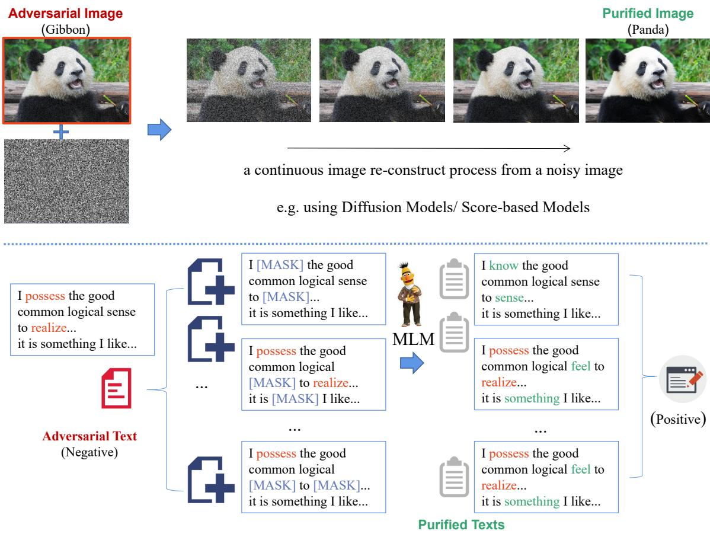
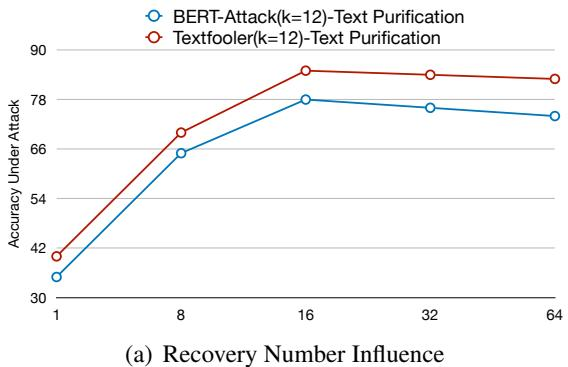
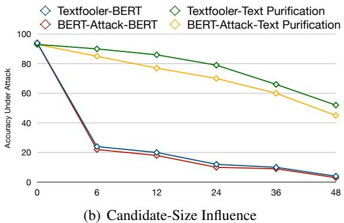

# Text Adversarial Purification as Defense against Adversarial Attacks

Linyang Li Demin Song, Xipeng Qiu

School of Computer Science, Fudan University Shanghai Key Laboratory of Intelligent Information Processing, Fudan University {linyangli19, dmsong20, xpqiu}@fudan.edu.cn

## Abstract

Adversarial purification is a successful defense mechanism against adversarial attacks without requiring knowledge of the form of the incoming attack. Generally, adversarial purification aims to remove the adversarial perturbations therefore can make correct predictions based on the recovered clean samples. Despite the success of adversarial purification in the computer vision field that incorporates generative models such as energy-based models and diffusion models, using purification as a defense strategy against textual adversarial attacks is rarely explored. In this work, we introduce a novel adversarial purification method that focuses on defending against textual adversarial attacks. With the help of language models, we can inject noise by masking input texts and reconstructing the masked texts based on the masked language models. In this way, we construct an adversarial purification process for textual models against the most widely used word-substitution adversarial attacks. We test our proposed adversarial purification method on several strong adversarial attack methods including Textfooler and BERT-Attack and experimental results indicate that the purification algorithm can successfully defend against strong word-substitution attacks.

## 1 Introduction

Adversarial examples (Goodfellow et al., 2014) can successfully mislead strong neural models in both computer vision tasks (Carlini and Wagner, 2016) and language understanding tasks (Alzantot et al., 2018; Jin et al., 2019). An adversarial example is a maliciously crafted example attached with an imperceptible perturbation and can mislead neural networks. To defend attack examples of images, the most effective method is adversarial training (Goodfellow et al., 2014; Madry et al., 2019) which is a mini-max game used to incorporate perturbations into the training process.

Defending adversarial attacks is extremely important in improving model robustness. However, defending adversarial examples in natural languages is more challenging due to the discrete nature of texts. That is, gradients cannot be used directly in crafting perturbations. The substitutionbased adversarial examples are more complicated than gradient-based adversarial examples in images, making it difficult for neural networks to defend against these substitution-based attacks.

The first challenge of defending against adversarial attacks in NLP is that due to the discrete nature, these substitution-based adversarial examples can have substitutes in any token of the sentence and each substitute has a large candidate list. This would cause a combinatorial explosion problem, making it hard to apply adversarial training methods. Strong attacking methods such as Jin et al. (2019) show that using the crafted adversarial examples as data augmentation in adversarial training cannot effectively defend against these substitutionbased attacks. Further, defending strategies such as adversarial training rely on the assumption that the candidate lists of the substitutions are accessible. However, the candidate lists of the substitutions should not be exposed to the target model; that is, the target model should be unfamiliar to the candidate list of the adversarial examples. In real-world defense systems, the defender is not aware of the strategy the potential attacks might use, so the assumption that the candidate list is available would significantly constrain the potential applications of these defending methods.

Considering that it is challenging to defend against textual adversarial attacks when the form of the attacks cannot be acknowledged in advance, we introduce a novel adversarial purification method as a feasible defense mechanism against these attacks. The adversarial purification method is to purify adversarially perturbed input samples before making predictions (Srinivasan et al., 2021; Shi et al., 2021; Yoon et al., 2021). The major works about adversarial purification focus on purifying continuous inputs such as images, therefore these works explore different generative models such as GANs (Samangouei et al., 2018), energy-based models (EBMs) (LeCun et al., 2006) and recently developed diffusion models (Song et al., 2021; Nie et al., 2022). However, in textual adversarial attacks, the inputs are discrete tokens which makes it more challenging to deploy previous adversarial purification methods.

Therefore, we introduce a purification mechanism with the help of masked language models. We first consider the widely used masking process to inject noise into the input; then we recover the clean texts from the noisy inputs with the help of the masked language models (e.g. a BERT (Devlin et al., 2018)). Further, considering that the iterative process in previous adversarial purification algorithms can be extremely costly (e.g. a VP-SDE process in diffusion models (Song et al., 2021)), we instead simplify the iterative process to an ensemble-purifying process that conducting adversarial purification multiple times to obtain an ensembled result as a compromise to the time cost in traditional adversarial purification process.

Through extensive experiments, we prove that the proposed text adversarial purification algorithm can successfully serve as defense against strong attacks such as Textfooler and BERT-Attack. Experiment results show that the accuracy under attack in baseline defense methods is lower than random guesses, while after text purification, the performance can reach only a few percent lower than the original accuracy when the candidate range of the attack is limited. Further, extensive results indicate that the candidate range of the attacker score is essential for successful attacks, which is a key factor in maintaining the semantics of the adversaries. Therefore we also recommend that future attacking methods can focus on achieving successful attacks with tighter constraints.

To summarize our contributions:

(1) We raise the concern of defending substitution-based adversarial attacks without acknowledging the form of the attacks in NLP tasks.

(2) To the best of our knowledge, we are the first to consider adversarial purification as a defense against textual adversarial attacks exemplified by strong word-substitution attacks and combine text adversarial purification with pre-trained models.

(3) We perform extensive experiments to demonstrate that the adversarial purification method is capable of defending strong adversarial attacks, which brings a new perspective to defending textual adversarial attacks.

## 2 Related Work

## 2.1 Adversarial Attacks in NLP

In NLP tasks, current methods use substitutionbased strategies (Alzantot et al., 2018; Jin et al., 2019; Ren et al., 2019) to craft adversarial examples. Most works focus on the score-based blackbox attack, that is, attacking methods know the logits of the output prediction. These methods use different strategies (Yoo et al., 2020; Morris et al., 2020b) to find words to replace, such as genetic algorithm (Alzantot et al., 2018), greedy-search (Jin et al., 2019; Li et al., 2020) or gradient-based methods (Ebrahimi et al., 2017; Cheng et al., 2019) and get substitutes using synonyms (Jin et al., 2019; Mrkšic et al.´ , 2016; Ren et al., 2019) or language models (Li et al., 2020; Garg and Ramakrishnan, 2020; Shi et al., 2019).

## 2.2 Adversarial Defenses

We divide the defense methods for wordsubstitution attacks by whether the defense method requires knowledge of the form of the attack.

When the candidate list is known, recent works introduce defense strategies that incorporate the candidates of the words to be replaced as an augmentation. Jin et al. (2019); Li et al. (2020); Si et al. (2020) uses generated adversaries to augment the classifier for better defense performances; Jia et al. (2019); Huang et al. (2019) introduce a certified robust model to construct a certified space within the range of a candidate list therefore the substitutions in the candidate list cannot perturb the model. Zhou et al. (2020); Dong et al. (2021) construct a convex hull based on the candidate list which can resist substitutions in the candidate list.

To defend unknown attacks, NLP models can incorporate gradient-based adversarial training strategies (Miyato et al., 2016; Madry et al., 2019) since recent works (Ebrahimi et al., 2017; Cheng et al., 2019; Zhu et al., 2019; Li and Qiu, 2020) show that gradient-based adversarial training can also improve defense performances against wordsubstitution attacks.

  
Figure 1: Text Adversarial Purification Process: Compared with Image Purification, we use masked language models to recover noisy texts to purify adversarial texts as a defense against word-substitutions attacks.

## 2.3 Adversarial Purification

Adversarial purification is a defense strategy that uses generative models to purify adversarial inputs before making predictions, which is a promising direction in adversarial defense. Samangouei et al. (2018) uses a defensive GAN framework to build clean images to avoid adversarial attacks. Energybased models (EBMs) are used to purify attacked images via Langevin dynamics (LeCun et al., 2006). Score-based models (Yoo et al., 2020) is also introduced as a purification strategy. Recent works focus on exploring diffusion models as the purification model in purifying the attacked images (Nie et al., 2022). Though widely explored, adversarial purification strategy is less explored in the NLP field.

## 3 Text Adversarial Purification

## 3.1 Background of Adversarial Purification

A classic adversarial purification process is to gradually purify the input through T steps of purification runs. As seen in Figure 1, the purification process in the image domain is to first construct an input $x ^ { ' }$ from the perturbed input x by injecting random noise. Then the purification algorithm will recover the clean image x from the noisy image $x ^ { ' }$ bwhich usually takes multiple rounds. The intuition of such a purification process is that the recovered inputs will not contain adversarial effects.

Specifically, in the score-based adversarial purification (Yoo et al., 2020), the sample injected with random noise is $x ^ { ' } = x + \varepsilon$ where $\varepsilon \sim \mathcal { N } ( 0 , \sigma ^ { 2 } I )$ and the goal is to purify $x ^ { ' }$ with score network $s _ { \theta }$ In a continuous time step where $x _ { 0 } = x ^ { ' }$ , the goal is to recover x0 through a score-based generative model $x _ { t } = x _ { t - 1 } + \alpha _ { t - 1 } s _ { \theta } ( x _ { t - 1 } )$ where α is the step size related to $x _ { t - 1 }$ . After T times of generation, the recovered $\widehat { x } = x _ { T }$ is used in the final bprediction which contains less adversarial effect.

As for the diffusion-based purification methods (Nie et al., 2022), the process includes a forward diffusion process and a reverse recovery process. The noise injection process is a forward stochastic differential equation (SDE), that is, the noisy input $x ^ { ' } = x ( T )$ and initial perturbed input $x = x ( 0 )$ The diffusion process is $x ( T ) = \sqrt { \alpha ( T ) } x ( 0 ) +$ $\sqrt { 1 - \alpha ( T ) } \varepsilon$ where α is a hyper-parameter and $\varepsilon \sim \mathcal { N } ( 0 , \sigma ^ { 2 } I )$ . The final purified input ${ \widehat x } = { \widehat x } ( 0 )$ where $\widehat { x } ( 0 )$ b bis the reverse-time SDE generated input bfrom the diffused input x(T).

## 3.2 Text Adversarial Purification with BERT

Instead of the iterative purification process used in purifying images, we introduce a novel purification method that purifies the input texts via masking and masks prediction with pre-trained masked language models exemplified by BERT (Devlin et al., 2018).

As seen in Figure 1, instead of gradually adding noise and recovering the clean sample from the noisy samples, we inject random noise into the input texts multiple times and recover the noisy data to a clean text based on the mask-prediction ability of the masked language model $F _ { m } ( \cdot )$

Considering that the perturbed text is X, we can inject noise to construct multiple copies $X _ { i } ^ { ' }$ $\left[ w _ { 0 } , \cdot \cdot \cdot , \left[ \mathrm { M A S K } \right] , w _ { n } , \cdot \cdot \cdot , \right] ,$ . We use two simple masking strategies: (1) Randomly mask the input texts; (2) Randomly insert masks into the input texts. Such a random masking process is similar to adding a random noise $\varepsilon \sim \mathcal { N } ( 0 , \sigma ^ { 2 } I )$ to the inputs x.

After constructing multiple noisy inputs, we run the denoise process via masked language models: $\widehat { X } _ { i } = F _ { m } ( \bar { X _ { i } ^ { \prime } } )$

With N recovered texts, we are able to make predictions with the classifier $\begin{array} { r l } { F _ { c } ( \cdot ) \colon } & { { } S _ { i } \quad = } \end{array}$ $\begin{array} { r } { \frac { 1 } { N } \sum _ { i = 0 } ^ { N } \Big ( S o f t m a x ( F _ { c } ( \widehat { X } _ { i } ) ) \Big ) } \end{array}$

bUnlike continuous perturbations to images, word-substitution adversarial samples only contain several perturbed words. Therefore, we consider using a multiple-time mask-and-recover process as text adversarial purification, which makes full use of the pre-trained ability of the masked language models. Compared with the generation process used in image adversarial purification, masked language model-based purification method is easier to implement and utilize in pre-trained modelbased applications as a defense against strong wordsubstitution adversarial attacks.

## 3.3 Combining with Classifier

Normal adversarial purification methods are plugand-play processes inserted before the classification, however, the masked language model itself is a widely used classification model. That is, the purification model $F _ { m } ( \cdot )$ and the classification model $F _ { c } ( \cdot )$ can share the same model. Therefore, instead of using a normal masked language model such as BERT, we train the classifier and the mask-filling ability as multi-tasks. The classification loss is $\mathcal { L } _ { c } = \mathcal { L } ( F _ { c } ( \boldsymbol { X } ^ { \prime } ) , y , \theta ) + \mathcal { L } ( F _ { c } ( \boldsymbol { X } ) , y , \theta )$ and the masked language model loss is ${ \mathcal { L } } _ { m l m } =$ $\mathcal { L } ( F _ { m } ( \boldsymbol { X } ^ { ' } ) , \boldsymbol { X } , \theta )$ . Here, the input X is the clean text used in training the classifier and the $X ^ { ' }$ is the random masked text. The loss function $\mathcal { L } ( \cdot )$ is the cross-entropy loss used in both the text classification head and masked language modeling head in the pre-trained models exemplified by BERT.

In this way, we are utilizing the pre-trained models to their full ability by using both the mask-filling function learned during the pre-training stage as well as the generalization ability to downstream tasks.

Algorithm 1 Adversarial Training   
Require: Training Sample X, adversarial step $T _ { a }$   
1: $X ^ { ' } $ Inject Noise X   
2: $\begin{array} { r } { \pmb { \delta } _ { 0 }  \frac { 1 } { \sqrt { D } } \pmb { \mathcal { N } } ( 0 , \sigma ^ { 2 } ) } \end{array}$ // Init Perturb   
3: for $t = \dot { 0 } , 1 , . . . T _ { a }$ do   
4: $\pmb { \mathrm { g } } _ { \delta } \gets \nabla \delta \bigl ( \mathcal { L } _ { c } + \mathcal { L } _ { m l m } \bigr ) / /$ Get Perturbation   
5: $\delta _ { t } \gets \prod _ { \| \delta \| _ { F } < \epsilon } ( \delta _ { t } + \alpha \cdot \pmb { g } _ { \delta } / | | \pmb { g } _ { \delta } | | _ { F } )$   
6: $\mathcal { L } _ { n o i s e } \gets \mathcal { L } ( \boldsymbol { F } _ { m } ( \boldsymbol { X } ^ { \prime } + \delta _ { t } ) , \boldsymbol { X } , \boldsymbol { \theta } )$   
7: $X ^ { ' } \gets X ^ { ' } + \delta _ { t } /$ / Update Input   
8: ${ \pmb g } _ { t + 1 } = { \pmb g } _ { t } + \nabla \theta ( { \pmb { \mathcal L } } _ { c } + { \pmb { \mathcal L } } _ { m l m } + { \pmb { \mathcal L } } _ { n o i s e } )$   
9: $\theta \gets \theta - \pmb { g } _ { T + 1 }$ // Update model parameter θ

## 3.4 Combining with Adversarial Training

Different from the image field where adversaries are usually generated by gradients, wordsubstitution attacks do not have direct connections with gradient-based adversaries in the text domain. Therefore, it is intuitive to incorporate gradientbased adversarial training in the purification process when the purification process is combined with the classifier training.

We introduce the adversarial training process therefore the purification function $F _ { m } ( \cdot )$ includes mask-prediction and recovering clean texts from inputs with gradient-based perturbations, which leads to stronger purification ability compared with a standard BERT.

Following standard adversarial training process with gradient-based adversaries introduced by Zhu et al. (2019); Li and Qiu (2020). In the adversarial training process, a gradient-based perturbation δ is added to the embedding output of the input text X (for simplicity, we still use X and $X ^ { ' }$ to denote the embedding output in the Algorithm 1). Then the perturbed inputs are added to the training set in the training process. We combine gradient-based adversarial training with the text purification process. As illustrated in Algorithm 1, for an adversarial training step, we add perturbations to the masked text $X ^ { ' }$ and run $T _ { a }$ times of updates. We calculate gradients based on both classification losses $\mathcal { L } _ { c }$ and masked language modeling losses $\mathcal { L } _ { m l m } ;$ ; further, as seen in line 6, we also calculate the loss that the masked language model will predict the texts from the perturbed text $X ^ { \prime } + \delta$ , which enhanced the text recover ability from noisy or adversarial texts.

## 4 Experiments

## 4.1 Datasets

We use two widely used text classification datasets: IMDB 1 (Maas et al., 2011) and AG’s News 2 (Zhang et al., 2015) in our experiments. The IMDB dataset is a bi-polar movie review classification task; the AG’s News dataset is a four-class news genre classification task. The average length is 220 words in the IMDB dataset, and 40 words in the AG’s News dataset. We use the test set following the Textfooler 1k test set in the main result and sample 100 samples for the rest of the experiments since the attacking process is seriously slowed down when the model is defensive.

## 4.2 Attack Methods

Popular attack methods exemplified by genetic Algorithm (Alzantot et al., 2018), Textfooler (Jin et al., 2019) and BERT-Attack (Li et al., 2020) can successfully mislead strong models of both IMDB and AG’s News task with a very small percentage of substitutions. Therefore, we use these strong adversarial attack methods as the attacker to test the effectiveness of our defense method. The hyperparameters used in the attacking algorithm vary in different settings: we choose candidate list size K to be 12, 48, and 50 which are used in the Textfooler and BERT-Attack methods.

We use the exact same metric used in Textfooler and BERT-Attack that calculates the after-attack accuracy, which is the targeted adversarial evaluation defined by Si et al. (2020). The after-attack accuracy measures the actual defense ability of the system under adversarial attacks.

## 4.3 Victim Models and Defense Baselines

The victim models are the fine-tuned pre-train models exemplified by BERT and RoBERTa, which we implement based on Huggingface Transformers 3 (Wolf et al., 2020). As discussed above, there are few works concerning adversarial defenses against attacks without knowing the candidates in NLP tasks. Moreover, previous works do not focus on recent strong attack algorithms such as Textfooler (Jin et al., 2019), BERT-involved attacks (Li et al., 2020; Garg and Ramakrishnan, 2020) Therefore, we first list methods that can defend against adversarial attacks without accessing the candidate list as our baselines:

Adv-Train (Adv-HotFlip): Ebrahimi et al. (2017) introduces the adversarial training method used in defending against substitution-based adversarial attacks in NLP. It uses gradients to find actual adversaries in the embedding space.

Virtual-Adv-Train (FreeLB): Li and Qiu (2020); Zhu et al. (2019) use virtual adversaries to improve the performances in fine-tuning pretrained models, which can also be used to deal with adversarial attacks without accessing the candidate list. We follow the standard FreeLB training process to re-implement the defense results.

Further, there are some works that require the candidate list, it is not a fair comparison with defense methods without accessing the candidates, so we list them separately:

Adv-Augmentation: We generate adversarial examples of the training dataset as a data augmentation method. We mix the generated adversarial examples and the original training dataset to train a model in a standard fine-tuning process.

ASCC: Dong et al. (2021) also uses a convexhull concept based on the candidate vocabulary as a strong adversarial defense.

ADA: Si et al. (2020) uses a mixup strategy based on the generated adversarial examples to achieve adversarial defense with variants AMDA-SMix that mixup the special tokens.

FreeLB++: Li et al. (2021) introduces a variant of FreeLB method that expands the norm bound.

RanMASK: Zeng et al. (2021) introduces a masking strategy that makes use of noises to improve robustness.

<table><tr><td>Defense ↓ Attacks→</td><td>Origin</td><td>Textfooler (K=12)</td><td>BERT-Attack (K=12)</td><td>Textfooler (K=50)</td><td>BERT-Attack (K=48)</td></tr><tr><td colspan="6">IMDB↓</td></tr><tr><td>BERT (Devlin et al., 2018)</td><td>94.1</td><td>20.4</td><td>18.5</td><td>2.8</td><td>3.2</td></tr><tr><td>RoBERTa (Liu et al., 2019) Adv-HotFlip (BERT) (Ebrahimi et al., 2017)</td><td>97.3 95.1</td><td>26.3 36.1</td><td>24.5 34.2</td><td>25.2</td><td>23.0</td></tr><tr><td>FreeLB (BERT) (Li and Qiu, 2020)</td><td>96.0</td><td>30.2</td><td>30.4</td><td>8.0 7.3</td><td>6.2 2.3</td></tr><tr><td> FreeLB++ (BERT) (Li et al., 2021)</td><td>93.2</td><td></td><td>-</td><td>45.3</td><td>39.9</td></tr><tr><td>▲ RanMASK (RoBERTa) (Zeng et al., 2021)</td><td>93.0</td><td></td><td></td><td>23.7</td><td>26.8</td></tr><tr><td>Text Purification(BERT)</td><td>93.0</td><td>81.5</td><td>76.7</td><td></td><td></td></tr><tr><td>Text Purification(RoBERTa)</td><td>96.1</td><td>84.2</td><td>82.0</td><td>51.0 54.3</td><td>44.5 52.2</td></tr><tr><td>AG&#x27;s News ↓</td><td></td><td></td><td></td><td></td><td></td></tr><tr><td colspan="6"></td></tr><tr><td>BERT (Devlin et al., 2018)</td><td>92.0</td><td>32.8</td><td>34.3</td><td>19.4</td><td>14.1</td></tr><tr><td>RoBERTa (Liu et al., 2019)</td><td>97.3</td><td>26.3</td><td>24.5</td><td>25.2</td><td>23.0</td></tr><tr><td>Adv-HotFlip (BERT) FreeLB (BERT)</td><td>91.2 90.5</td><td>35.3 40.1</td><td>34.1 34.2</td><td>18.2</td><td>8.5</td></tr><tr><td></td><td>90.6</td><td>61.5</td><td></td><td>20.1</td><td>8.5</td></tr><tr><td>Text Purification(BERT)</td><td>90.8</td><td></td><td>49.7</td><td>34.9</td><td>22.5</td></tr><tr><td>Text Purification(RoBERTa)</td><td></td><td>59.1</td><td>41.2</td><td>34.2</td><td>19.5</td></tr></table>

Table 1: After-Attack Accuracy compared with defense methods that can defend attacks without acknowledging the form of the attacks. That is, the substitution candidates of the attack methods are unknown to defense systems.

<table><tr><td colspan="3">Methods Origin Textfooler GA</td></tr><tr><td colspan="3">IMDB↓</td></tr><tr><td>BERT</td><td>94.0</td><td>2.0 45.0</td></tr><tr><td>Data-Augmentation ADA (Si et al., 2020) AMDA(Si et al., 2020) 2 ASCC (Dong et al., 2021)</td><td>93.0 96.7 96.9 77.0</td><td>18.0 53.0 3.0 17.4 71.0</td></tr><tr><td>Text Purification(BERT)</td><td>93.0 51.0</td><td>79.0</td></tr></table>

Table 2: After-Attack Accuracy compared with accesscandidates methods based on the BERT model. Here we implement Textfooler with K=50 for consistency with previous works. GA is the Genetic Attack method. We use the AMDA-SMix setup for the AMDA method.

## 4.4 Implementations

We use BERT-BASE and RoBERTa-BASE models based on the Huggingface Transformers 4. We modify the adversarial training with virtual adversaries based on the implementation of FreeLB, TAVAT, and FreeLB++. The training hyper-parameters we use are different from FreeLB and TAVAT since we aim to find large perturbations to simulate adversaries. We set adversarial learning rate α = 1e-1 to and normalization boundary ϵ = 2e-1 in all tasks. We set the multiple purification size N = to 16 for all tasks and we will discuss the selection of N in the later section.

For our text adversarial purification method, we use the model that is trained with gradient-based adversarial training as the purification model $F _ { m } ( \cdot )$ and the classifier $F _ { c } ( \cdot )$ for the main experiments and conduct thorough ablations to explore the effect of combining purification with classifier and adversarially trained classifier.

As for implementing adversarial attack methods, we use the TextAttack toolkit while referring the official codes of the corresponding attack methods 5 (Morris et al., 2020a). The similarity thresholds of the word-substitution range are the main factors of the attacking algorithm. We tune the USE (Cer et al., 2018) constraint 0.5 for the AG task and 0.7 for the IMDB task and 0.5 for the cosinesimilarity threshold of the synonyms embedding (Mrkšic et al.´ , 2016) which can reproduce the results of the attacking methods reported.

## 4.5 Results

As seen in Table 1, the proposed Text Adversarial Purification algorithm can successfully defend strong attack methods. The accuracy of our defending method under attack is significantly higher than non-defense models (50% vs 20% in the IMDB dataset). Compared with previous defense methods, our proposed method can achieve higher defense accuracy in both the IMDB task and AG’s News task. The Adv-HotFlip and the FreeLB methods are effective, which indicates that gradient-based adversaries are not very similar to actual substitutions. We can see that Adv-HotFlip and FreeLB methods achieve similar results (around 30% when K = 12) which indicates that gradient-based adversarial training methods have similar defense abilities no matter whether the adversaries are virtual or real since they are both unaware of the attacker’s candidate list. Also, the original accuracy (on the clean data) of our method is only a little lower than the baseline methods, which indicates that the purified texts still contain enough information for classification. The RoBERTa model also shows robustness using both original fine-tuned model and our defensive framework, which indicates our purification algorithm can be used in various pretrained language models. Compared with methods that specifically focus on adversarial defense, our proposed method can still surpass the state-of-theart defense system FreeLB++ (Li et al., 2021) and RanMASK (Zeng et al., 2021).

<table><tr><td>Defense ↓ Attacks→</td><td>Origin</td><td>Textfooler (K=12)</td><td>BERT-Attack (K=12)</td></tr><tr><td colspan="4">Text Purification Only ↓</td></tr><tr><td>Purification</td><td>94.0</td><td>72.0</td><td>60.0</td></tr><tr><td>Purification Multi. Recovery</td><td>87.0</td><td>20.0</td><td>13.0</td></tr><tr><td>Purification  Mask Insertion  Multi. Recovery</td><td>92.0</td><td>11.0</td><td>3.0</td></tr><tr><td colspan="4">Combining Classifier ↓</td></tr><tr><td>Purification Comb. Classifier</td><td>95.0</td><td>76.0</td><td>67.0</td></tr><tr><td>Purification Comb. Classifier Multi. Recovery</td><td>95.0</td><td>45.0</td><td>34.0</td></tr><tr><td>PurificationComb. Classifier  Multi. Recovery Mask Insertion</td><td>95.0</td><td>29.0</td><td>17.0</td></tr><tr><td colspan="4">Combining Adversarially Trained Classifier ↓</td></tr><tr><td>PurificationAT Classifier</td><td>93.0</td><td>86.0</td><td>77.0</td></tr><tr><td>Purification AT Classifier  Multi. Recovery</td><td>93.0</td><td>63.0</td><td>52.0</td></tr><tr><td>Purification AT Classifier Multi. Recovery  Mask Insertion</td><td>93.0</td><td>42.0</td><td>29.0</td></tr><tr><td>BERT</td><td>94.0</td><td>10.0</td><td>5.0</td></tr></table>

Table 3: Ablations results tested on attacking the IMDB task based on BERT models. Comb. Classifier is the combined fine-tuned $F _ { c } ( \cdot )$ and $F _ { m } ( \cdot )$ and AT Classifier is the adversarially trained $F _ { c } ( \cdot )$ . Mask Insertion is to use both mask-replacing and mask-insertion in injecting noise.

Further, the candidate size is extremely important in defending against adversarial attacks, when the candidate size is smaller, exemplified by K = 12, our method can achieve very promising results. As pointed out by Morris et al. (2020b), the candidate size should not be too large that the quality of the adversarial examples is largely damaged.

As seen in Table 2, we compare our method with previous access-candidates defense methods.

When defending against the widely used Textfooler attack and genetic attack (Alzantot et al., 2018), our method can achieve similar accuracy even compared with known-candidates defense methods. As seen, the data augmentation method cannot significantly improve model robustness since the candidates can be very diversified. Therefore, using generated adversarial samples as an augmentation strategy does not guarantee robustness against greedy-searched methods like Textfooler and BERT-Attack.

## 4.6 Analysis

## 4.6.1 Ablations

As we design an adversarial purification algorithm with masked language models and propose a multiple-recovering strategy, we aim to explore which process helps more in the purification defense system. Plus, we combine classifiers within the purification model so it is also important to explore whether such a combination is helpful.

For each type of purification method, we test whether the specific purification process we propose is effective. That is, we test whether making multiple recoveries in the purification process is helpful; also, we test whether using both masking tokens and inserting additional masks is helpful.

As seen in Table 3, we can summarize that:

(1) Multi-time recovering is necessary: in the image domain, multiple reconstructions with a continuous time purification process are necessary.

<table><tr><td></td><td>Texts</td><td>Confidence (Positive)</td></tr><tr><td>Clean-Sample</td><td>I have the good common logical sense to know that oil can not last forever and I am acutely aware of how much of my life in the suburbs revolves around petrochemical products. I&#x27;ve been an avid consumer of new technology and I keep running out of space on powerboards - so...</td><td>93.2%</td></tr><tr><td>Adv. of BERT</td><td>I possess the good common logical sense to realize that oil can not last forever and I am acutely aware of how much of my life in the suburbs spins around petrochemical products. I&#x27;ve been an avid consumer of new technology and I keep running out of space on powerboards - well...</td><td>38.3%</td></tr><tr><td>Adv. of Text Pure</td><td>I know the wonderful general sense to knows that oils can not last endless and I am acutely know of how majority of my lived in the city spins around petrochemical products . I&#x27;ve been an amateur consumers of newly technologies and I kept working out of spaces on powerboards ! well..</td><td>80.1%</td></tr><tr><td rowspan="3">Purified Texts</td><td>Well I know the wonderful general sense notion to knows that oils production can not last for endless years and I am acutely know of how the majority of my live in the city spins around the petrochemical production ... I&#x27;ve been an amateur consumers of new technologies and I kept working out of spaces on power skateboards! well ...</td><td>80.4%</td></tr><tr><td>I know the wonderful common sense notion to knows that oils can not last forever and I also acutely know of how majority of my lived in the world and around petrochemical production ... I&#x27;ve been an amateur consumers of newly technologies and I kept working out of them on skateboards ! well ...</td><td>81.4%</td></tr><tr><td>I know the wonderfully general sense notion to knows that oils can not last endless and I am acutely know of how majority part of my lived in the big city spins around petrocochemical production ... I should have been an amateur consumers fan of newly technologies and I kept on working out of spaces and on powerboards ! well</td><td>76.2%</td></tr><tr><td></td><td>I am the the general sense notion and knows that oils can not last endless and I am acutely know of the part of my lived as the city spins around petrochemical production ... I&#x27;ve</td><td></td></tr></table>

Table 4: A random selected sample that BERT model failed to defend against the Textfooler Attack in the IMDB dataset and Text Pure (Text Adversarial Purification) succeed. Adv. of BERT is the adversarial sample generated by Textfooler to attack the classifier. Adv. of Text Pure is the sample generated by Textfooler to attack the classifier but failed. The purified texts are also listed.

Similarly, the multi-recovery process is important in obtaining high-quality purification results. We can observe that one-time recovery cannot achieve promising defense performances.

(2) Combining classifiers is effective: we can observe that when we use trained classifiers and masked language models, the defense performances are better than using fine-tuned classifier and vanilla BERT as a masked language model, indicating that such a combined training process is helpful in obtaining more strong defense systems. Also, with gradient-based adversarial training, the purification process can obtain a further boost, indicating that our proposed text purification algorithm can be used together with previous defense methods as an advanced defense system.

## 4.6.2 Example of Purification Results

As seen in Table 4, we construct multiple recoveries and use the averaged score as the final classification result. Such a purification process is effective compared with vanilla fine-tuned BERT.

We can observe that the adversarial sample that successfully attacked the vanilla BERT model only achieves this by replacing only a few tokens. While with the purification process, the attack algorithm is struggling in finding effective substitutions to achieve a successful attack. Even replacing a large number of tokens that seriously hurt the semantics of the input texts, with the purification process involved, the classifier can still resist the adversarial effect. Further, by observing the purified texts, we can find that the purified texts can make predictions correctly though some substitutes still exist in the purified texts, indicating that making predictions based on purified texts using the combined trained classifier can obtain a promising defense performance. That is, our proposed method, though is not a plug-and-play system, can be used as a general system as a defense against substitution-based attacks.

## 5 Conclusion and Future Work

In this paper, we introduce a textual adversarial purification algorithm as a defense against substitution-based adversarial attacks. We utilize the mask-infill ability of pre-trained models to recover noisy texts and use these purified texts to make predictions. Experiments show that the purification method is effective in defending strong adversarial attacks without acknowledging the substitution range of the attacks. We are the first to consider the adversarial purification method with a multiple-recovering strategy in the text domain while previous successes of adversarial purification strategies usually focus on the image field. Therefore, we hope that the adversarial purification method can be further explored in NLP applications as a powerful defense strategy.

## Limitations

In this paper, we discuss an important topic in the NLP field, the defense against adversarial attacks in NLP applications. We provide a strong defense strategy against the most widely used word substitution attacks in the NLP field, which is limited in several directions.

• We are testing defense strategies using downstream task models such as BERT and RoBERTa, and the purification tool is a model with a mask-filling ability such as BERT. Such a process can be further improved with strong models such as large language models.

• We study the concept of adversarial purification in the adversarial attack scenarios with word-substitution attacks on small fine-tuned models. The concept of adversarial purification can be further expanded to various NLP applications. For instance, the purification of natural language can be used in malicious text purification which is more suitable in applications with large language models.

## Acknowledgement

This work was supported by the National Natural Science Foundation of China (No. 62236004 and No. 62022027) and CAAI-Huawei MindSpore Open Fund.

## References

Moustafa Alzantot, Yash Sharma, Ahmed Elgohary, Bo-Jhang Ho, Mani B. Srivastava, and Kai-Wei Chang. 2018. Generating natural language adversarial examples. CoRR, abs/1804.07998.

Nicholas Carlini and David A. Wagner. 2016. Towards evaluating the robustness of neural networks. CoRR, abs/1608.04644.

Daniel Cer, Yinfei Yang, Sheng-yi Kong, Nan Hua, Nicole Limtiaco, Rhomni St John, Noah Constant, Mario Guajardo-Cespedes, Steve Yuan, Chris Tar, et al. 2018. Universal sentence encoder. arXiv preprint arXiv:1803.11175.

Yong Cheng, Lu Jiang, and Wolfgang Macherey. 2019. Robust neural machine translation with doubly adversarial inputs. arXiv preprint arXiv:1906.02443.

Jacob Devlin, Ming-Wei Chang, Kenton Lee, and Kristina Toutanova. 2018. BERT: pre-training of deep bidirectional transformers for language understanding. CoRR, abs/1810.04805.

Xinshuai Dong, Hong Liu, Rongrong Ji, and Anh Tuan Luu. 2021. Towards robustness against natural language word substitutions. In International Conference on Learning Representations.

Javid Ebrahimi, Anyi Rao, Daniel Lowd, and Dejing Dou. 2017. Hotflip: White-box adversarial examples for text classification. arXiv preprint arXiv:1712.06751.

Siddhant Garg and Goutham Ramakrishnan. 2020. Bae: Bert-based adversarial examples for text classification. arXiv preprint arXiv:2004.01970.

Ian J Goodfellow, Jonathon Shlens, and Christian Szegedy. 2014. Explaining and harnessing adversarial examples. arXiv preprint arXiv:1412.6572.

Po-Sen Huang, Robert Stanforth, Johannes Welbl, Chris Dyer, Dani Yogatama, Sven Gowal, Krishnamurthy Dvijotham, and Pushmeet Kohli. 2019. Achieving verified robustness to symbol substitutions via interval bound propagation. arXiv preprint arXiv:1909.01492.

Robin Jia, Aditi Raghunathan, Kerem Göksel, and Percy Liang. 2019. Certified robustness to adversarial word substitutions. CoRR, abs/1909.00986.

Di Jin, Zhijing Jin, Joey Tianyi Zhou, and Peter Szolovits. 2019. Is BERT really robust? natural language attack on text classification and entailment. CoRR, abs/1907.11932.

Yann LeCun, Sumit Chopra, Raia Hadsell, M Ranzato, and F Huang. 2006. A tutorial on energy-based learning. Predicting structured data, 1(0).

Linyang Li, Ruotian Ma, Qipeng Guo, Xiangyang Xue, and Xipeng Qiu. 2020. Bert-attack: Adversarial attack against bert using bert. arXiv preprint arXiv:2004.09984.

Linyang Li and Xipeng Qiu. 2020. Textat: Adversarial training for natural language understanding with token-level perturbation. arXiv preprint arXiv:2004.14543.

Zongyi Li, Jianhan Xu, Jiehang Zeng, Linyang Li, Xiaoqing Zheng, Qi Zhang, Kai-Wei Chang, and Cho-Jui Hsieh. 2021. Searching for an effective defender: Benchmarking defense against adversarial word substitution. arXiv preprint arXiv:2108.12777.

Yinhan Liu, Myle Ott, Naman Goyal, Jingfei Du, Mandar Joshi, Danqi Chen, Omer Levy, Mike Lewis, Luke Zettlemoyer, and Veselin Stoyanov. 2019. Roberta: A robustly optimized bert pretraining approach. arXiv preprint arXiv:1907.11692.

Andrew Maas, Raymond E Daly, Peter T Pham, Dan Huang, Andrew Y Ng, and Christopher Potts. 2011. Learning word vectors for sentiment analysis. In Proceedings of the 49th annual meeting of the association for computational linguistics: Human language technologies, pages 142–150.

Aleksander Madry, Aleksandar Makelov, Ludwig Schmidt, Dimitris Tsipras, and Adrian Vladu. 2019. Towards deep learning models resistant to adversarial attacks.

Takeru Miyato, Andrew M. Dai, and Ian J. Goodfellow. 2016. Virtual adversarial training for semi-supervised text classification. ArXiv, abs/1605.07725.

John Morris, Eli Lifland, Jin Yong Yoo, Jake Grigsby, Di Jin, and Yanjun Qi. 2020a. Textattack: A framework for adversarial attacks, data augmentation, and adversarial training in nlp. In Proceedings of the 2020 Conference on Empirical Methods in Natural Language Processing: System Demonstrations, pages 119–126.

John X. Morris, Eli Lifland, Jack Lanchantin, Yangfeng Ji, and Yanjun Qi. 2020b. Reevaluating adversarial examples in natural language. In ArXiv, volume abs/2004.14174.

Nikola Mrkšic, Diarmuid O Séaghdha, Blaise Thom-´ son, Milica Gašic, Lina Rojas-Barahona, Pei-Hao Su,´ David Vandyke, Tsung-Hsien Wen, and Steve Young. 2016. Counter-fitting word vectors to linguistic constraints. arXiv preprint arXiv:1603.00892.

Weili Nie, Brandon Guo, Yujia Huang, Chaowei Xiao, Arash Vahdat, and Animashree Anandkumar. 2022. Diffusion models for adversarial purification. In International Conference on Machine Learning, ICML 2022, 17-23 July 2022, Baltimore, Maryland, USA, volume 162 of Proceedings of Machine Learning Research, pages 16805–16827. PMLR.

Shuhuai Ren, Yihe Deng, Kun He, and Wanxiang Che. 2019. Generating natural language adversarial examples through probability weighted word saliency. In Proceedings of the 57th Annual Meeting of the Associationfor Computational Linguistics, pages 1085– 1097.

Pouya Samangouei, Maya Kabkab, and Rama Chellappa. 2018. Defense-gan: Protecting classifiers against adversarial attacks using generative models. CoRR, abs/1805.06605.

Changhao Shi, Chester Holtz, and Gal Mishne. 2021. Online adversarial purification based on selfsupervised learning. In 9th International Conference on Learning Representations, ICLR 2021, Virtual Event, Austria, May 3-7, 2021. OpenReview.net.

Zhouxing Shi, Minlie Huang, Ting Yao, and Jingfang Xu. 2019. Robustness to modification with shared words in paraphrase identification. CoRR, abs/1909.02560.

Chenglei Si, Zhengyan Zhang, Fanchao Qi, Zhiyuan Liu, Yasheng Wang, Qun Liu, and Maosong Sun. 2020. Better robustness by more coverage: Adversarial training with mixup augmentation for robust fine-tuning. arXiv preprint arXiv:2012.15699.

Yang Song, Jascha Sohl-Dickstein, Diederik P. Kingma, Abhishek Kumar, Stefano Ermon, and Ben Poole. 2021. Score-based generative modeling through stochastic differential equations. In 9th International Conference on Learning Representations, ICLR 2021, Virtual Event, Austria, May 3-7, 2021. OpenReview.net.

Vignesh Srinivasan, Csaba Rohrer, Arturo Marbán, Klaus-Robert Müller, Wojciech Samek, and Shinichi Nakajima. 2021. Robustifying models against adversarial attacks by langevin dynamics. Neural Networks, 137:1–17.

Thomas Wolf, Lysandre Debut, Victor Sanh, Julien Chaumond, Clement Delangue, Anthony Moi, Pierric Cistac, Tim Rault, Rémi Louf, Morgan Funtowicz, Joe Davison, Sam Shleifer, Patrick von Platen, Clara Ma, Yacine Jernite, Julien Plu, Canwen Xu, Teven Le Scao, Sylvain Gugger, Mariama Drame, Quentin Lhoest, and Alexander M. Rush. 2020. Transformers: State-of-the-art natural language processing. In Proceedings of the 2020 Conference on Empirical Methods in Natural Language Processing: System Demonstrations, pages 38–45, Online. Association for Computational Linguistics.

Jin Yong Yoo, John X. Morris, Eli Lifland, and Yanjun Qi. 2020. Searching for a search method: Benchmarking search algorithms for generating nlp adversarial examples. ArXiv, abs/2009.06368.

Jongmin Yoon, Sung Ju Hwang, and Juho Lee. 2021. Adversarial purification with score-based generative models. In Proceedings of the 38th International Conference on Machine Learning, ICML 2021, 18-24 July 2021, Virtual Event, volume 139 of Proceedings ofMachine Learning Research, pages 12062–12072. PMLR.

Jiehang Zeng, Xiaoqing Zheng, Jianhan Xu, Linyang Li, Liping Yuan, and Xuanjing Huang. 2021. Certified robustness to text adversarial attacks by randomized [mask]. arXiv preprint arXiv:2105.03743.

Xiang Zhang, Junbo Zhao, and Yann LeCun. 2015. Character-level convolutional networks for text classification. In Advances in neural information processing systems, pages 649–657.

Yi Zhou, Xiaoqing Zheng, Cho-Jui Hsieh, Kai-wei Chang, and Xuanjing Huang. 2020. Defense against adversarial attacks in nlp via dirichlet neighborhood ensemble. arXiv preprint arXiv:2006.11627.

Chen Zhu, Yu Cheng, Zhe Gan, Siqi Sun, Thomas Goldstein, and Jingjing Liu. 2019. Freelb: Enhanced adversarial training for language understanding. arXiv preprint arXiv:1909.11764.

## Appendix

## Recovery Number Analysis

One key problem is that how many recoveries we should use in the recovering process, as finding a proper T is also important in the image-domain purification process. We use two attack methods with $K = 1 2$ to test how the accuracy varies when using different recovery number N.

As seen in Fig. 2 (a), the ensemble size is actually not a key factor. Larger ensemble size would not result in further improvements. We assume that larger ensemble size will smooth the output score which will benefit the attack algorithm. That is, the tiny difference between substitutes can be detected by the attack algorithm since the confidence score is given to the attack algorithms. Still, we can conclude that a multiple recovery process is effective in the purification process and quite simple to implement.

## Candidate Size Analysis

The attack algorithms such as BERT-Attack and Textfooler use a wide range of substitution set (e.g. K=50 in Textfooler means for each token to replace, the algorithm will find the best replacement in 50 candidates), which seriously harms the quality of the input texts.

As seen in Fig. 2 (b), when the candidate is 0, the accuracy is high on the clean samples. When the candidate is 6, the normal fine-tuned BERT model cannot correctly predict the generated adversarial examples. This indicates that normal fine-tuned BERT is not robust even when the candidate size is small. After purification, the model can tolerate these limited candidate size attacks. When the candidate size grows, the performance of our defense framework drops by a relatively large margin. We assume that large candidate size would seriously harm the semantics which is also explored in Morris et al. (2020b), while these adversaries cannot be well evaluated even using human-evvaluations since the change rate is still low.

  
Figure 2: Hyper-Parameter Selection Analysis

## A For every submission:

 A1. Did you describe the limitations of your work? Left blank.

 A2. Did you discuss any potential risks of your work? Left blank.

 A3. Do the abstract and introduction summarize the paper’s main claims? Left blank.

 A4. Have you used AI writing assistants when working on this paper? Left blank.

B  Did you use or create scientific artifacts? Left blank.

 B1. Did you cite the creators of artifacts you used? Left blank.

 B2. Did you discuss the license or terms for use and / or distribution of any artifacts? Left blank.

 B3. Did you discuss if your use of existing artifact(s) was consistent with their intended use, provided that it was specified? For the artifacts you create, do you specify intended use and whether that is compatible with the original access conditions (in particular, derivatives of data accessed for research purposes should not be used outside of research contexts)? Left blank.

 B4. Did you discuss the steps taken to check whether the data that was collected / used contains any information that names or uniquely identifies individual people or offensive content, and the steps taken to protect / anonymize it? Left blank.

 B5. Did you provide documentation of the artifacts, e.g., coverage of domains, languages, and linguistic phenomena, demographic groups represented, etc.? Left blank.

 B6. Did you report relevant statistics like the number of examples, details of train / test / dev splits, etc. for the data that you used / created? Even for commonly-used benchmark datasets, include the number of examples in train / validation / test splits, as these provide necessary context for a reader to understand experimental results. For example, small differences in accuracy on large test sets may be significant, while on small test sets they may not be. Left blank.

## C  Did you run computational experiments?

Left blank.

 C1. Did you report the number of parameters in the models used, the total computational budget (e.g., GPU hours), and computing infrastructure used? Left blank.

 C2. Did you discuss the experimental setup, including hyperparameter search and best-found hyperparameter values? Left blank.

 C3. Did you report descriptive statistics about your results (e.g., error bars around results, summary statistics from sets of experiments), and is it transparent whether you are reporting the max, mean, etc. or just a single run? Left blank.

 C4. If you used existing packages (e.g., for preprocessing, for normalization, or for evaluation), did you report the implementation, model, and parameter settings used (e.g., NLTK, Spacy, ROUGE, etc.)? Left blank.

D  Did you use human annotators (e.g., crowdworkers) or research with human participants? Left blank.

 D1. Did you report the full text of instructions given to participants, including e.g., screenshots, disclaimers of any risks to participants or annotators, etc.? Left blank.

 D2. Did you report information about how you recruited (e.g., crowdsourcing platform, students) and paid participants, and discuss if such payment is adequate given the participants’ demographic (e.g., country of residence)? Left blank.

 D3. Did you discuss whether and how consent was obtained from people whose data you’re using/curating? For example, if you collected data via crowdsourcing, did your instructions to crowdworkers explain how the data would be used? Left blank.

 D4. Was the data collection protocol approved (or determined exempt) by an ethics review board? Left blank.

 D5. Did you report the basic demographic and geographic characteristics of the annotator population that is the source of the data? Left blank.