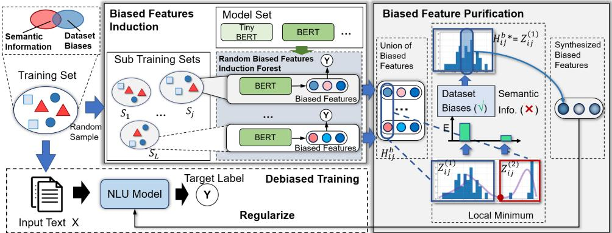
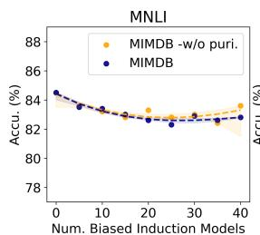
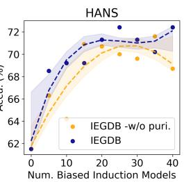
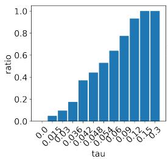
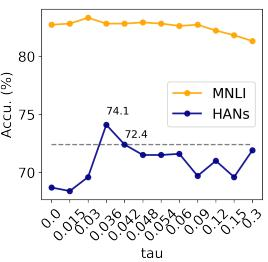
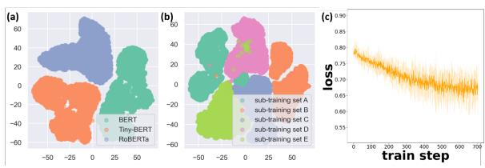

# Towards Stable Natural Language Understanding via Information Entropy Guided Debiasing

Li Du †1,2 , Xiao Ding ∗†1 , Zhouhao Sun1, Ting Liu1 , Bing Qin1 , and Jingshuo Liu1

1 Research Center for Social Computing and Information Retrieval Harbin Institute of Technology, China

2 Beijing Academy of Artificial Intelligence, Beijing, China {ldu, xding, hzsun, tliu, qinb}@ir.hit.edu.cn jingshuoliu@stu.hit.edu.cn

## Abstract

Although achieving promising performance, current Natural Language Understanding models tend to utilize dataset biases instead of learning the intended task, which always leads to performance degradation on out-of-distribution (OOD) samples. To increase the performance stability, previous debiasing methods empirically capture bias features from data to prevent the model from corresponding biases. However, our analyses show that the empirical debiasing methods may fail to capture part of the dataset biases and mistake semantic information of input text as biases, which limits the effectiveness of debiasing. To address these issues, we propose a debiasing framework IEGDB that comprehensively detects the dataset biases to induce a set of biased features, and purify the biased features with the guidance of information entropy. Experimental results show that IEGDB can consistently improve the stability of performance on OOD datasets for a set of widely adopted NLU models.

## 1 Introduction

The Natural Language Understanding (NLU) task requires a model to understand the semantics of input text and then infer the target label. State-ofthe-Art NLU models such as BERT have achieved impressive performance on various NLU tasks (Devlin et al., 2019; Liu et al., 2019). However, recent analyses have demonstrated that these models may exploit the dataset biases, i.e., superficial surface cues that are spuriously associated with the target labels for making inferences (McCoy et al., 2019; Zellers et al., 2019; Utama et al., 2020a). This leads to performance degradation on out-of-distribution (OOD) challenge sets that are designed for making models relying on spurious associations obtaining incorrect predictions (McCoy et al., 2019; Zhang et al., 2019; He et al., 2019).

To increase the stability of model performance on OOD samples, debiasing methods are proposed to mitigate the influence of dataset biases. In general, the debiasing methods work by first extracting a set of biasedfeatures characterizing the dataset biases, then regularizing the main NLU model using the biased features by various existing regularizers, to prevent it from fitting dataset biases (Schuster et al., 2019; Clark et al., 2019; Utama et al., 2020a). Hence, the key of debiasing lies in how to identify the dataset bias and extract corresponding biased features.

Early debiasing methods rely on the prior knowledge of researchers to design biased features (He et al., 2019; Clark et al., 2019; Mahabadi et al., 2020). However, the assumption that the types of biases should be known a-priori limits their application to many NLU tasks and datasets. To lift the reliance on human prior knowledge, automatic debiasing methods are proposed. These methods induce biased features using certain biased models, which are constructed based on certain empirical assumptions about the inductive bias of models. For example, weak learners or models overfitted tiny training sets are prone to capture the dataset biases, and can capture most of the dataset biases (Utama et al., 2020b; Sanh et al., 2020). With such generic assumptions, these automatic debiasing methods can be employed for inducing biased features for any NLU tasks.

The effectiveness of the automatic debiasing methods depends on how well the empirical assumptions for building biased feature induction models can hold. However, the validity of these assumptions may not have theoretical guarantees. By analyzing the biased features extracted by previous automatic debiasing methods, we show that, these methods may not fully recognize all the dataset biases, meanwhile they may mistake part of the semantics of the input text as dataset biases. As a result, the induced biased features may be not comprehensive enough to characterize all the biases, and not pure enough with only the information about the biases involved. Hence, if regularizing the NLU model using such biased features, on the one hand, the main NLU model cannot be effectively prevented from capturing the dataset biases that remained unrecognized, on the other hand, part of the semantic information would be mistaken as biases and excluded from the main NLU model. These would impair both the in-distribution and OOD performance.

In this paper, we propose an Information Entropy Guided automatic DeBiasing (IEGDB) framework. To quantitatively increase the comprehensiveness of the biased features, IEGDB provides a random biased feature induction forest. By assembling multiple biased feature induction models, the random biased feature induction forest can maximize the mutual information between the biased features and the dataset biases, to find (nearly) all dataset biases. The key challenge in purifying the extracted biased features lies in how to identify the semantic component of the biased features without reliance on prior knowledge, as the semantic component is mixed up with the bias component. To solve this problem, We turn to the guidance of information entropy. As the biased features primarily focus on dataset biases (Utama et al., 2020b), among the two components of biased features, the component carrying relatively less information would correspond to the semantics. Hence, the semantic component can be figured out by modeling the mixture distribution of biased features and quantifying the Information Entropy of each component of the mixture distribution. Then the biased features can be purified by excluding the semantic component.

Experimental results show that, our approach can enhance the comprehensiveness and purity of biased features, to consistently improve model stability on multiple OOD datasets, meanwhile persevere the in-distribution performance.

## 2 Background and Preliminary Analysis

Previous analyses demonstrate that NLU models may utilize dataset biases, leading to performance degradation on the OOD datasets (McCoy et al., 2019; Sharma et al., 2018). Hence, debiasing methods are proposed to increase the performance stability by detecting the dataset biases, and then regularizing the NLU model to enforce it focusing more on the semantics of input text.

Formally, given an instance $( X _ { i } , Y _ { i } )$ where $X _ { i }$ is the input text and $Y _ { i }$ is the target label, the debiasing methods aim at extracting a set of features $h _ { i } ^ { b } \in \mathbb { R } ^ { d }$ , which characterize the dataset biases within $X _ { i }$ . Then $h _ { i } ^ { b }$ can be employed to regularize an NLU model $\mathcal { M } _ { N L U }$ for preventing NLU captures the dataset biases.

Early debiasing methods extract biased features based on human priors. However, the dataset biases could range from simple lexical overlap to complex language stylistic patterns (Poliak et al., 2018; Zellers et al., 2019; Nie et al., 2020). Hence, manually designing biased features can be rather time-consuming. To address this issue, recent debiasing methods propose to train a biased model $M _ { b }$ for automatically inducing a set of biased features $h _ { b } ^ { i } = M _ { b } ( X _ { i } )$ for each instance $( X _ { i } , Y _ { i } )$

Previous automatic debiasing methods construct biased models by training an NLU model such as BERT upon a tiny subset of the original training set (Utama et al., 2020b), or a weak learner optimized upon the whole training set (Sanh et al., 2020; Du et al., 2021). Essentially, these methods are constructed based on two main empirical assumptions about the inductive bias of models: (1) By restricting the available information for the biased feature induction model, it would have to overfit the dataset and capture the ungeneralizable dataset biases; (2) By restricting the strength of the biased feature induction model, it would focus on more the superficial features and cannot understand the more complex semantic information (Sanh et al., 2020).

However, the validity of these empirical assumptions does not have a theoretical guarantee. The overfitted models or weak models would also capture the semantic information. This leads to the impurity of the extracted biased features. Furthermore, it leads to a dilemma: a model trained upon a tiny sub-training set or a weak learner can hardly learn to represent all the dataset biases. While if the amount of instances for training the model or the strength of the model is enhanced, the biased feature model would not focus on dataset biases only and would involve the semantic information. We conducted experiments to validate these arguments. The specific results are shown in Sec 1 of the Appendix.

The incompleteness and impurity of biased features would affect the effectiveness of debiasing. Hence we propose an information entropy guided automatic debiasing framework to comprehensively enrich and purify the biased features.

## 3 Methodology

As Figure 1 shows, the IEGDB framework contains three parts: (1) A random biased feature induction forest to enrich the biased features; (2) Information entropy guided biased features purification for excluding the semantic components within the extracted biased features; (3) Then the main NLU model can be regularized using the identified biased features to increase the stability of performance.

## 3.1 Random Biased Feature Induction Forest

Inspired by ensemble learning, the random biased feature induction forest enhances the completeness of biased feature induction by assembling several biased feature induction models trained upon multiple different sub-training sets. We conduct a theoretical analysis, showing that the random biased feature induction forest can maximize mutual information with the dataset biases.

Specifically, the training of the biased feature induction forest applies the general technique of bagging, by assembling multiple biased feature induction models trained by overfitting tiny training sets. Given the training dataset $\mathcal { D } = \{ ( X _ { i } , Y _ { i } ) \} _ { i = 1 } ^ { N }$ containing N instances, we randomly sample with replacement by L times from to obtain a serial of sub-training sets $\mathcal { T } = \{ T _ { 1 } , \ldots , T _ { L } \}$ , with each subtraining sets containing n instances. Then among a set of language models (e.g., BERT, Tiny-BERT), we choose one kind of model M as the biased feature induction model. Upon an arbitrary subtraining set $T _ { l }$ , M is trained to learn to induce the biased features in the same way of the previous automatic debiasing method of Utama et al. (2020a). After the training process on total L sub-training sets, we can obtain a serial of biased feature induction models $\{ M ^ { T _ { l } } \} _ { \mathcal { M } , T _ { L } }$ , which constitute a forest ${ \mathcal { F } } _ { : }$ , where $M ^ { T _ { l } }$ is the Mth kind of model trained upon the lth sub-training set. Then given each instance $\{ X _ { i } , Y _ { i } \} \ \in \mathcal { D }$ , we can derive the biased features using the random biased feature induction forest as:

$$
H _ { i } ^ { b } = \mathcal { F } ( X _ { i } ) = \bigcup _ { T _ { l } } M ^ { T _ { l } } ( X _ { i } ) = \bigcup _ { T _ { l } } h _ { i , M ^ { T _ { l } } } ^ { b } ,\tag{1}
$$

where $H _ { i } ^ { b } \in \mathbb { R } ^ { d \times L }$ . As the output layer of language models is generally activated with tanh function, which makes $h _ { i , M ^ { T _ { l } } } ^ { b } \in [ - 1 , 1 ]$

Theoretical analysis of the random biased feature induction forest Intuitively, by assembling multiple biased feature induction models, the random biased feature induction forest can detect more dataset biases compared to only using a single biased feature induction model. We argue that, in theory, through the assembling operation, the random biased feature induction forest can maximize the mutual information between the extracted biases features and the dataset biases.

As proved by Harald Cramér and C. R. Rao, (Cramér, 1999), given a single sub-training set $T _ { l }$ containing n instances and a certain model M that mainly captures dataset biases, the Fisher Information of the biased feature induction model $M ^ { T _ { l } }$ is proportional to the size of the sub-training set n:

$$
\begin{array} { r } { \mathcal { T } _ { F i s h e r } ( M ^ { T _ { l } } ) \propto n . } \end{array}\tag{2}
$$

Moreover, the Fisher information of $M ^ { T _ { l } }$ provides a lower bound of the mutual information between all the biased features induced from subtraining set $\begin{array} { r l } { T _ { l } ~ ( \mathrm { i . e . , } \bigcup _ { i \in T _ { l } } h _ { i } ^ { b } ) } \end{array}$ and all the dataset biases contained in $T _ { l }$ (Wei and Stocker, 2016; Brunel and Nadal, 1998):

$$
\mathcal { M T } ( \bigcup _ { i \in T _ { l } } h _ { i } ^ { b } , T _ { l } ) \geq \mathcal { T } _ { F i s h e r } \big ( M ^ { T _ { l } } \big ) .\tag{3}
$$

Therefore, the lower bound of $\textstyle { \mathcal { M T } } ( \bigcup _ { i \in T _ { l } } h _ { i } ^ { b } , T _ { l } )$ is proportional to $n , \mathrm { i . e . }$ . the size of $T _ { l }$ . However, the dilemma between model inductive bias and the size of the training set restricts us from recognizing more dataset biases by simply enlarging the size of the sub-training set. Hence, alternately, to recognize more dataset biases, we enlarge the total instances exploited for inducing biased features by assembling multiple biased feature induction models trained upon different sub-training sets.

As shown in Eq. (2,3), the mutual information between the extracted biased features and dataset biases depends on the number unique instances. It can be proved that after L sampling operations with each sub-training set containing n instances, the expectation of total unique instances u equals:

$$
\mathbb { E } ( u ) = N ( 1 - e ^ { \frac { L n } { N } } ) .\tag{4}
$$

The specific proving process is provided in Sec 2 of the Appendix. Hence,

$$
{ \mathcal { M T } } ( \bigcup _ { i \in { \mathcal { T } } } H _ { i } ^ { b } \geq N ( 1 - e ^ { \frac { L n } { N } } ) , \quad\tag{5}
$$

where $\mathcal { T } = \{ T _ { 1 } , \ldots , T _ { L } \}$

This inequality indicates that, in theory, all the dataset biases can be captured once the number of unique instances within converges to the total number of instances N. In other words, when $u $ N, $\textstyle H _ { i } ^ { b } = \bigcup _ { i \in \mathcal { T } } h _ { i } ^ { b }$ can contain the information of almost all dataset biases.

  
Figure 1: The architecture of the IEGDB framework.

## 3.2 Information Entropy Guided Biased Features Purification

Given the union of biases features $H _ { i } ^ { b } \in \mathbb { R } ^ { d \times L }$ , we purify $H _ { i } ^ { b }$ to exclude the semantic components, for producing a set of features $h _ { i } ^ { b } \in \mathbb { R } ^ { d }$ for regularizing the main NLU model. The main difficulty lies in that, without prior knowledge, it would be rather challenging to precisely point out which element of $H _ { i } ^ { b }$ that semantic information has been involved in, and then disentangle them from the remaining.

To address this issue, we resort to the statistical regularity of $H _ { i } ^ { b }$ and purify $H _ { i } ^ { b }$ with the guidance of information entropy. Specifically, as Figure 1 shows, we assume that: (1) Each dimension of $H _ { i } ^ { b } .$ i.e., $H _ { i j } ^ { b } , j \in [ 1 , d ]$ essentially contains two kinds of information, i.e., dataset biases and semantic information. Hence, $H _ { i j } ^ { b }$ could be characterized by a mixture distribution. (2) $H _ { i } ^ { b }$ can be purified, by excluding the component with less information entropy for each dimension $H _ { i j } ^ { b }$ . The rationale lies in that, as the biased feature induction models mainly focused on dataset biases (Utama et al., 2020b; Sanh et al., 2020), $H _ { i } ^ { b }$ induced by these models would also contain more dataset bias information compared to semantic information. Hence, it can be assumed that, with a high probability, among the two components of each $H _ { i j } ^ { b }$ , the component carrying more information would correspond the dataset biases. While the amount of information can be quantified by information entropy. Hence, for two components of $H _ { i j } ^ { b }$ , the component carrying less information entropy would correspond to semantic information.

Therefore, the problem turns to how to split the two components of $H _ { i j } ^ { b }$ into two isolated distributions, then estimate the entropy of each distribution. However, to obtain the information entropy, the probability density function (PDF) of the distributions should be known. To this end, classical methods model the mixture distributions using parameterized models such as Gaussian Mixture Distribution, and then estimate the parameters of each distribution to obtain the PDF of each distribution.

However, the estimation of the parameters requires an iterative solution, and it would be rather time-consuming to apply such an iterative process for each dimension of the biased features of each sample. Moreover, it would also be an over-strong assumption that the two components of $H _ { i j } ^ { b }$ follow a certain distribution. Hence, to lower the computational burden, we adopt a non-parametric approximation.

Specifically, we first formalize $H _ { i j } ^ { b }$ as:

$$
H _ { i j } ^ { b } = \alpha Z _ { i j } ^ { ( 1 ) } + ( 1 - \alpha ) Z _ { i j } ^ { ( 2 ) } ,\tag{6}
$$

where $Z _ { i j } ^ { ( 1 ) } , Z _ { i j } ^ { ( 2 ) }$ are two distributions, with each one corresponding to either the semantic or dataset biases component of $H _ { i j } ^ { b }$ , respectively. Without loss of generality, we assume that both $Z _ { i j } ^ { ( 1 ) }$ and $Z _ { i j } ^ { ( 2 ) }$ )are unimodal distribution. α is a coefficient. Hence, $H _ { i j } ^ { b }$ could be characterized by a bimodal distribution, with each “peak” corresponding to $Z _ { i j } ^ { ( 1 ) }$ and $Z _ { i j } ^ { ( 2 ) }$ , respectively.

Under such formalization, one reasonable approximation for obtaining $Z _ { i j } ^ { ( 1 ) }$ )and $Z _ { i j } ^ { ( 2 ) }$ could be simply separating the two peaks of $\dot { H } _ { i j } ^ { b }$ at the local minimum between two peaks, as long as the local minimum is small enough. Hence, for calculating the local minimum, as well as the entropy of $Z _ { i j } ^ { ( 1 ) }$ and $Z _ { i j } ^ { ( 2 ) }$ , estimating the PDF of $H _ { i j } ^ { b }$ is still necessary. Rather than parameterize $H _ { i j } ^ { b }$ , we approximate the PDF of $H _ { i j } ^ { b }$ using Kernel Density Estimation, which is a non-parametric method to obtain the empirical PDF of a random variable by using kernels as weights:

$$
\hat { P } ( h _ { i j } ^ { b } = h ) = \frac { 1 } { L w } \sum _ { k = 1 } ^ { L } \Phi ( \frac { h - h _ { i j , k } } { \omega } ) ,\tag{7}
$$

where $h _ { i j , k }$ is the jth dimension of the biased features of instance i induced by the kth biased feature induction model, Φ is the kernel function, $\omega > 0$ is a smoothing parameter called bandwidth.

Given the empirical PDF of $H _ { i j } ^ { b } , \mathrm { i . e . , } \hat { p } ( h _ { i j } ^ { b } )$ , we simply split the two peaks of $H _ { i j } ^ { b }$ at the local minimum between two peaks to separate $H _ { i j } ^ { b }$ into two distributions $Z _ { i j , } ^ { b }$ 1and $Z _ { i j , 2 } ^ { b }$ :

$$
\begin{array} { r } { P ( Z _ { i j } ^ { ( 1 ) } = h ) = \left\{ \begin{array} { l l } { \beta _ { 1 } \hat { p } ( h ) } & { \mathrm { i f } \in [ - 1 , \epsilon ] ; } \\ { 0 } & { \mathrm { o t h e r w i s e } . } \end{array} \right. } \end{array}\tag{8}
$$

$$
P ( Z _ { i j } ^ { ( 1 ) } = h ) = \left\{ \begin{array} { l l } { \beta _ { 2 } \hat { p } ( h ) } & { \mathrm { i f } \in ( \epsilon , 1 ] ; } \\ { 0 } & { \mathrm { o t h e r w i s e . } } \end{array} \right.\tag{9}
$$

where $\beta _ { 1 }$ and $\beta _ { 2 }$ are two normalization constants, and ϵ is the local minimum. To find ϵ, we take a series of points $\delta _ { 0 } , \ldots , \delta _ { \lfloor \frac { 2 } { \delta } \rfloor }$ from the [ 1, 1] interval, using δ as the interval. Then by substituting these points into the empirical PDF, the local minimum can be found. Our empirical analysis shows that bimodal distributions are widespread in extracted biased features, and in most cases, the bimodal distribution can be well approximated by two isolated peaks. Moreover, in practice, we introduce a threshold τ and regard $H _ { i j } ^ { b }$ as a bimodal distribution only if ϵ is smaller than τ . By controlling τ to be a small value, the dimensions of biased features which cannot be well approximated by a bimodal distribution would be skipped.

Then given the empirical PDF of two distributions, the information entropy of $Z _ { i j } ^ { ( k ) }$ )can be approximated as:

$$
I E _ { i j } ^ { ( k ) } = \sum _ { \delta } - P ( Z _ { i j } ^ { ( k ) } = \delta ) \mathrm { l o g } _ { \it 2 } ( P ( Z _ { i j } ^ { ( k ) } = \delta ) ) .\tag{10}
$$

By excluding the component corresponding to the semantic information, we can obtain the purified biased features distribution $p ( H _ { i j } ^ { b } { } ^ { * } )$

$$
\begin{array} { r } { p ( H _ { i j } ^ { b ^ { \ast } } ) = \left\{ \begin{array} { l l } { p ( Z _ { i j } ^ { ( 1 ) } ) } & { \mathrm { i f } I E _ { i j } ^ { ( 1 ) } > I E _ { i j } ^ { ( 2 ) } ; } \\ { p ( Z _ { i j } ^ { ( 2 ) } ) } & { \mathrm { o t h e r w i s e } . } \end{array} \right. } \end{array}\tag{11}
$$

where $H _ { i j } ^ { b } { } ^ { * }$ describes the distribution of the jth dimension of the purified biased feature union.

Finally, we pool $H _ { i j } ^ { b }$ ∗to obtain the jth biased feature $h _ { i j } ^ { b }$ by estimating the expectation of $H _ { i j } ^ { b } { } ^ { * }$ :

$$
h _ { i j } ^ { b } = \sum _ { \delta } P ( H _ { i j } ^ { b } { } ^ { * } = \delta ) \delta .\tag{12}
$$

In this way, for each instance i, given $H _ { i } ^ { b } \in \mathbb { R } ^ { d \times L }$ we can obtain d biased features for regularizing the main NLU model. Moreover, using the information entropy we can quantify the loss of information during the biased feature purification process.

<table><tr><td>Task</td><td>Dataset</td><td>Challenge Set</td></tr><tr><td>NLI</td><td>MNLI (Williams et al., 2018)</td><td>HANS (McCoy et al., 2019)</td></tr><tr><td>FV</td><td>Fever (Thorne et al., 2018)</td><td>symm (Schuster et al., 2019)</td></tr><tr><td>PI</td><td> $\mathrm { Q Q P ^ { l } }$ </td><td>PAWS (Zhang et al., 2019)</td></tr></table>

Table 1: Tasks and datasets for evaluating model performance.

## 3.3 Regularization of the Main NLU Model

Given the identified biased features, we regularize the main NLU model to prevent it from learning dataset biases. Among various previous methods, in this paper, we use the widely adopted method Product-of-Expert (Hinton et al., 2015) for regularizing the main NLU model.

The loss function of the Product-of-Expert regularization is formulated as:

$$
\mathcal { L } = - Y _ { i } \mathrm { s o f t m a x } ( p _ { N L U } \cdot p _ { b } ) .\tag{13}
$$

where $f _ { b }$ is a biased features based prediction model, $p _ { b }$ is the probability predicted by $f _ { b } ,$ pNLU is the probability predicted by the main NLU model. Hinton (2002) proved that, with this loss function, for instances where $p _ { N L U }$ has high similarity with $p _ { b } .$ , i.e., the main NLU model makes similar predictions with the biased model $f _ { b } ,$ , the weight of these instances would be decreased.

## 4 Experiments

## 4.1 Evaluation Tasks

We evaluate our approach on three NLU tasks: natural language inference (NLI), fact verification (FV), and paraphrase identification (PI). We evaluate the in-distribution performances using the test set of each task and examine the stability of the model on OOD samples by comparing the zero-shot performance on corresponding challenge datasets. On the Paraphrase Identification task, following Devlin et al. (2019) and Radford et al. (2018), model performance is measured using the F1 score. As the challenge datasets are designed to remove the dataset biases, models relying on the dataset biases often perform close to a random baseline on the challenge datasets. On the NLI and the fact verification task, model performance is evaluated using prediction accuracy. Table 1 lists the dataset and corresponding challenge set employed in each NLU task. More details about each task and the datasets are provided in Sec 5 of the Appendix.

## 4.2 Experimental Details

On all three tasks, the biased feature induction model is chosen as BERT-base (Devlin et al., 2019).

<table><tr><td>Method</td><td>MNLI</td><td>HANS</td><td>∆</td><td>Gen. G</td><td>Fever</td><td>symm.</td><td>∆</td><td>Gen.G</td><td>QQP</td><td>PAWS</td><td>∆</td><td>Gen. G</td></tr><tr><td>Bert-base</td><td>84.5</td><td>61.5</td><td>-</td><td>23.0</td><td>85.6</td><td>55.7</td><td>-</td><td>29.9</td><td>87.9</td><td>48.7</td><td>,</td><td>39.2</td></tr><tr><td>Known-bias Reweighting</td><td>83.5</td><td>69.2</td><td>+7.7</td><td>14.3</td><td>84.6</td><td>61.7</td><td>+6.0</td><td>22.9</td><td>85.5</td><td>49.7</td><td>+1.0</td><td>35.8</td></tr><tr><td>Known-bias POE</td><td>82.9</td><td>67.9</td><td>+6.4</td><td>15.0</td><td>86.5</td><td>60.6</td><td>+4.9</td><td>25.9</td><td>84.3</td><td>50.3</td><td>+1.6</td><td>34.0</td></tr><tr><td>Known-bias Conf-reg</td><td>84.5</td><td>69.1</td><td>+7.6</td><td>15.4</td><td>86.4</td><td>60.5</td><td>+4.8</td><td>25.9</td><td>85.0</td><td>49.0</td><td>+0.3</td><td>36.0</td></tr><tr><td>Shallow Model DB Reweighting</td><td>82.3</td><td>69.1</td><td>+7.6</td><td>13.2</td><td>87.2</td><td>60.8</td><td>+5.1</td><td>26.4</td><td>79.4</td><td>46.5</td><td>-2.3</td><td>32.9</td></tr><tr><td>Shallow Model DB POE</td><td>82.7</td><td>69.8</td><td>+8.3</td><td>12.9</td><td>85.4</td><td>60.9</td><td>+5.2</td><td>24.5</td><td>80.7</td><td>47.4</td><td>-1.3</td><td>33.3</td></tr><tr><td>Shallow Model DB Conf-reg</td><td>83.9</td><td>67.7</td><td>+6.2</td><td>16.2</td><td>87.9</td><td>60.4</td><td>+4.7</td><td>27.5</td><td>83.9</td><td>49.2</td><td>+0.5</td><td>34.7</td></tr><tr><td>Weak Learner DB</td><td>83.3</td><td>67.9</td><td>+6.4</td><td>15.4</td><td>85.3</td><td>58.5</td><td>+2.8</td><td>26.8</td><td></td><td></td><td></td><td></td></tr><tr><td>LGTR</td><td>84.4</td><td>58.0</td><td>-3.5</td><td>25.6</td><td>85.5</td><td>57.9</td><td>+2.2</td><td>27.6</td><td></td><td></td><td></td><td></td></tr><tr><td>IEGDB</td><td>82.8</td><td>72.4</td><td>+10.9</td><td>10.4</td><td>84.9</td><td>66.5</td><td>+10.8</td><td>18.4</td><td>84.6</td><td>51.7</td><td>+3.0</td><td>32.9</td></tr></table>

Table 2: Model performance (MNLI / Fever: accu. (%); QQP: F1) on in-distribution and corresponding challenge instances. Gen. G refers to generalization gap, i.e., the difference between the in-distribution and OOD performance.

We derive the biased features of each instance by employing the embedding vector of the [CLS] token at the top transformer layer of the biased feature induction model, where [CLS] is a special token. On each task, totally 40 sub-training sets are sampled for training the random biased feature induction forest, with each sub-training set containing 2,000 instances. The BERT-base model is chosen as the main NLU model. In the biased feature purification process, the kernel function is set as the normal kernel $\Phi = e x p ( - x ^ { 2 } / 2 \omega ^ { 2 } )$ The bandwidth ω is set as 0.5. The interval width $\delta \ : = \ : 0 . 0 2 . \ : \ : \tau \ : = \ : 0 . 0 6$ . Before regularizing the main NLU model, we implement the biased feature based model $f _ { b }$ using a one-layer MLP. More details about the hyperparameters are provided in Sec 6 of the Appendix.

## 4.3 Baseline Methods

We make comparisons with the following methods:

(i) BERT (Devlin et al., 2019) refers to the BERT-base model trained without debiasing.

Prior-knowledge-based Debiasing Methods These methods rely on the intuition of researchers on dataset biases. The major difference between these methods lies in how to regularize the main NLU model using the biased features.

(ii) Known-biasReweighting (Clark et al., 2019; Schuster et al., 2019) down-weights the instances that target labels can be well predicted by the biased features. (iii) $\mathbf { K n o w n - b i a s } _ { \mathbf { P o E } }$ (Clark et al., 2019) down-weights the instances that the prediction of main NLU models is similar to prediction based on biased features. (iv) Known-biasConf-reg (Utama et al., 2020a) decreases the model confidence on examples in which biased features lead to correct prediction to regularize the main NLU model.

## Auto-Debiasing Methods

(v) Shallow Model Debiasing (Utama et al., 2020b) employs a BERT-base model trained upon a tiny subset of the original training set to induce biased features. (vi) Weak Learner Debiasing (Sanh et al., 2020) uses the Tiny-BERT model (Turc et al., 2019) as a weak learner to induce biased features from the whole training set. (vii) LTGR (Du et al., 2021) employs a teacher model to capture the long-tailed biased features for regularizing the main NLU model.

In this paper, all the baseline debiasing methods take the BERT-base model as the main NLU model.

## 4.4 Main Results

From Table 2 we observe that:

(1) Comparison between the automatic debiasing methods with the prior knowledge-based debiasing methods shows that, in general, the prior knowledge-based methods still show better performance on both in-distribution test sets and OOD challenge sets. This is because the distribution of biases in NLU datasets can be rather complex, which leads to challenges in automatically detecting the biases precisely and comprehensively. Compared to the prior-knowledge-based debiasing methods which rely on a laborious and timeconsuming manual biased features identification process, our approach can achieve better performance on all three challenge datasets and have comparable in-distribution performance. This indicates the effectiveness and efficiency of our approach.

(2) Compared with the Shallow Model Debiasing and the Weak Learner Debiasing which employs a single shallow model as the biased feature induction model, IEGDB can consistently improve model performance on all three challenge datasets, and promote or keep the in-distribution performance. This indicates that, by assembling multiple biased feature induction models, our approach can more comprehensively detect the dataset biases to increase the stability of performance, and through the biased feature purification process, the semantic components within the biased features can be excluded to keep or promote the in-distribution performance.

<table><tr><td>Model</td><td>MNLI</td><td>HANS</td></tr><tr><td>IEGDB</td><td>82.8</td><td>72.4</td></tr><tr><td>IEGDB -w/o puri</td><td>83.6</td><td>68.7</td></tr><tr><td>IEGDB -w smaller IE</td><td>81.8</td><td>62.9</td></tr></table>

Table 3: Results of the ablation study.

## 4.5 Ablation Study

To further illustrate the effects of each component of our approach, we conduct an ablation study by removing the biased feature purification of the IEGDB framework and only aggregating the biased features by a mean pooling (denoted as IEGDB -w/o puri), and keeping the component with smaller Information Entropy (denoted as IEGDB -w smaller IE). Experiments are conducted on the MNLI dataset and corresponding challenge set HANS. The results are shown in Table 3. From which we observe, (1) Eliminating the biased feature purification leads to OOD performance degradation. This is because, the biased feature purification process can effectively remove the semantic components within the biased features, so that the semantic information will not be mistaken as the biases, and the main NLU model can more adequately capture the semantic information for increasing the OOD performance. (2) IEGDB -w smaller IE has both lower in-distribution and OOD performance compared to the original IEGDB and IEGDB -w/o puri. The OOD performance of IEGDB -w smaller IE is even close to the original BERT. These results indicate that, taking the component with smaller Information Entropy as the biased features leads to a severe loss of the semantic information for the main NLU model. This suggests the reasonability of regarding the component with smaller Information Entropy as semantic information.

## 4.6 Sensitivity Analysis

All experiments are conducted on the MNLI dataset and corresponding challenge set HANS.

## 4.6.1 Influence of the Number of Biased Feature Induction Models

We induce the biased features with different numbers of biased feature induction models and show the performance of the main NLU model regularized with these biased features in Figure 2. We also make a comparison with IEGDB -w/o puri to further illustrate the effects of the biased feature purification. We have the following observations: (1) With the number of biased induction models increasing from 1 to 40, the accuracy on the HANS dataset increases from 68.4% to 72.4%. This highlight the importance of including more biased feature induction models in increasing the comprehensiveness of the detected biased detection to promote the stability of model performance. (2) The OOD performance increases with the number of biased feature induction models, while the speed of performance improvement decreases with more biased feature induction models (and hence with instances) involved and tends to converge to a constant value. This is because, as the analysis in section 3.1 shows, the total information the random biased feature induction forest can capture grows at a negative exponential speed and would finally converge to 0. (3) Eliminating the biased feature purification leads to consistent performance degradation on the OOD challenge set, and the maximum OOD performance appears with less biased feature induction models. This highlights the effects of the biased feature purification process in excluding the semantic components within the biased features to increase the OOD performance.

  
Figure 2: Influence of the number of biased feature induction models on model performance.

  
Figure 3: Model performance and the proportion of purified features with different threshold τ.

## 4.6.2 Influence of the Threshold τ

Figure 3 shows the performance of our approach IEGDB on MNLI and HANs dataset with different τ, together with the proportion of dimensions of biased features that are purified. As τ increases, more biased features would be purified. From Figure 3 we can observe that, (1) As τ increases from 0 to 0.09, the performance of IEGDB increases, as more biased features are purified to exclude the semantic component. While the performance of IEGDB decreases when $\tau > 0 . 0 9 .$ , part of biased features with less semantic information involved are also mistaken as a bimodal distribution and purified, leading to undesired information loss. (2) With a relatively small value of τ , a large proportion of the biased features can be deemed as a bimodal distribution. This suggests the reasonability of our approach by approximating the bimodal distribution of biased features using two peaks; (3) The performance of IEGDB keeps relatively stable with a wide range of τ, indicating the robustness of our approach on hyperparameter settings.

<table><tr><td rowspan="2">Dataset</td><td colspan="2">BERT</td><td colspan="2">RoBERTa</td><td colspan="2">DeBERTa</td></tr><tr><td>base</td><td>large</td><td>base</td><td>large</td><td>base</td><td>large</td></tr><tr><td>MNLI HANS</td><td>84.5 61.5</td><td>85.6 69.5</td><td>87.4 71.5</td><td>89.5 75.2</td><td>87.3 76.8</td><td>90.8 77.3</td></tr><tr><td>Dataset</td><td>IEGDBBERT base</td><td></td><td>IEGDBRoBERTa</td><td></td><td></td><td>IEGDBDeBERTa</td></tr><tr><td>MNLI</td><td>82.8</td><td>large 85.5</td><td>base</td><td>large</td><td>base</td><td>large</td></tr><tr><td>HANS</td><td>72.4</td><td>72.6</td><td>86.9 75.8</td><td>89.3 78.8</td><td>87.3 79.0</td><td>88.3 78.1</td></tr></table>

Table 4: Performance (Accu.(%)) of different kinds of main NLU model debiased by our approach.

## 4.7 Generality Analysis

To investigate whether our approach can also improve the performance stability of other kinds of more advanced pretrained language models (PLMs) and larger-sized PLMs, we conduct experiments with BERT-large (Devlin et al., 2019), RoBERTa(- large) (Liu et al., 2019) and Deberta(-large) (He et al., 2020), respectively, with the biased features unchanged. The results are shown in Table 4.

From which we observe that: (1) The performance gap between MNLI and corresponding challenge dataset HANs still exists for more powerful PLMs, such as large-sized BERT, RoBERTa, and Deberta, suggesting that these models may still capture dataset biases for making predictions and indicating the urgent need for debiasing these PLMs. (2) Compared to the vanilla PLMs, our approach can improve the performance stability for different kinds of PLMs, and different-sized PLMs, using the same set of biased features. This suggests the generality of our approach. We also make comparisons with the baseline method Shallow Model DebiasingPoE and the full results are provided in Sec 4 of the Appendix. From which we observe that our approach can improve the OOD performance for multiple PLMs compared to the baseline method.

## 5 Related Work

Previous analysis demonstrates that the existence of dataset biases allows an NLU model to complete the task without learning the semantic information (Gururangan et al., 2018; McCoy et al., 2019; Belinkov et al., 2019). This phenomenon exists in various different tasks, such as reading comprehension (Kaushik et al., 2019), question answering (Mudrakarta et al., 2018), and fact verification (Schuster et al., 2019).

One line of debiasing methods mitigates the dataset biases based on prior knowledge Min et al. (2020); Belinkov et al. (2018); Clark et al. (2019); He et al. (2019). However, these methods are limited by the dependence on human prior. Moreover, researches indicate that hidden biases may still remain after manually debiasing (Sharma et al., 2018), highlighting the necessity of automatically and comprehensively detecting the dataset biases. To address these issues, automatic debiasing methods are proposed. Utama et al. (2020b) automatically captures the dataset bias by training a shallow model on a tiny training set, while Sanh et al. (2020) captures the dataset bias using a learner with limited capacity. However, these methods still rely on certain empirical assumptions that are not bounded to be valid, which affects the comprehensiveness and purity of the extracted biased features, and then limits the effectiveness of debiasing.

In this paper, we propose an Information Entropy Guided debiasing framework, which comprehensively and quantitatively extracts and purifies the biased features to further improve the stability of NLU models.

## 6 Conclusion

In this paper, we propose an information entropy guided automatic debiasing NLU framework IEGDB. By assembling multiple biased feature induction models, IEGDB can induce biased features more comprehensively characterizing the dataset biases. Then the extracted biased features are purified by identifying and excluding the semantic components within the biased features using information-guided blind source separation. Furthermore, we provide a theoretical framework for quantitatively analyzing the comprehensiveness and purity of the extracted features. Experimental results show that our approach can significantly increase the performance stability on OOD samples for various NLU models, meanwhile keeping the in-distribution performance.

## Limitations

In this paper, we employ an information entropyguided algorithm for purifying the induced biased features. For each dimension of the biased features, the component with less information entropy is priorly regarded as the component corresponding to semantic information, and excluded when deriving the purified biased features. However, there is still the risk that the discarded component still account for part of the dataset biases. This would lead to a decrease in the effectiveness of the debiasing process. Hence, although the prior-knowledge free nature endows our proposed biased features purification algorithm with strong generality, in cases when resources indicating the distribution of dataset biases are available, incorporating these resources would further enhance the purification of the biased features.

## 7 Acknowledgments

We thank the anonymous reviewers for their constructive comments and gratefully acknowledge the support of the Technological Innovation “2030 Megaproject” - New Generation Artificial Intelligence of China (2020AAA0106501), and the National Natural Science Foundation of China (U22B2059, 62176079).

## References

Yonatan Belinkov, Yonatan Bisk, and B A. 2018. Synthetic and natural noise both break neural machine translation. In International Conference on Learning Representations.

Yonatan Belinkov, Adam Poliak, Stuart M Shieber, Benjamin Van Durme, and Alexander M Rush. 2019. Don’t take the premise for granted: Mitigating artifacts in natural language inference. In Proceedings of the 57th Annual Meeting of the Association for Computational Linguistics, pages 877–891.

Nicolas Brunel and Jean-Pierre Nadal. 1998. Mutual information, fisher information, and population coding. Neural computation, 10(7):1731–1757.

Christopher Clark, Mark Yatskar, and Luke Zettlemoyer. 2019. Don’t take the easy way out: Ensemble based methods for avoiding known dataset biases. In Proceedings ofthe 2019 Conference on Empirical Methods in Natural Language Processing and the 9th International Joint Conference on Natural Language Processing (EMNLP-IJCNLP), pages 4069–4082.

Harald Cramér. 1999. Mathematical methods of statistics, volume 43. Princeton university press.

Jacob Devlin, Ming-Wei Chang, Kenton Lee, and Kristina Toutanova. 2019. Bert: Pre-training of deep bidirectional transformers for language understanding. In NAACL-HLT (1).

Mengnan Du, Varun Manjunatha, Rajiv Jain, Ruchi Deshpande, Franck Dernoncourt, Jiuxiang Gu, Tong Sun, and Xia Hu. 2021. Towards interpreting and mitigating shortcut learning behavior of nlu models. In Proceedings of the 2021 Conference of the North American Chapter of the Association for Computational Linguistics: Human Language Technologies, pages 915–929.

Mor Geva, Yoav Goldberg, and Jonathan Berant. 2019. Are we modeling the task or the annotator? an investigation of annotator bias in natural language understanding datasets. In Proceedings ofthe 2019 Conference on Empirical Methods in Natural Language Processing and the 9th International Joint Conference on Natural Language Processing (EMNLP-IJCNLP), pages 1161–1166.

Suchin Gururangan, Swabha Swayamdipta, Omer Levy, Roy Schwartz, Samuel Bowman, and Noah A Smith. 2018. Annotation artifacts in natural language inference data. In Proceedings of the 2018 Conference of the North American Chapter ofthe Associationfor Computational Linguistics: Human Language Technologies, Volume 2 (Short Papers), pages 107–112.

He He, Sheng Zha, and Haohan Wang. 2019. Unlearn dataset bias in natural language inference by fitting the residual. In Proceedings ofthe 2nd Workshop on Deep Learning Approaches for Low-Resource NLP (DeepLo 2019), pages 132–142.

Pengcheng He, Xiaodong Liu, Jianfeng Gao, and Weizhu Chen. 2020. Deberta: Decoding-enhanced bert with disentangled attention. In International Conference on Learning Representations.

Geoffrey Hinton, Oriol Vinyals, and Jeff Dean. 2015. Distilling the knowledge in a neural network. arXiv preprint arXiv:1503.02531.

Geoffrey E Hinton. 2002. Training products of experts by minimizing contrastive divergence. Neural computation, 14(8):1771–1800.

Xiaoqi Jiao, Yichun Yin, Lifeng Shang, Xin Jiang, Xiao Chen, Linlin Li, Fang Wang, and Qun Liu. 2020. Tinybert: Distilling bert for natural language understanding. In Findings of the Association for Computational Linguistics: EMNLP 2020, pages 4163–4174.

Divyansh Kaushik, Eduard Hovy, and Zachary Lipton. 2019. Learning the difference that makes a difference with counterfactually-augmented data. In International Conference on Learning Representations.

Yinhan Liu, Myle Ott, Naman Goyal, Jingfei Du, Mandar Joshi, Danqi Chen, Omer Levy, Mike Lewis, Luke Zettlemoyer, and Veselin Stoyanov. 2019. Roberta: A robustly optimized bert pretraining approach. arXiv preprint arXiv:1907.11692.

Rabeeh Karimi Mahabadi, Yonatan Belinkov, and James Henderson. 2020. End-to-end bias mitigation by modelling biases in corpora. In Proceedings of the 58th Annual Meeting of the Association for Computational Linguistics, pages 8706–8716.

E Matthew. 2018. Peters, mark neumann, mohit iyyer, matt gardner, christopher clark, kenton lee, luke zettlemoyer. deep contextualized word representations. In Proc. ofNAACL.

Tom McCoy, Ellie Pavlick, and Tal Linzen. 2019. Right for the wrong reasons: Diagnosing syntactic heuristics in natural language inference. In Proceedings of the 57th Annual Meeting of the Association for Computational Linguistics, pages 3428–3448.

Tomas Mikolov, Kai Chen, Greg Corrado, and Jeffrey Dean. 2013. Efficient estimation of word representations in vector space. arXiv preprint arXiv:1301.3781.

Junghyun Min, R Thomas McCoy, Dipanjan Das, Emily Pitler, and Tal Linzen. 2020. Syntactic data augmentation increases robustness to inference heuristics. In Proceedings of the 58th Annual Meeting of the Association for Computational Linguistics, pages 2339–2352.

Pramod Kaushik Mudrakarta, Ankur Taly, Mukund Sundararajan, and Kedar Dhamdhere. 2018. Did the model understand the question? In Proceedings of the 56th Annual Meeting of the Association for Computational Linguistics (Volume 1: Long Papers), pages 1896–1906.

Yixin Nie, Adina Williams, Emily Dinan, Mohit Bansal, Jason Weston, and Douwe Kiela. 2020. Adversarial nli: A new benchmark for natural language understanding. In Proceedings of the 58th Annual Meeting of the Association for Computational Linguistics, pages 4885–4901.

Adam Poliak, Jason Naradowsky, Aparajita Haldar, Rachel Rudinger, and Benjamin Van Durme. 2018. Hypothesis only baselines in natural language inference. In Proceedings ofthe Seventh Joint Conference on Lexical and Computational Semantics, pages 180– 191.

Alec Radford, Karthik Narasimhan, Tim Salimans, and Ilya Sutskever. 2018. Improving language understanding by generative pre-training.

Victor Sanh, Thomas Wolf, Yonatan Belinkov, and Alexander M Rush. 2020. Learning from others mistakes: Avoiding dataset biases without modeling them. In International Conference on Learning Representations.

Tal Schuster, Darsh Shah, Yun Jie Serene Yeo, Daniel Roberto Filizzola Ortiz, Enrico Santus, and Regina Barzilay. 2019. Towards debiasing fact verification models. In Proceedings ofthe 2019 Conference on Empirical Methods in Natural Language Processing

and the 9th International Joint Conference on Natural Language Processing (EMNLP-IJCNLP), pages 3419–3425.

Rishi Sharma, James Allen, Omid Bakhshandeh, and Nasrin Mostafazadeh. 2018. Tackling the story ending biases in the story cloze test. In Proceedings of the 56th Annual Meeting of the Association for Computational Linguistics (Volume 2: Short Papers), pages 752–757.

James Thorne, Andreas Vlachos, Oana Cocarascu, Christos Christodoulopoulos, and Arpit Mittal. 2018. The fact extraction and verification (fever) shared task. In Proceedings ofthe First Workshop on Fact Extraction and VERification (FEVER), pages 1–9.

Iulia Turc, Ming-Wei Chang, Kenton Lee, and Kristina Toutanova. 2019. Well-read students learn better: On the importance of pre-training compact models.

Prasetya Ajie Utama, Nafise Sadat Moosavi, and Iryna Gurevych. 2020a. Mind the trade-off: Debiasing nlu models without degrading the in-distribution performance. In Proceedings of the 58th Annual Meeting of the Association for Computational Linguistics, pages 8717–8729.

Prasetya Ajie Utama, Nafise Sadat Moosavi, and Iryna Gurevych. 2020b. Towards debiasing nlu models from unknown biases. In Proceedings of the 2020 Conference on Empirical Methods in Natural Language Processing (EMNLP), pages 7597–7610.

Xue-Xin Wei and Alan A Stocker. 2016. Mutual information, fisher information, and efficient coding. Neural computation, 28(2):305–326.

Adina Williams, Nikita Nangia, and Samuel R Bowman. 2018. A broad-coverage challenge corpus for sentence understanding through inference. In NAACL-HLT.

Rowan Zellers, Ari Holtzman, Yonatan Bisk, Ali Farhadi, and Yejin Choi. 2019. Hellaswag: Can a machine really finish your sentence? In Proceedings of the 57th Annual Meeting of the Association for Computational Linguistics, pages 4791–4800.

Yuan Zhang, Jason Baldridge, and Luheng He. 2019. Paws: Paraphrase adversaries from word scrambling. In Proceedings ofthe 2019 Conference ofthe North American Chapter of the Association for Computational Linguistics: Human Language Technologies, Volume 1 (Long and Short Papers), pages 1298–1308.

## A Appendix

## A.1 The Comprehensiveness and Purity of the Biased Features Induced by the Empirical Automatic Debiasing Methods

As stated in Section 2, the empirical automatic debiasing methods may fail to recognize part of dataset biases, and mistake part of semantic information as the dataset biases, which leads to the incompleteness and impurity of biased features induced by these methods. We conduct experiments to investigate this issue.

Remind that (1) By restricting the available information for training the biased feature induction model, it would have to overfit the dataset, and capture the ungeneralizable dataset biases; (2) By restricting the strength of the biased feature induction model, it would focus on more the superficial features and cannot understand the more complex semantic information. For clarity, we call these two lines of automatic debiasing methods as shallow model debiasing and weaker leaner debiasing, respectively. In general, a weaker learner would not capture all predictive information within training data. Previous research has demonstrated that weak learners such as MLP or LSTM can also capture semantic information (Mikolov et al., 2013; Matthew, 2018; Jiao et al., 2020). These all suggest the incompleteness and impurity of biased features induced by the weaker leaner debiasing. Hence, in this section, we mainly focus on investigating the completeness and purity of shallow model debiasing.

## A.1.1 Whether the Empirical biased feature induction Method Can Recognize All Dataset Biases

To investigate this issue, we compare the similarity between biased features extracted by three different biased feature induction models: Tiny-BERT (Jiao et al., 2020), BERT (Devlin et al., 2019) and RoBERTa (Liu et al., 2019), on the same training set. And compare the similarity between biased features extracted by BERT under three different randomly sampled subsets of training data. Ideally, if any biased feature induction model can recognize all the potential dataset biases, then given an instance, then the biased features extracted by different models should have high similarity, as they essentially characterized the same dataset biases. Similarly, if different sub-training sets contain the same dataset biases, then the same model finetuned upon different sub-training sets would capture similar information, and then extract similar biased features for a given instance.

  
Figure 4: Visualization of the biased features induced with: (a) different models upon the same sub-training set. (b) the same model upon different sub-training set. (c) The loss value of training a biased feature based model upon the corresponding dataset.

Specifically, we visualized the biased features induced Tiny-BERT (Jiao et al., 2020), BERT (Devlin et al., 2019) and RoBERTa (Liu et al., 2019) on the same dataset using t-SNE in Figure 4 (a), with each color corresponds to biased features induced by each kind of model. As Figure 4 (a) shows, the biased features induced by different kinds of models distributed upon different isolated clusters. In other words, different models indicate the low similarity between these biased features. While as Figure (b) shows, the biased features induced by the BERT model trained upon different sub-training sets also fall into different clusters. These results all indicate that the biased features induced using a single model or induced upon a single sub-training set may not be comprehensive enough to represent all the dataset biases, and hence part of the dataset biases still remain unrecognized.

## A.1.2 Whether the Empirical Biased Feature Induction Methods Focus Only on Dataset Biases

We conduct a correlation analysis to investigate this issue. Specifically, we train a biased model on the MNLI dataset using the method of (Utama et al., 2020b), and employ the biased model to derive a representation of instances on the corresponding challenge set HANS. Then a three-layer-MLPbased model is trained to capture the correlation between the representations of input text and target labels on the HANS dataset. As the challenge set HANS is constructed by removing the dataset biases in MNLI, if the biased model only focuses on the dataset biases, then it cannot extract the semantic information of input text, hence the representations of instances on HANS obtained by such biased feature induction model will not be predictive, and the loss function will not have substantial decrease during the training process. However, as Figure 4 (c) shows, the loss continuously decreases. This indicates that the semantic information is still involved in the induced biased features.

## A.2 Prove of Eq. 4

The problem of Eq.4 can be described as:

Drawing with replacement, Ln instances from a bin of N different instances, with an equal probability of drawing each instance, what is the expected number of ‘unique’ instances? How many different instances are we expected to get?

Using the classic technique of probability, we start by defining a set of so-called indicator (i.e. binary-valued) random variables, and then use linearity of expectation.

We begin by defining each of the N bins of the random variable

$$
I _ { j } = { \left\{ \begin{array} { l l } { 1 } & { { \mathrm { ~ i f ~ } } \mathrm { d r a w ~ a t ~ l e a s t ~ o n e ~ i n s t a n c e ~ f r o m ~ t h e } } \\ { 0 } & { { \mathrm { ~ o t h e r w i s e } } . } \end{array} \right. }\tag{jth}
$$

(14)

Let u be the random variable denoting the number of different instances we draw, the expectation of u equals:

$$
u = \sum _ { j = 1 } ^ { L n } I _ { j }\tag{15}
$$

Using linearity of expectation,

$$
\begin{array} { r } { \mathbb { E } [ u ] = \mathbb { E } \left[ \displaystyle \sum _ { j = 1 } ^ { L n } I _ { j } \right] } \\ { = \displaystyle \sum _ { j = 1 } ^ { L n } \mathbb { E } \left[ I _ { j } \right] } \end{array}\tag{16}
$$

(17)

It remains to compute $\mathbb { E } [ u ] [ I _ { j } ]$ for $j = 1 , \ldots , N$ Note that for any j

$$
\begin{array} { r } { \mathbb { E } [ u ] = \mathbb { E } \left[ \sum _ { j = 1 } ^ { N } I _ { j } \right] } \\ { = \displaystyle \sum _ { j = 1 } ^ { n } \mathbb { E } \left[ I _ { j } \right] } \end{array}\tag{18}
$$

(19)

So the expected number of u is

$$
\mathbb { E } [ u ] = n \left[ 1 - \left( { \frac { N - 1 } { N } } \right) ^ { L n } \right]\tag{20}
$$

<table><tr><td>Model</td><td>ANLI-R1</td><td>R2</td><td>R3</td></tr><tr><td>BERT-base</td><td>0</td><td>28.9</td><td>28.8</td></tr><tr><td>Shallow Model Debiasing</td><td>25.8</td><td>28.1</td><td>30.1</td></tr><tr><td>IEGDB</td><td>26.3</td><td>30.6</td><td>30.4</td></tr></table>

Table 5: Zero-shot performance on target datasets.

Furthermore, we can approximate u as:

$$
\begin{array} { l } { \displaystyle \left( \frac { N - 1 } { N } \right) ^ { L n } = \left( 1 - \frac 1 N \right) ^ { L n } } \\ { \displaystyle \qquad = \left( 1 - \frac 1 N \right) ^ { n \cdot \frac { L n } N } \approx e ^ { - L n / N } } \end{array}\tag{21}
$$

(22)

which is the expectation of unique instances after total Ln instances are sampled from N instances.

## A.3 Transferability Analysis

We further examine the stability of our approach through a transferability analysis. In specific, we uate its zero-shot performance on three challenge sets ANLI R1-R3 (Nie et al., 2020). ANLI R1-R3 contain instances designed to fool the model to make wrong predictions by human edition on input text. Hence, to make correct predictions, models have to understand the semantics of input. Models utilizing biased information always have a zero-shot performance close to 0. The reason for not adopting other NLI datasets is that different NLI datasets could probably share similar dataset bias patterns (McCoy et al., 2019; Geva et al., 2019; Du et al., 2021). Hence, it would be hard to distinguish the performance improvement brought by utilizing the same bias pattern, or by promoting the understanding of the semantic information. Two baselines are involved for comparison: BERT-base, and Shallow Model Debiasing.

The results are shown in Table 5. We observe that: (1) The BERT-base model has poor performance on all three target tasks, especially on the ANLI R1 dataset, as it is specifically designed to fool the BERT model to make its performance close to 0. This suggests that BERT may utilize a large number of biased features for making predictions. (2) Shallow Model Debiasing and IEGDB can enhance model performance on all three target datasets, indicating the effectiveness of automatic debiasing methods in mitigating the influence of dataset bias to improve model stability. (3) Compared to Shallow Model Debiasing, our approach can further increase the model performance on all three target datasets and has more consistent performance. This suggests that guided by information entropy, IEGDB can better recognize the biased information from the dataset, for regularizing the model to further increase the stability.

<table><tr><td rowspan="2">Dataset</td><td colspan="2">BERT</td><td colspan="2">RoBERTa</td><td colspan="2">DeBERTa</td></tr><tr><td>base</td><td>large</td><td>base</td><td>large</td><td>base</td><td>large</td></tr><tr><td>MNLI HANS</td><td>84.5 61.5</td><td>85.6 69.5</td><td>87.4 71.5</td><td>89.5 75.2</td><td>87.3 76.8</td><td>90.8 77.3</td></tr><tr><td>Dataset</td><td>Shallow-DBBERT base</td><td>large</td><td>base</td><td>Shallow-DBRoBERTa large</td><td>base</td><td>Shallow-DBDeBERTa large</td></tr><tr><td>MNLI HANS</td><td>82.7 69.8</td><td>85.3 70.9</td><td>87.2 74.7</td><td>89.3 77.2</td><td>86.5 77.3</td><td>90.5 77.6</td></tr><tr><td>Dataset</td><td>IEGDBBERT base</td><td>large</td><td>base</td><td>IEGDBRoBERTa large</td><td>base</td><td>IEGDBDeBERTa large</td></tr><tr><td>MNLI HANS</td><td>82.8 72.4</td><td>85.5 72.6</td><td>86.9 75.8</td><td>89.3 78.8</td><td>87.3 79.0</td><td>88.3 78.1</td></tr></table>

Table 6: Performance (Accu. (%)) of different kinds of main NLU model debiased by our approach.

## A.4 Generality Analysis

Table 6 show the performance of vanilla PLMs, PLMs debiased with Shallow Model Debiasing (Utama et al., 2020a), and our approach. The results show that our approach can also outperform the baseline method to increase the OOD performance while preserving the in-distribution performance, by assembling multiple biased feature induction models to increase the comprehensiveness of the biased features, then purifing the biased features for excluding the semantic components.

## A.5 Details of Evaluation Tasks and Datasets

Natural Language Inference This task requires the model to predict the semantic entailment relationship between a premise and a hypothesis. We use the MNLI dataset (Williams et al., 2018) as the benchmark, and use the corresponding challenge dataset HANS (McCoy et al., 2019) to test the stability on OOD samples. HANS is built by removing the lexical overlap bias that extensively exists in the MNLI dataset. Models trained on MNLI often perform close to a random baseline on HANS.

Fact Verification This task requires a model to predict whether a claim can be supported or refuted by corresponding evidences. We train the model on the Fever dataset (Thorne et al., 2018), and evaluate the stability of models on the FeverSymmetric V 0.1 (Schuster et al., 2019) dataset, which is collected to remove the claim-only biases (i.e., the biases within the claims which make models able to make predictions without evidence).

Paraphrase Identification We conduct experiments on the QQP dataset2, which consists of 362K questions pairs annotated as either duplicate or nonduplicate, and the corresponding challenge dataset PAWS (Zhang et al., 2019), which is constructed by removing the lexical overlap biases within the QQP dataset.

## A.6 Experimental Details

We provide more details about the settings of hyperparameters on each task:

## MNLI

• batch size: 64

• number of epochs: 3

• learning rate: 5e-5

• Optimizer: Adam

## Fever

• batch size: 64

• number of epochs: 3

• learning rate: 5e-5

• Optimizer: Adam

## QQP

• batch size: 64

• number of epochs: 3

• learning rate: 5e-5

• Optimizer: Adam

## ACL 2023 Responsible NLP Checklist

## A For every submission:

✓ A1. Did you describe the limitations of your work? Sec 7

 A2. Did you discuss any potential risks of your work? Not applicable. Left blank.

✓ A3. Do the abstract and introduction summarize the paper’s main claims? Left blank.

✗ A4. Have you used AI writing assistants when working on this paper? Left blank.

## B ✗ Did you use or create scientific artifacts?

Left blank.

 B1. Did you cite the creators of artifacts you used? Not applicable. Left blank.

 B2. Did you discuss the license or terms for use and / or distribution of any artifacts? Not applicable. Left blank.

 B3. Did you discuss if your use of existing artifact(s) was consistent with their intended use, provided that it was specified? For the artifacts you create, do you specify intended use and whether that is compatible with the original access conditions (in particular, derivatives of data accessed for research purposes should not be used outside of research contexts)? Not applicable. Left blank.

 B4. Did you discuss the steps taken to check whether the data that was collected / used contains any information that names or uniquely identifies individual people or offensive content, and the steps taken to protect / anonymize it? Not applicable. Left blank.

 B5. Did you provide documentation of the artifacts, e.g., coverage of domains, languages, and linguistic phenomena, demographic groups represented, etc.? Not applicable. Left blank.

 B6. Did you report relevant statistics like the number of examples, details of train / test / dev splits, etc. for the data that you used / created? Even for commonly-used benchmark datasets, include the number of examples in train / validation / test splits, as these provide necessary context for a reader to understand experimental results. For example, small differences in accuracy on large test sets may be significant, while on small test sets they may not be. Not applicable. Left blank.

## C ✓ Did you run computational experiments?

Left blank.

✓ C1. Did you report the number of parameters in the models used, the total computational budget (e.g., GPU hours), and computing infrastructure used? Left blank.

✓ C2. Did you discuss the experimental setup, including hyperparameter search and best-found hyperparameter values? Left blank.

✓ C3. Did you report descriptive statistics about your results (e.g., error bars around results, summary statistics from sets of experiments), and is it transparent whether you are reporting the max, mean, etc. or just a single run? Left blank.

 C4. If you used existing packages (e.g., for preprocessing, for normalization, or for evaluation), did you report the implementation, model, and parameter settings used (e.g., NLTK, Spacy, ROUGE, etc.)? Not applicable. Left blank.

D ✗ Did you use human annotators (e.g., crowdworkers) or research with human participants? Left blank.

 D1. Did you report the full text of instructions given to participants, including e.g., screenshots, disclaimers of any risks to participants or annotators, etc.? Not applicable. Left blank.

 D2. Did you report information about how you recruited (e.g., crowdsourcing platform, students) and paid participants, and discuss if such payment is adequate given the participants’ demographic (e.g., country of residence)? Not applicable. Left blank.

 D3. Did you discuss whether and how consent was obtained from people whose data you’re using/curating? For example, if you collected data via crowdsourcing, did your instructions to crowdworkers explain how the data would be used? Not applicable. Left blank.

 D4. Was the data collection protocol approved (or determined exempt) by an ethics review board? Not applicable. Left blank.

 D5. Did you report the basic demographic and geographic characteristics of the annotator population that is the source of the data? Not applicable. Left blank.